# DICCIONARIO DE DATOS — Pie Firme (SaaS multi-clínica de podología)

> Etapa **E2** (análisis visual) de la fábrica RANNIX. Fuente única: los 49 mockups de `docs/mockups/*.html` (leídos completos) + `REQUERIMIENTO.md`.
> Esto es **modelo, no esquema**: no hay SQL ni nombres de tabla definitivos (los fija el PASO 0.7).
> Lo que las pantallas no resuelven **no se supone aquí**: va a la sección final "Dudas que van a PREGUNTAS_ABIERTAS".

## Cómo leer este documento

**Marcas (nunca se mezclan en una misma celda):**
- `[VISTO nn]` / `[VISTO nn,mm]`: el dato aparece en el/los mockup(s) con ese número.
- `[INFERIDO]`: lo agrego por necesidad técnica o porque una pantalla lo implica sin mostrarlo. Cuando es inferido y tiene una razón, se dice en la columna de relación o en la nota de la entidad.

**Columna "Oblig.":**
- `Sí*` = el mockup lo marca obligatorio (asterisco / clase `req`).
- `Opc` = el mockup dice expresamente que es opcional.
- `—` = el mockup lo muestra sin marca. **Eso NO significa que sea opcional**: la obligatoriedad real es una duda (ver "Dudas").
- `Sí†` = obligatorio por necesidad técnica (llave, relación, organización). Siempre `[INFERIDO]`.

**Tipos (lógicos, no de motor):** `texto`, `texto largo`, `entero`, `decimal`, `moneda` (MXN salvo que se indique), `porcentaje`, `fecha`, `fecha-hora`, `hora`, `booleano`, `enum` (lista cerrada visible en pantalla), `catálogo` (lista editable por la clínica), `archivo` (objeto en almacenamiento privado), `lista`, `FK` (relación).

**Notación de relación:** `→ Entidad` = pertenece a / referencia a (muchos a uno). `1:N` explícito cuando conviene.

---

## 0. Principio de multi-organización (aplica a TODAS las entidades)

1. **Organización = clínica cliente** (en el mockup 45 se llama "Datos de la clínica", razón social + RFC; en el 48 el superadministrador RANNIX las ve como "clínicas"). `[VISTO 45,48]`
2. **Toda tabla/entidad de este diccionario lleva `organizacion_id`** (→ Organización), obligatorio, y **ninguna consulta cruza organizaciones**. Es un campo técnico `[INFERIDO]` sustentado en: "Privacidad entre clínicas" (REQUERIMIENTO, "qué no puede fallar"), el asistente IA "solo ve datos de Podología Centro" `[VISTO 47]` y "los datos de salud nunca se muestran aquí [panel RANNIX], solo uso y facturación" `[VISTO 48]`. Para no repetir, **las tablas siguientes NO listan `organizacion_id`**; se da por presente en todas.
3. Excepciones (entidades **globales de plataforma**, sin organización o con organización "RANNIX"): Plan de suscripción (catálogo RANNIX), Ticket de soporte, usuarios superadmin RANNIX, y — **a decidir** — catálogos CIE-10 y plantillas base legales (ver Dudas D-01).
4. Campos técnicos comunes `[INFERIDO]` en toda entidad (no se repiten abajo): `id` (llave), `creado_en`, `actualizado_en`, `creado_por` (→ Usuario) y, donde haya riesgo de pérdida, `eliminado_en`/marca de baja lógica. La bitácora `[VISTO 43]` registra "Registro creado / editado / eliminado" y el expediente exige "no perder" `[REQUERIMIENTO]`, de ahí la baja lógica (INFERIDO).
5. **Sede** es la segunda dimensión de aislamiento (acceso "por sede" `[VISTO 44]`): muchas entidades llevan `sede_id`. Un usuario ve las sedes que se le asignan `[VISTO 44]`; si un podólogo de otra sede puede ver un expediente es pregunta abierta `[VISTO 02,44]`.

---

## 1. Resumen de relaciones

### 1.1 Diagrama (mermaid, simplificado a las relaciones principales)

```mermaid
erDiagram
  ORGANIZACION ||--o{ SEDE : tiene
  ORGANIZACION ||--o{ USUARIO : tiene
  ORGANIZACION ||--|| SUSCRIPCION : contrata
  SEDE ||--o{ CABINA : tiene
  USUARIO }o--o{ SEDE : "acceso por sede"
  USUARIO ||--o| EMPLEADO : "puede ser"
  USUARIO ||--o| PERFIL_PODOLOGO : "si es podologo"
  PACIENTE ||--|| EXPEDIENTE : tiene
  PACIENTE ||--o{ DATOS_FISCALES : tiene
  PACIENTE ||--o{ CONSENTIMIENTO : firma
  PACIENTE ||--o{ CITA : agenda
  CITA ||--o| CONSULTA : "se atiende en"
  CITA }o--o| PLAN_TRATAMIENTO : "sesion de"
  PLAN_TRATAMIENTO ||--o{ SESION_PLAN : contiene
  SESION_PLAN ||--o| CITA : genera
  CONSULTA ||--o{ NOTA_EVOLUCION : "versiona"
  CONSULTA ||--o{ HALLAZGO_PIE : registra
  CONSULTA ||--o{ EXPLORACION : registra
  CONSULTA ||--o{ DIAGNOSTICO_CONSULTA : lleva
  CONSULTA ||--o{ CONSUMO_CONSULTA : usa
  CONSULTA ||--o{ FOTO_CLINICA : adjunta
  CONSULTA ||--o| EVAL_PIE_DIABETICO : "puede incluir"
  CONSULTA ||--o| VIDEOCONSULTA : "si es a distancia"
  CONSULTA }o--o{ KIT_INSTRUMENTAL : "usa kit"
  KIT_INSTRUMENTAL }o--o{ LOTE_ESTERILIZACION : "esterilizado en"
  PACIENTE ||--o{ ESTUDIO_PISADA : tiene
  ESTUDIO_PISADA ||--o| ORDEN_PLANTILLA : origina
  CITA ||--o{ ANTICIPO : "puede tener"
  ANTICIPO ||--o| PAGO_CLIP : "se paga con"
  CITA ||--o| VENTA : "se cobra en"
  VENTA ||--o{ LINEA_VENTA : contiene
  VENTA ||--o{ PAGO_VENTA : "se paga con"
  VENTA ||--o| FACTURA_CFDI : "se factura en"
  FACTURA_CFDI ||--o{ NOTA_CREDITO : "puede tener"
  VENTA ||--o{ INGRESO : "genera"
  TURNO_CAJA ||--o{ VENTA : agrupa
  SERVICIO ||--o{ PRECIO : "historico"
  PRODUCTO ||--o{ PRECIO : "historico"
  PRODUCTO ||--o{ EXISTENCIA_SEDE : "por sede"
  EXISTENCIA_SEDE ||--o{ LOTE : "se divide en"
  PRODUCTO ||--o{ MOVIMIENTO_INVENTARIO : kardex
  TRASPASO ||--o{ LINEA_TRASPASO : contiene
  ORDEN_COMPRA ||--o{ LINEA_OC : contiene
  ORDEN_COMPRA ||--o{ RECEPCION_MERCANCIA : "se recibe en"
  PROVEEDOR ||--o{ ORDEN_COMPRA : surte
  PROVEEDOR ||--o{ CUENTA_POR_PAGAR : "genera"
  GASTO }o--o| PROVEEDOR : "de"
  GASTO }o--o| FONDO_REVOLVENTE : "se paga con"
  INGRESO }o--o| MOVIMIENTO_BANCARIO : "se concilia con"
  CUENTA_BANCARIA ||--o{ MOVIMIENTO_BANCARIO : tiene
  PERIODO_EDR ||--o{ LINEA_EDR : "proy_ / real_"
  EMPLEADO ||--o{ ASISTENCIA : registra
  PERIODO_NOMINA ||--o{ PRENOMINA_EMPLEADO : calcula
  EMPLEADO ||--o{ COMISION_PODOLOGO : genera
  EQUIPO ||--o{ ORDEN_TRABAJO : "se repara con"
  QUEJA }o--o| CONSULTA : "se liga a sesion"
  CAMPANA ||--o{ DESTINATARIO_CAMPANA : envia
  LOTE_IMPORTACION ||--o{ FILA_IMPORTACION : contiene
  LOTE_IMPORTACION ||--o{ MAPEO_COLUMNA : "propone"
```

### 1.2 Relaciones clave en prosa

- **Organización → Sede → Cabina/recurso** (cabina incluye el recurso "Domicilio" como ruta móvil `[VISTO 45]`). Todo operativo cuelga de sede.
- **Paciente** es de la **organización**, no de una sede (tiene "Sede de alta" como atributo `[VISTO 10]`, pero se atiende en varias: la paciente del mockup 02 tiene consultas en Roma Norte y Condesa). `[VISTO 02]`
- **Cita** es el nodo que une paciente–podólogo–sede–cabina–servicio–(plan)–(anticipo)–(consulta)–(venta). La **Consulta** es el acto clínico de una cita (o de una cita en línea); la **Venta/Ticket** es el acto comercial.
- **Plan de tratamiento** = N **sesiones**; cada sesión genera (o enlaza) una cita; el **plan comprado** (paquete/plan multi-sesión comercial, p. ej. LP-0098 `[VISTO 17]`) lleva un **saldo** de sesiones. Hay dos conceptos que las pantallas mantienen distintos y que aquí se separan: *plan clínico* (05) y *plan comercial* (20). Cómo se relacionan es duda D-12.
- **Inventario** es por **producto × sede**, subdividido en **lote** (caducidad); todo cambio pasa por **Movimiento de inventario** (kardex): venta, traspaso, merma, conteo, compra. `[VISTO 21]`
- **Finanzas:** Ingreso (cobro validado) y Gasto alimentan el **EDR**: `real_*` se calcula; `proy_*` es captura manual y el sistema **nunca lo toca** `[VISTO 35]`.
- **Trazabilidad sanitaria:** Consulta → Kit → Lote de esterilización (búsqueda inversa lote → pacientes) `[VISTO 15]`.

---

## 2. Plataforma, organización y seguridad

### E01. Organización (clínica cliente)
Mockups: 45, 46, 48, 28, 49. Sinónimos en pantalla: "clínica", "Podología Centro SA de CV".

| Atributo | Tipo | Oblig. | Llave / relación | Marca |
|---|---|---|---|---|
| razón social | texto | Sí* | — | [VISTO 45,48] |
| RFC | texto | Sí* | — | [VISTO 45] |
| régimen fiscal | catálogo SAT | Sí* | — | [VISTO 45] |
| domicilio fiscal (calle/colonia/ciudad) | texto | Sí* | — | [VISTO 45] |
| CP fiscal | texto | Sí* | — | [VISTO 45] |
| logo | archivo | — | — | [VISTO 45] |
| correo del administrador (alta) | texto | Sí* | alta por superadmin RANNIX | [VISTO 48] |
| plan elegido | FK | Sí* | → Plan de suscripción | [VISTO 48] |
| días de prueba gratuita | entero | — | valor 14 mostrado como predeterminado | [VISTO 48] |
| estado | enum: Activa / Prueba (n días) / Suspendida (pago) | — | ver MODELO_ESTADOS | [VISTO 48] |
| fecha de alta ("cliente desde") | fecha | — | — | [VISTO 46,48] |
| último acceso | fecha-hora | — | derivado de sesiones | [VISTO 48] |
| subdominio / dirección propia de acceso | texto | — | — | [INFERIDO] (pregunta 49: ¿misma pantalla o dirección propia?) |

### E02. Configuración de la clínica (parámetros)
Mockups: 45. Una fila por organización (o por sede cuando se indica "por sede").

| Atributo | Tipo | Oblig. | Llave / relación | Marca |
|---|---|---|---|---|
| tasa de IVA | porcentaje (16%) | — | — | [VISTO 45] |
| servicios de salud exentos de IVA | enum (Por definir / Sí / No) | — | pregunta abierta en 45 | [VISTO 45] |
| serie y folio inicial de factura | texto ("A · 1001") | — | — | [VISTO 45] |
| anticipo al agendar en línea: activo | booleano | — | — | [VISTO 45] |
| anticipo al agendar en línea: porcentaje | porcentaje (30%) | — | ver contradicción C-02 | [VISTO 45] |
| conciliar liquidaciones Clip automáticamente | booleano | — | — | [VISTO 45] |
| recordatorio antes de la cita (horas) | entero (24) | — | ver contradicción C-03 | [VISTO 45] |
| seguimiento de revisión periódica (días) | entero (180) | — | — | [VISTO 45] |
| notificaciones por correo activas | booleano | — | — | [VISTO 45] |
| WhatsApp activo (por sede) | booleano | — | por sede | [VISTO 45] |
| tiempo de sesión (minutos) | entero (60) | — | — | [VISTO 45] |
| 2FA obligatorio a administradores | booleano | — | — | [VISTO 45] |
| log de auditoría activo (≥ 5 años) | booleano + años de retención | — | — | [VISTO 45] |
| permitir login con Google | booleano | — | — | [VISTO 45,49] |
| política de cancelación (horas de aviso) | entero (48) | — | solo aparece en portal 25,26,27; no en 45 | [VISTO 25,26,27] |
| minutos de retención del horario al pagar | entero (10) | — | portal | [VISTO 26] |
| minutos de entrada anticipada a videoconsulta | entero (10; 15 en 09) | — | ver C-03 | [VISTO 29,09] |

### E03. Certificado y proveedor de timbrado (CFDI) de la organización
Mockups: 45, 18.

| Atributo | Tipo | Oblig. | Llave / relación | Marca |
|---|---|---|---|---|
| PAC (proveedor de timbrado) | enum/catálogo ("Por definir") | Sí* | — | [VISTO 45,18] |
| certificado CSD (.cer) | archivo | — | — | [VISTO 45] |
| vigencia del CSD | fecha (14-mar-2028) | — | — | [VISTO 45,18] |
| llave (.key) | archivo cifrado | — | — | [VISTO 45] |
| contraseña de la llave | secreto (cifrado) | — | nunca visible | [VISTO 45] |
| tiene certificado propio por clínica | booleano | — | "certificados (CSD) propios de cada clínica ✓" | [VISTO 18] |

### E04. Integración Clip (cuenta de cobros)
Mockups: 45, 17, 26, 36.

| Atributo | Tipo | Oblig. | Llave / relación | Marca |
|---|---|---|---|---|
| cuenta Clip (alias) | texto ("podologiacentro") | — | — | [VISTO 45] |
| estado de conexión | enum Conectada / Desconectada | — | — | [VISTO 45] |
| credenciales / token de Clip | secreto cifrado | — | — | [INFERIDO] |
| número de terminales | entero | — | derivado | [VISTO 45] |

### E05. Terminal Clip
| Atributo | Tipo | Oblig. | Llave / relación | Marca |
|---|---|---|---|---|
| terminal | texto | — | → Sede (una por sede) | [VISTO 45] |
| identificador | texto | — | — | [INFERIDO] |

### E06. Sede
Mockups: 45, 01, 25, 22, 31. (Nombres de sede inconsistentes entre mockups: se ignoran por instrucción.)

| Atributo | Tipo | Oblig. | Llave / relación | Marca |
|---|---|---|---|---|
| nombre | texto | — | — | [VISTO 45,25] |
| dirección | texto | — | — | [VISTO 45,25] |
| horario de atención (L–V, sábado, etc.) | texto estructurado | — | ver E07 | [VISTO 45,25] |
| número de cabinas | entero | — | derivado de Cabina | [VISTO 45] |
| teléfono de sede | texto | — | — | [INFERIDO] (el 55 1412 0283 aparece en ticket 17 y portal 25; si es por sede es duda) |
| estado activa/inactiva | enum | — | — | [INFERIDO] |
| RFC / datos del ticket | texto | — | el ticket 17 imprime nombre, dirección, tel. y RFC | [VISTO 17] |

### E07. Horario y bloqueo de agenda
Mockups: 45 ("bloqueos y festivos aquí"), 11 (bloqueado: comida), 30 (Bloqueo: comida 14:00–15:00), 25.

| Atributo | Tipo | Oblig. | Llave / relación | Marca |
|---|---|---|---|---|
| ámbito | enum: sede / podólogo / cabina | — | — | [INFERIDO] |
| sede | FK | — | → Sede | [VISTO 45] |
| podólogo | FK | — | → Perfil de podólogo ("horarios de atención por podólogo se editan en su perfil") | [VISTO 45] |
| día de semana + hora inicio/fin | enum + hora | — | — | [VISTO 45,25] |
| bloqueo: fecha-hora inicio/fin | fecha-hora | — | — | [VISTO 11,30] |
| motivo del bloqueo (comida, festivo, …) | texto | — | — | [VISTO 11,30,45] |

### E08. Cabina / recurso agendable
Mockups: 45, 01, 11, 05.

| Atributo | Tipo | Oblig. | Llave / relación | Marca |
|---|---|---|---|---|
| nombre | texto ("Cabina 1", "Domicilio") | — | — | [VISTO 45] |
| tipo | enum: Consultorio / Ruta móvil | — | — | [VISTO 45] |
| equipo | texto / lista | — | → Equipo (ver E134) | [VISTO 45] |
| estado | enum (Activa…) | — | — | [VISTO 45] |
| sede | FK | Sí† | → Sede | [VISTO 45] |

### E09. Usuario
Mockups: 44, 49, 43, 12 (responsable), 48.

| Atributo | Tipo | Oblig. | Llave / relación | Marca |
|---|---|---|---|---|
| nombre | texto | Sí* | — | [VISTO 44] |
| apellido | texto | Sí* | — | [VISTO 44] |
| email (también es usuario de acceso: "nombre o correo") | texto único | Sí* | — | [VISTO 44,49] |
| contraseña (mín. 8 caracteres) | secreto | Sí* | el admin la teclea al crear | [VISTO 44] |
| rol | FK/enum: Administrador / Podólogo / Recepción | Sí* | → Rol | [VISTO 44] |
| sedes con acceso | N:M | Sí* | → Sede | [VISTO 44] |
| estado | enum: Activo / Inactivo / Bloqueado | — | ver MODELO_ESTADOS | [VISTO 44] |
| último acceso | fecha-hora | — | — | [VISTO 44,48] |
| creado (fecha) | fecha | — | — | [VISTO 44] |
| acceso con Google | booleano | — | — | [VISTO 49,45] |
| 2FA activo / secreto | booleano / secreto | — | obligatorio a administradores | [VISTO 45] |
| intentos fallidos consecutivos | entero | — | "3 intentos → bloqueado" | [VISTO 43] (el umbral exacto es duda) |
| es superadmin RANNIX | booleano | — | vive fuera de las organizaciones | [VISTO 48] |
| debe cambiar contraseña / token de recuperación | — | — | "¿Olvidaste tu contraseña?" | [VISTO 49] |

### E10. Rol y permiso
Mockup: 44 (matriz de permisos por rol, "propuesta").

| Atributo | Tipo | Oblig. | Llave / relación | Marca |
|---|---|---|---|---|
| rol | enum: Administrador / Podólogo / Recepción (+ Superadmin RANNIX) | — | — | [VISTO 44,48] |
| módulo | enum: Agenda y pacientes; Expediente clínico; Caja, tickets e inventario; Finanzas; RH/nómina/comisiones; Usuarios, clínica y suscripción | — | — | [VISTO 44] |
| nivel | enum: editar / ver / ver con bitácora / solo datos de contacto / solo las suyas / sin acceso | — | — | [VISTO 44] |
| alcance (sus pacientes / sede / toda la clínica) | enum | — | "editar (sus pacientes)" | [VISTO 44] |
| roles personalizables por clínica | — | — | no se ve; solo 3 roles fijos | [INFERIDO] (duda) |

> La matriz completa por entidad (ver/crear/editar/borrar) va en `MATRIZ_ROLES.md`, etapa siguiente.

### E11. Sesión de trabajo / intento de acceso
Mockups: 43 (inicios de sesión, fallidos, bloqueo), 45 (tiempo de sesión).

| Atributo | Tipo | Oblig. | Llave / relación | Marca |
|---|---|---|---|---|
| usuario | FK | — | → Usuario | [VISTO 43] |
| resultado (éxito/fallo) | enum | — | — | [VISTO 43] |
| IP | texto | — | — | [VISTO 43] |
| fecha-hora | fecha-hora | — | — | [VISTO 43] |
| dispositivo (p. ej. "tablet recepción") | texto | — | — | [VISTO 10] |

### E12. Perfil de podólogo
Mockups: 03, 25, 44, 01, 40, 39.

| Atributo | Tipo | Oblig. | Llave / relación | Marca |
|---|---|---|---|---|
| usuario | FK | Sí† | → Usuario (rol Podólogo) | [INFERIDO] |
| cédula profesional | texto | — | se imprime en consulta y portal | [VISTO 03,25] |
| especialidad/descripción pública | texto ("Uñas y pie diabético") | — | — | [VISTO 25] |
| foto | archivo | — | — | [VISTO 25] |
| duración y horarios de atención | ver E07 | — | "se editan en su perfil" | [VISTO 45] |
| sedes donde atiende | N:M | — | → Sede | [VISTO 44,40] |
| esquema de comisión | FK | — | → Esquema de comisión | [VISTO 40] |
| visible en portal de reserva | booleano | — | "Cualquiera disponible" + podólogos listados | [VISTO 25] (el control de visibilidad es [INFERIDO]) |

### E13. Plan de suscripción (catálogo RANNIX, global)
Mockups: 28, 46, 48.

| Atributo | Tipo | Oblig. | Llave / relación | Marca |
|---|---|---|---|---|
| nombre | enum: "Por podólogo" / "Por clínica" | — | — | [VISTO 28,46,48] |
| precio mensual | moneda (400 / 1,000) | — | — | [VISTO 28,46] |
| unidad de cobro | enum: por podólogo activo / por clínica | — | — | [VISTO 28,46] |
| incluye (podólogos y sedes) | texto | — | "Podólogos y sedes de la clínica" | [VISTO 28] |
| IVA incluido | booleano | — | duda | [VISTO 28] (pregunta) |

### E14. Suscripción de la organización
Mockups: 46, 48.

| Atributo | Tipo | Oblig. | Llave / relación | Marca |
|---|---|---|---|---|
| plan actual | FK | — | → Plan de suscripción | [VISTO 46] |
| podólogos activos (contados) | entero | — | derivado de Perfil de podólogo activo | [VISTO 46,48] |
| cargo mensual | moneda | — | = podólogos × 400, o 1,000 | [VISTO 46] |
| próximo cobro | fecha | — | — | [VISTO 46] |
| estado | enum: Activa / Prueba / Suspendida (pago) | — | — | [VISTO 46,48] |
| inicio de prueba / días restantes | fecha / entero | — | "Prueba (9 días)" | [VISTO 48] |
| método de pago | texto (VISA ···· 4418, vence 09/28) | — | solo datos enmascarados; la tarjeta la procesa un tercero | [VISTO 46] |
| cobro automático | booleano | — | — | [VISTO 46] |
| datos de facturación (razón social, RFC, correo de facturas) | texto | — | — | [VISTO 46] |
| uso del mes: citas, sedes, usuarios, almacenamiento (GB) | entero/decimal | — | derivados | [VISTO 46,48] |
| MRR de la clínica | moneda | — | derivado | [VISTO 48] |
| proveedor de cobro recurrente | enum | — | duda (Clip no verificado) | [VISTO 46] (pregunta) |

### E15. Cobro de suscripción
Mockups: 46, 48.

| Atributo | Tipo | Oblig. | Llave / relación | Marca |
|---|---|---|---|---|
| suscripción | FK | Sí† | → Suscripción | [INFERIDO] |
| periodo (mes) | texto/fecha | — | "Oct 2026" | [VISTO 46] |
| importe | moneda | — | — | [VISTO 46] |
| estado | enum: Próxima / Pagada / (Rechazado) | — | "4 de 5 cobrados · 1 rechazado" | [VISTO 46,48] |
| folio de factura RANNIX | texto ("RNX-2026-0710") | — | — | [VISTO 46] |
| XML de la factura | archivo | — | — | [VISTO 46] |

### E16. Ticket de soporte
Mockup: 48.

| Atributo | Tipo | Oblig. | Llave / relación | Marca |
|---|---|---|---|---|
| folio | texto ("S-211") | — | — | [VISTO 48] |
| clínica | FK | — | → Organización | [VISTO 48] |
| asunto | texto | — | — | [VISTO 48] |
| estado | enum: Urgente / Abierto (…) | — | ver MODELO_ESTADOS | [VISTO 48] |
| mensajes / seguimiento | lista | — | solo hay "Soporte" como pestaña | [INFERIDO] |
| acceso del soporte a la clínica (suplantación) | — | — | duda abierta; no se muestra | [VISTO 48] (pregunta) |

### E17. Plantilla de documento (avisos, consentimientos, mensajes)
Mockups: 45, 16, 10, 26, 29.

| Atributo | Tipo | Oblig. | Llave / relación | Marca |
|---|---|---|---|---|
| nombre | texto | — | — | [VISTO 45] |
| tipo/canal-uso | enum: Recordatorio de cita; Confirmación de reserva; Aviso de privacidad; Consentimiento informado de procedimientos; Autorización de fotografías; Consentimiento de telemedicina; Mensaje de campaña | — | — | [VISTO 45,16,29] |
| versión | texto/entero ("v3", "v2") | — | cada firma guarda la versión | [VISTO 45,10,02] |
| estado | enum: Activa / Borrador | — | — | [VISTO 45] |
| vigente desde | fecha | — | "vigente 01/10/2026" | [VISTO 10] |
| contenido | texto largo con variables ({{nombre}}, {{liga_cita}}) | — | — | [VISTO 16] |
| forma de aceptación | enum: Firma en pantalla / casilla / correo | — | — | [VISTO 45,26,29] |
| servicio al que aplica (consentimiento por procedimiento) | FK | — | "plantilla 'Procedimiento ungueal'" | [VISTO 19] |

### E18. Asistente IA: conversación y mensaje
Mockup: 47.

| Atributo | Tipo | Oblig. | Llave / relación | Marca |
|---|---|---|---|---|
| usuario | FK | Sí† | → Usuario | [INFERIDO] |
| título/fecha de la conversación | texto/fecha-hora | — | "Nueva conversación / Historial" | [VISTO 47] |
| pregunta | texto | — | — | [VISTO 47] |
| respuesta | texto largo + tabla | — | — | [VISTO 47] |
| fuente citada | texto/enlace a reporte | — | "Fuente: ingresos validados · vista de ingresos por servicio" | [VISTO 47] |
| se accedió a dato clínico | booleano | — | "se registra el acceso en la bitácora" | [VISTO 47] |
| proveedor de IA / costo | — | — | no definido | [VISTO 47] (pregunta) |

---

## 3. Pacientes y consentimientos

### E19. Paciente
Mockups: 10, 02, 26, 13, 16, 12, 30. (Folio del expediente en formatos distintos entre mockups: ver C-06.)

| Atributo | Tipo | Oblig. | Llave / relación | Marca |
|---|---|---|---|---|
| folio / número de expediente (PF-…) | texto, automático | — | único por organización | [VISTO 10,02,17,30] |
| nombre(s) | texto | Sí* | — | [VISTO 10,26] |
| apellido paterno | texto | Sí* | — | [VISTO 10] |
| apellido materno | texto | — | — | [VISTO 10] |
| sexo | enum: Mujer / Hombre / Otro | Sí* | — | [VISTO 10] |
| fecha de nacimiento | fecha | Sí* | de ella se deriva edad y "menor de 18 → tutor" | [VISTO 10,26] |
| edad | entero calculado | — | derivado | [VISTO 10,02] |
| CURP | texto | — | — | [VISTO 10,02] |
| estado civil | catálogo | — | — | [VISTO 10] |
| teléfono celular (WhatsApp) | texto | Sí* | clave de detección de duplicados (coincidencia por teléfono) | [VISTO 10] |
| teléfono alterno | texto | — | — | [VISTO 10] |
| correo electrónico | texto | — | — | [VISTO 10,26] |
| ocupación | texto | — | — | [VISTO 10,02] |
| calle y número | texto | Sí* | — | [VISTO 10] |
| colonia | texto | — | — | [VISTO 10] |
| alcaldía/municipio | texto | — | — | [VISTO 10] |
| C.P. y estado | texto | — | — | [VISTO 10] |
| deporte/actividad | texto | — | — | [VISTO 10] |
| talla de calzado | decimal + escala ("24.5 MX") | — | — | [VISTO 10,03] |
| alergias conocidas (resumen/alerta) | catálogo/texto | — | detalle en E24 | [VISTO 10,02] |
| ¿diabetes? | enum | — | detalle en E24 | [VISTO 10] |
| preferencia de contacto | lista: WhatsApp/SMS/Correo/Llamada | — | — | [VISTO 10] |
| horario preferido | enum (Tarde…) | — | — | [VISTO 10] |
| ¿cómo nos conoció? | catálogo | Sí* | — | [VISTO 10] |
| referido por (paciente o médico) | FK/texto | — | → Paciente o texto de médico externo ("Dr. Hugo Salas, endocrinólogo") | [VISTO 10,02] |
| campaña / canal de origen | catálogo | — | → Campaña (ver E64) o canal ("Google · «uña encarnada CDMX»") | [VISTO 10] |
| sede de alta | FK | Sí* | → Sede | [VISTO 10,02] |
| etiquetas | lista | — | → Etiqueta (E22) | [VISTO 10,16] |
| notas administrativas | texto largo | — | — | [VISTO 10] |
| facturar siempre automáticamente | booleano | — | — | [VISTO 10] |
| folio anterior (de sistema previo) | texto | — | "Guardar como folio anterior" ("Clave interna P-4127") | [VISTO 13] |
| estado del paciente | enum: Activa(o) / Inactivo (>6 meses) | — | "Activa" en 02; "inactivo" en 16 | [VISTO 02,16] |
| origen del registro | enum: recepción / portal en línea / importación | — | pacientes del portal reservan sin cuenta | [VISTO 26,13,10] |
| consentimiento de comunicaciones (promos, encuestas) | booleano | — | se excluye de campañas sin él | [VISTO 10,16] |
| valor histórico (suma cobrada) | moneda | — | derivado | [VISTO 16] |
| último contacto (fecha, canal) | fecha-hora | — | derivado de contactos | [VISTO 16] |

### E20. Contacto de emergencia
| Atributo | Tipo | Oblig. | Llave / relación | Marca |
|---|---|---|---|---|
| paciente | FK | Sí† | → Paciente | [INFERIDO] |
| nombre | texto | — | — | [VISTO 10,02] |
| parentesco | catálogo | — | — | [VISTO 10] |
| teléfono | texto | — | — | [VISTO 10,02] |

### E21. Tutor o representante
Mockup: 10 (sección 2, se activa si <18 o no puede firmar), 26 (nombre y parentesco).
| Atributo | Tipo | Oblig. | Llave / relación | Marca |
|---|---|---|---|---|
| paciente | FK | Sí† | → Paciente | [INFERIDO] |
| nombre | texto | — | — | [VISTO 10,26] |
| parentesco | catálogo | — | — | [VISTO 10,26] |
| teléfono | texto | — | — | [VISTO 10] |
| identificación: tipo y folio | texto | — | — | [VISTO 10] |
| firma del tutor | → Firma | — | consentimiento de menores/tutor ("Sí (tutor)" en servicio infantil) | [VISTO 19] |

### E22. Etiqueta / segmento de paciente
| Atributo | Tipo | Oblig. | Llave / relación | Marca |
|---|---|---|---|---|
| nombre ("Enfermería", "Referida", "Plan abandonado", "Recurrente", "Diabético", "Plantillas", "Una sola visita") | texto | — | N:M con Paciente | [VISTO 10,16] |
| tipo (manual / automática) | enum | — | en 16 las etiquetas parecen calculadas (Plan abandonado, Una sola visita) | [INFERIDO] |

### E23. Datos fiscales del paciente / cliente
Mockups: 10 (sección 3), 18, 26 ("Necesito factura").
| Atributo | Tipo | Oblig. | Llave / relación | Marca |
|---|---|---|---|---|
| paciente (o cliente receptor) | FK | Sí† | → Paciente (también hay facturas a personas morales "Ortiz y Asoc. SA de CV" que no parecen pacientes, 18) | [VISTO 18] |
| RFC | texto | Sí* (en 18) | — | [VISTO 10,18] |
| razón social / nombre (igual que la constancia) | texto | Sí* (en 18) | — | [VISTO 10,18] |
| régimen fiscal | catálogo SAT | Sí* (en 18) | — | [VISTO 10,18] |
| C.P. fiscal | texto | Sí* (en 18) | — | [VISTO 10,18] |
| uso de CFDI | catálogo SAT | Sí* (en 18) | — | [VISTO 10,18] |
| correo para factura | texto | Sí* (en 18) | — | [VISTO 10,18] |
| constancia de situación fiscal | archivo | — | "constancia_pea.pdf ✓" | [VISTO 18] |
| guardar en el perfil del paciente | booleano de acción | — | — | [VISTO 18] |
| ¿pueden existir varios receptores por paciente? | — | — | no resuelto | [VISTO 18] (duda D-14) |

### E24. Antecedentes clínicos del paciente (ficha)
Mockups: 03 (revisión rápida, "se actualizan en la ficha"), 06, 02, 10.
| Atributo | Tipo | Oblig. | Llave / relación | Marca |
|---|---|---|---|---|
| paciente | FK | Sí† | → Paciente (1:1 vigente; historial de cambios por bitácora) | [INFERIDO] |
| diabetes | enum: No / Tipo 1 / Tipo 2 | — | — | [VISTO 03,06] |
| años de evolución de diabetes | entero | Sí* (en 06) | — | [VISTO 03,06] |
| HbA1c (valor y fecha) | decimal + fecha | — | "8.1% · 20/01/2026" | [VISTO 03,06,02] |
| tratamiento de la diabetes | texto | — | — | [VISTO 03,06] |
| médico tratante (nombre, especialidad) | texto | — | — | [VISTO 06] |
| marcas booleanas: hipertensión, insuf. venosa, insuf. arterial, neuropatía, psoriasis, inmunosupresión, anticoagulación, úlcera previa, amputación previa, embarazo, tabaquismo | booleano ×11 | — | — | [VISTO 03] |
| cirugía previa en pie | texto | — | "ninguna en pie" | [VISTO 02] |
| calzado / actividad | texto | — | "Cerrado 8 h/día; docente, de pie 6 h" | [VISTO 03,02] |
| hábitos adicionales (tabaquismo) | enum | — | — | [VISTO 06,02] |

### E25. Alergia del paciente
| Atributo | Tipo | Oblig. | Llave / relación | Marca |
|---|---|---|---|---|
| paciente | FK | Sí† | → Paciente | [INFERIDO] |
| sustancia (látex, lidocaína con epinefrina, penicilina) | texto/catálogo | — | — | [VISTO 03,02,13] |
| reacción y año ("reacción leve 2023") | texto | — | — | [VISTO 02] |
| vigente | booleano | — | — | [INFERIDO] |

### E26. Medicamento actual del paciente
| Atributo | Tipo | Oblig. | Llave / relación | Marca |
|---|---|---|---|---|
| paciente | FK | Sí† | → Paciente | [INFERIDO] |
| nombre/dosis ("Metformina 850 mg c/12 h", "AAS 100 mg") | texto | — | — | [VISTO 03,02] |
| marca de anticoagulante | booleano | — | alerta "Anticoagulante: ácido acetilsalicílico" | [VISTO 02] |

### E27. Consentimiento / aceptación firmada
Mockups: 10 (sección 5), 02 (documentos vigentes), 26, 29, 08, 04.
| Atributo | Tipo | Oblig. | Llave / relación | Marca |
|---|---|---|---|---|
| paciente | FK | Sí† | → Paciente | [INFERIDO] |
| tipo | enum: Aviso de privacidad; Datos de salud (sensibles); Fotografías clínicas; Fotos para docencia/difusión; Recordatorios/promos/encuestas; Procedimiento (ungueal…); Telemedicina; Grabación de videoconsulta; Dictado/uso de IA; Términos de reserva y cancelación | — | — | [VISTO 10,26,29,08,02] |
| plantilla y versión aceptada | FK | — | → Plantilla de documento | [VISTO 02,10,45] |
| aceptado (sí/no) | booleano | Sí*/Opc según tipo | opcional: docencia, recordatorios, grabación; fotos clínicas "opcional" en 26 | [VISTO 10,26,29] |
| firma | → Firma | — | — | [VISTO 10,29] |
| fecha-hora | fecha-hora | — | — | [VISTO 10,29] |
| dispositivo / IP | texto | — | "IP/dispositivo: tablet recepción" | [VISTO 10] |
| canal | enum: recepción en pantalla / liga al celular / portal / sala de videoconsulta | — | — | [VISTO 10,26,29] |
| consulta o cita a la que aplica | FK | — | para procedimiento y telemedicina | [VISTO 02,29] |
| revocado/vigente | enum | — | "Documentos vigentes" implica vigencia | [VISTO 02] |

### E28. Firma
Entidad genérica de captura de firma. Mockups: 03, 10, 29, 07, 06.
| Atributo | Tipo | Oblig. | Llave / relación | Marca |
|---|---|---|---|---|
| firmante (usuario o paciente o tutor) | FK polimórfica | — | — | [VISTO 03,10] |
| imagen/trazo | archivo | — | "firma en pantalla" | [VISTO 03,10] |
| nombre tecleado como firma | texto | — | videoconsulta: "Tu nombre completo (firma)" | [VISTO 29] |
| fecha-hora | fecha-hora | — | — | [VISTO 03,10,29] |
| cédula del firmante | texto | — | "céd. 9876543" | [VISTO 03] |
| documento firmado | FK polimórfica | — | consulta, valoración, consentimiento, plantilla ortopédica | [VISTO 03,06,10,07] |
| versión del documento firmado | entero | — | "versión 1 / versión 2 (re-firmada)" | [VISTO 43] |

---

## 4. Expediente clínico

### E29. Expediente
Mockup: 02 ("Expediente PF-004127"). Contenedor 1:1 del paciente; las pestañas son vistas de otras entidades.
| Atributo | Tipo | Oblig. | Llave / relación | Marca |
|---|---|---|---|---|
| paciente | FK | Sí† | → Paciente | [VISTO 02] |
| número de expediente | texto | — | = folio del paciente | [VISTO 02] |
| estado | enum: Activa(o) … | — | "Activa" | [VISTO 02] |
| alertas clínicas calculadas (alergias, diabetes, anticoagulante, revisión de pie diabético vencida, plan con cita faltante) | lista derivada | — | "apoyo, no diagnóstico" | [VISTO 02] |
| última sesión y quién atendió | derivado | — | de Consulta | [VISTO 02] |
| pestañas: Resumen, Historial de consultas, Fotos clínicas, Planes de tratamiento, Documentos y consentimientos, Facturas y pagos, Plantillas ortopédicas | — | — | vistas | [VISTO 02] |
| totales: nº consultas, nº podólogos, nº fotos, total pagado | derivados | — | — | [VISTO 02] |
| fecha de cierre / resguardo (retención ≥ 5 años) | fecha | — | política | [VISTO 43,45] (la regla exacta es duda) |

### E30. Consulta
Mockups: 03, 02, 09, 08, 17, 15, 43, 14. En pantalla se llama "Consulta", "sesión" y "nota"; folio "#CON-10231" (03 usa también "#C-…" para la cita).
| Atributo | Tipo | Oblig. | Llave / relación | Marca |
|---|---|---|---|---|
| folio de consulta (#CON-…) | texto | — | — | [VISTO 04,05,08,14,15] |
| paciente | FK | Sí* | → Paciente | [VISTO 03] |
| fecha y hora | fecha-hora | Sí* | — | [VISTO 03] |
| sede / cabina | FK, FK | Sí* | → Sede, → Cabina | [VISTO 03] |
| podólogo (con cédula) | FK | Sí* | → Perfil de podólogo | [VISTO 03] |
| cita vinculada | FK | — | → Cita (puede no existir: llegada sin cita) | [VISTO 03] |
| tipo de atención | enum: Presencial / A distancia (videoconsulta) / Domicilio | Sí* | ver C-05 | [VISTO 03,11,02] |
| servicio | FK | Sí* | → Servicio | [VISTO 03] |
| plan de tratamiento | FK | — | → Plan de tratamiento | [VISTO 03] |
| motivo de consulta | texto largo | Sí* | — | [VISTO 03] |
| padecimiento actual | texto largo | Sí* | — | [VISTO 03] |
| signos vitales | ver E31 | — | — | [VISTO 03] |
| diagnóstico principal / secundarios | ver E36 | Sí* (principal) | — | [VISTO 03] |
| procedimiento realizado | FK | Sí* | → Procedimiento | [VISTO 03] |
| anestesia | enum ("No aplicó"…) | — | — | [VISTO 03] |
| descripción del procedimiento | texto largo | — | — | [VISTO 03] |
| medicamentos / indicaciones | texto largo (dosis, vía, frecuencia) | — | ver E40 | [VISTO 03] |
| nota de evolución (versionada) | ver E32 | Sí* | — | [VISTO 03] |
| pronóstico | enum (Bueno…) | Sí* | — | [VISTO 03] |
| próxima cita sugerida (tipo, plazo) | catálogo + plazo | — | genera sugerencia de cita | [VISTO 03] |
| cerrar plan de tratamiento | booleano | — | "Sí, concluido / No" | [VISTO 03] |
| firma del podólogo | → Firma | Sí* | — | [VISTO 03] |
| firma del paciente (recibo de indicaciones) | → Firma | — | "si aplica" | [VISTO 03] |
| estado de la nota | enum: Borrador / Cerrada / Pendiente de firma / … | — | ver MODELO_ESTADOS; "A distancia" aparece en esa columna, ver C-05 | [VISTO 02,03] |
| borrador autoguardado (hora) | fecha-hora | — | — | [VISTO 03] |
| cobro vinculado: importe servicio, productos, estado | derivado | — | → Venta | [VISTO 03,02] |
| resumen de modalidad "a distancia" | booleano | — | "Nota «a distancia»" | [VISTO 09] |
| limitaciones por ser a distancia | catálogo/texto | — | "No hay exploración táctil/vascular" | [VISTO 09] |
| observación por video y fotos | texto largo | Sí* (en 09) | — | [VISTO 09] |
| liga del dictado (dictado vinculado) | FK | — | → Dictado de voz | [VISTO 08] |
| estado de pago en línea / consentimiento a distancia | derivado | — | — | [VISTO 09] |

### E31. Signos vitales y somatometría de la consulta
Mockup: 03.
| Atributo | Tipo | Oblig. | Llave / relación | Marca |
|---|---|---|---|---|
| consulta | FK | Sí† | → Consulta | [INFERIDO] |
| peso (kg) | decimal | — | — | [VISTO 03,07] |
| talla (cm) | decimal | — | — | [VISTO 03] |
| T/A (mmHg) | texto/2 enteros | — | — | [VISTO 03] |
| glucosa capilar (mg/dL) | entero | — | — | [VISTO 03] |
| frecuencia cardiaca (lpm) | entero | — | — | [VISTO 03] |
| temperatura (°C) | decimal | — | — | [VISTO 03] |
| dolor (0–10) | entero | — | — | [VISTO 03] |
| talla de calzado | decimal | — | — | [VISTO 03] |

### E32. Nota de evolución (versión)
Mockups: 03, 02, 43.
| Atributo | Tipo | Oblig. | Llave / relación | Marca |
|---|---|---|---|---|
| consulta | FK | Sí† | → Consulta | [VISTO 03] |
| versión | entero | — | "versión 1 / versión 2 (re-firmada)" | [VISTO 43] |
| texto de la nota (evolución, hallazgos, diagnóstico, pronóstico, tratamiento) | texto largo | Sí* | NOM-004 | [VISTO 03] |
| firmada | booleano | — | "firmada: sí" | [VISTO 43] |
| nota aclaratoria (fecha) | texto largo | — | solo como PROPUESTA; contradice lo que muestra 43, ver C-01 | [VISTO 03] (pregunta) |
| modalidad "a distancia" | booleano | — | — | [VISTO 09,02] |
| origen del texto (tecleado / dictado+IA) | enum | — | — | [VISTO 08] |

### E33. Hallazgo en el mapa del pie
Mockup: 03.
| Atributo | Tipo | Oblig. | Llave / relación | Marca |
|---|---|---|---|---|
| consulta | FK | Sí† | → Consulta | [VISTO 03] |
| número consecutivo en el mapa | entero | — | — | [VISTO 03] |
| pie | enum: Izquierdo / Derecho | — | — | [VISTO 03] |
| zona / uña (p. ej. "Uña 1er dedo", "Antepié plantar (cabezas MT 2–3)", "Talón") | catálogo de zonas (dedos 1–5 + uñas, antepié, medio pie, talón, dorso) | — | — | [VISTO 03,06] |
| lado (plantar / dorsal / medial) | enum | — | — | [VISTO 03] |
| tipo de hallazgo (callosidad, onicomicosis, fisura, lesión…) | catálogo | — | — | [VISTO 03] |
| descripción del hallazgo (con medida) | texto | — | "Hiperqueratosis 1.5 cm" | [VISTO 03] |
| gravedad | enum: Leve / Moderada / (Grave) | — | "Grave" no se ve; solo Leve/Moderada | [VISTO 03] |
| uña afectada (amarillo) / lesión marcada (rojo) | booleano | — | — | [VISTO 03] |
| coordenadas en el dibujo | número×2 | — | — | [INFERIDO] |
| foto adjunta a la zona | FK | — | → Foto clínica | [VISTO 03] |

### E34. Exploración (por tipo)
Mockup: 03 (cinco pestañas), 06, 07. Se modela como una entidad con `tipo` y atributos propios por tipo. Atributos **solo los nombrados en pantalla**.
| Atributo | Tipo | Oblig. | Llave / relación | Marca |
|---|---|---|---|---|
| consulta | FK | Sí† | → Consulta | [VISTO 03] |
| tipo | enum: Dermatológica / Ungueal / Ortopédica-biomecánica / Vascular / Neurológica | — | — | [VISTO 03] |
| **Ungueal** (por uña): uña seleccionada; forma (p. ej. involuta); grosor; color; patrón de onicomicosis; estado de pliegues; dolor a la presión (0–10); signos de infección | varios | — | — | [VISTO 03] |
| **Dermatológica** (nombrados, sin valores): hidratación, hiperqueratosis, helomas, fisuras, maceración, tiña, verrugas, hiperhidrosis | varios | — | — | [VISTO 03] |
| **Ortopédica**: arco, hallux valgus, dedos en garra, retropié, marcha, huella | varios | — | — | [VISTO 03] |
| **Vascular**: pulsos pedio/tibial, temperatura, llenado capilar, edema, ITB | varios | — | detalle de valores en E37 | [VISTO 03,06] |
| **Neurológica**: monofilamento, diapasón, reflejos, térmica/dolor | varios | — | detalle en E37 | [VISTO 03,06] |

### E35. Catálogo de diagnósticos (CIE-10)
| Atributo | Tipo | Oblig. | Llave / relación | Marca |
|---|---|---|---|---|
| código CIE-10 ("L60.0", "L84", "B35.1", "E11.5", "M21.4") | texto | — | — | [VISTO 02,03,07,09] |
| descripción | texto | — | — | [VISTO 02,03] |
| activo | booleano | — | — | [INFERIDO] |
| ámbito (global RANNIX o por clínica) | enum | — | duda | [INFERIDO] |

### E36. Diagnóstico de la consulta
| Atributo | Tipo | Oblig. | Llave / relación | Marca |
|---|---|---|---|---|
| consulta (o plan, o valoración, u orden de plantilla) | FK | Sí† | → Consulta (también → Plan [05], → Orden de plantilla [07]) | [VISTO 03,05,07] |
| diagnóstico | FK | Sí* (principal) | → Catálogo CIE-10 | [VISTO 03] |
| tipo | enum: principal / secundario | — | — | [VISTO 03] |

### E37. Valoración de pie diabético
Mockups: 06 (SINBAD, Wagner, riesgo), 03 (botón de acceso), 02 (alerta "revisión vencida").
| Atributo | Tipo | Oblig. | Llave / relación | Marca |
|---|---|---|---|---|
| consulta / paciente / fecha | FK, FK, fecha | Sí* (paciente) | → Consulta, → Paciente | [VISTO 06] |
| tipo de diabetes, años de evolución, HbA1c y fecha, tratamiento, médico tratante, úlcera/amputación previa, tabaquismo | (de Antecedentes) | Sí* (tipo, años) | copiados/ligados de E24 | [VISTO 06] |
| síntomas referidos (hormigueo, ardor, calambres, dolor en reposo, claudicación, pérdida de sensibilidad) | lista | — | — | [VISTO 06] |
| monofilamento 10 g: resultado por sitio y pie | → E38 | — | — | [VISTO 06] |
| resumen monofilamento ("3 de 10 sitios sin sensibilidad", por pie) | entero | — | derivado | [VISTO 06] |
| diapasón 128 Hz (izq./der.) | enum (Presente/Disminuida…) | — | — | [VISTO 06] |
| reflejo aquíleo (izq./der.) | enum | — | — | [VISTO 06] |
| sensibilidad térmica | enum | — | — | [VISTO 06] |
| sensibilidad protectora | enum (Ausente/Intacta) | Sí* | entra al SINBAD y al riesgo | [VISTO 06] |
| pulso pedio, pulso tibial posterior (izq./der.) | enum | — | — | [VISTO 06] |
| llenado capilar (s), izq./der. | decimal ×2 | — | — | [VISTO 06] |
| temperatura, coloración, edema, vello/piel atrófica | enum | — | — | [VISTO 06] |
| índice tobillo-brazo (izq./der.) | decimal ×2 | — | opcional según equipo (duda) | [VISTO 06] |
| deformidades y piel (hallux valgus, garra, Charcot, callosidad, fisura, maceración, onicomicosis) | lista | — | — | [VISTO 06] |
| úlcera activa (→ E39) | FK | — | solo si existe | [VISTO 06] |
| Wagner (opcional) | enum grados | — | — | [VISTO 06] |
| infección IDSA/IWGDF | enum | — | — | [VISTO 06] |
| perfusión WIfI (opcional) | enum | — | — | [VISTO 06] |
| categoría de riesgo del pie (0–3) | entero | — | propuesta automática; el podólogo confirma | [VISTO 06] |
| frecuencia de revisión propuesta | enum (cada 1–3 meses…) | Sí* | — | [VISTO 06] |
| próxima revisión | fecha | — | alimenta alerta "revisión vencida" | [VISTO 06,02] |
| recordatorio automático al paciente | booleano | — | — | [VISTO 06] |
| alerta en expediente si se vence | booleano | — | — | [VISTO 06] |
| generar carta de referencia (angiología/endocrinología) | booleano → E46 | — | — | [VISTO 06] |
| indicar calzado terapéutico / plantilla | booleano | — | → E52 | [VISTO 06] |
| educación al paciente y plan | texto largo | — | — | [VISTO 06] |
| firma | → Firma | — | "Firmar y cerrar" | [VISTO 06] |

### E38. Resultado de monofilamento por sitio
| Atributo | Tipo | Oblig. | Llave / relación | Marca |
|---|---|---|---|---|
| valoración | FK | Sí† | → Valoración de pie diabético | [INFERIDO] |
| sitio plantar (1er dedo, 3er dedo, 5º dedo, cabeza MT1, MT3, MT5, medio pie medial, medio pie lateral, talón, dorso) | catálogo de 10 | — | — | [VISTO 06] |
| pie | enum | — | — | [VISTO 06] |
| siente | booleano | — | — | [VISTO 06] |

### E39. Úlcera activa y puntaje SINBAD
| Atributo | Tipo | Oblig. | Llave / relación | Marca |
|---|---|---|---|---|
| valoración | FK | Sí† | → E37 | [INFERIDO] |
| pie y localización | texto/FK a zona | — | "Der. · cabeza MT 3 plantar" | [VISTO 06] |
| área (cm²) | decimal | — | — | [VISTO 06] |
| profundidad | enum | — | — | [VISTO 06] |
| puntos S, I, N, B, A, D | enteros 0/1 | — | derivados de los datos | [VISTO 06] |
| puntaje total (x / 6) | entero | — | derivado | [VISTO 06] |

### E40. Indicación / receta emitida
Mockups: 03 (imprimir indicaciones), 09 (enviar receta e indicaciones).
| Atributo | Tipo | Oblig. | Llave / relación | Marca |
|---|---|---|---|---|
| consulta | FK | Sí† | → Consulta | [INFERIDO] |
| medicamento, dosis, vía, frecuencia, duración | texto | — | "Mupirocina 2% tópica c/12 h por 5 días" | [VISTO 03] |
| indicaciones no farmacológicas | texto | — | "Calzado abierto 1 semana" | [VISTO 03] |
| medio de entrega | enum: impresa / enviada | — | — | [VISTO 03,09] |
| ¿es receta o solo indicaciones? | — | — | no definido | (duda) |

### E41. Procedimiento (catálogo) y procedimiento realizado
| Atributo | Tipo | Oblig. | Llave / relación | Marca |
|---|---|---|---|---|
| nombre ("Curación y control post-extracción", "Extracción total de uña, hemostasia, curación") | texto/catálogo | Sí* (en 03) | puede igualarse a Servicio o ser distinto (duda) | [VISTO 03,05] |
| código | texto | — | — | [INFERIDO] |
| anestesia usada | enum | — | — | [VISTO 03] |
| kit típico | FK | — | — | [INFERIDO] |

### E42. Consumo de producto/material en la consulta
Mockup: 03 (Productos y material usado).
| Atributo | Tipo | Oblig. | Llave / relación | Marca |
|---|---|---|---|---|
| consulta | FK | Sí† | → Consulta | [INFERIDO] |
| producto | FK | — | → Producto | [VISTO 03] |
| lote y caducidad | FK + fecha | — | → Lote ("Escanear lote") | [VISTO 03] |
| cantidad | decimal | — | — | [VISTO 03] |
| ¿cobrar? | booleano | — | alimenta la Venta | [VISTO 03] |
| descuenta inventario de la sede | — | — | si todos los insumos descuentan automáticamente es duda | [VISTO 21] (pregunta) |

### E43. Uso de kit instrumental en la consulta (trazabilidad)
Mockups: 03, 15.
| Atributo | Tipo | Oblig. | Llave / relación | Marca |
|---|---|---|---|---|
| consulta | FK | Sí† | → Consulta | [VISTO 03,15] |
| kit | FK | — | → Kit | [VISTO 03,15] |
| lote de autoclave del kit | FK | — | → Lote de esterilización | [VISTO 03,15] |
| fecha-hora de uso, cabina | fecha-hora, FK | — | — | [VISTO 15] |
| método de selección (QR / manual) | enum | — | duda | [VISTO 15] (pregunta) |

### E44. Foto clínica
Mockups: 04, 03, 09, 02.
| Atributo | Tipo | Oblig. | Llave / relación | Marca |
|---|---|---|---|---|
| archivo (imagen) | archivo | — | almacenamiento privado, URL firmada | [VISTO 04] (modo de almacenamiento [INFERIDO]) |
| consulta / sesión | FK | Sí* | → Consulta | [VISTO 04] |
| paciente | FK | Sí† | → Paciente | [INFERIDO] |
| pie y zona | enum + FK a zona | Sí* | — | [VISTO 04] |
| momento | enum: Antes / Después / (Después inmediato) | Sí* | — | [VISTO 04] |
| ángulo (dorsal, plantar…) | enum | — | — | [VISTO 04] |
| autorización del paciente | enum: Solo expediente clínico / Docencia-difusión | Sí* | enlaza a E27 | [VISTO 04] |
| subida por | FK | — | → Usuario | [VISTO 04] |
| origen | enum: tomada en clínica / enviada por paciente | — | "etiqueta «enviada por paciente»" | [VISTO 09] |
| fecha y hora | fecha-hora | — | — | [VISTO 04] |
| comentario | texto | — | — | [VISTO 04] |
| anotaciones sobre la foto | lista/archivo | — | "Anotar sobre foto" | [VISTO 04] |
| eliminada/retirada | booleano + motivo | — | duda: eliminar vs retirar | [VISTO 04] (pregunta) |
| número de fotos por sesión | derivado | — | columna "Fotos" | [VISTO 02,04] |

### E45. Documento adjunto del expediente
Mockups: 02 (pestaña Documentos y consentimientos), 18 (constancia), 13/REQUERIMIENTO (papel/fotos escaneadas).
| Atributo | Tipo | Oblig. | Llave / relación | Marca |
|---|---|---|---|---|
| paciente | FK | Sí† | → Paciente | [INFERIDO] |
| archivo | archivo | — | — | [VISTO 02] |
| tipo (consentimiento, estudio, referencia, escaneo…) | catálogo | — | — | [INFERIDO] |
| fecha, subido por | fecha, FK | — | — | [INFERIDO] |

### E46. Documento emitido (carta de referencia, constancia, certificado)
| Atributo | Tipo | Oblig. | Llave / relación | Marca |
|---|---|---|---|---|
| paciente / consulta | FK | — | — | [VISTO 06] |
| tipo (carta de referencia a angiología/endocrinología) | enum | — | "Imprimir referencia" | [VISTO 06] |
| certificados y constancias | — | — | mencionados solo en REQUERIMIENTO, ninguna pantalla | [INFERIDO] |

### E47. Solicitud ARCO
Mockup: 02 (botón "Solicitud ARCO").
| Atributo | Tipo | Oblig. | Llave / relación | Marca |
|---|---|---|---|---|
| paciente | FK | Sí† | → Paciente | [INFERIDO] |
| tipo (acceso/rectificación/cancelación/oposición) | enum | — | solo el botón aparece; tipos por LFPDPPP | [INFERIDO] |
| estado, fechas, resolución | — | — | no se muestra | [INFERIDO] |

### E48. Dictado por voz
Mockup: 08.
| Atributo | Tipo | Oblig. | Llave / relación | Marca |
|---|---|---|---|---|
| consulta | FK | Sí† | → Consulta ("se vincula a la consulta #CON-10261") | [VISTO 08] |
| sección dictada | enum: Nota de evolución / Descripción del procedimiento / Hallazgos | — | — | [VISTO 08] |
| idioma, micrófono | texto | — | — | [VISTO 08] |
| duración (mm:ss) | entero | — | — | [VISTO 08] |
| consentimiento para grabar / usar IA | booleano | Sí* | → Consentimiento | [VISTO 08] |
| audio | archivo | — | ¿se conserva o se borra? duda | [VISTO 08] (pregunta) |
| transcripción editable | texto largo | — | — | [VISTO 08] |
| estado | enum: Aceptado / Editado / Descartado (+ en curso) | — | ver MODELO_ESTADOS | [VISTO 08] |
| fecha-hora | fecha-hora | — | — | [VISTO 08] |
| usuario que dictó | FK | — | "todo dictado queda en la bitácora" | [VISTO 08] |

### E49. Propuesta de estructura de la IA para la nota
| Atributo | Tipo | Oblig. | Llave / relación | Marca |
|---|---|---|---|---|
| dictado | FK | Sí† | → Dictado | [INFERIDO] |
| campo propuesto (motivo, procedimiento, hallazgo 1…n, medicamento, próxima cita) | enum | — | el diagnóstico NO se propone | [VISTO 08] |
| valor propuesto | texto | — | — | [VISTO 08] |
| decisión (aceptado/rechazado) | enum | — | "Rechazar / Aceptar y pasar a la nota", campo por campo | [VISTO 08] |

### E50. Videoconsulta (sala)
Mockups: 09, 29, 30, 26, 11.
| Atributo | Tipo | Oblig. | Llave / relación | Marca |
|---|---|---|---|---|
| cita | FK | Sí† | → Cita (tipo "Videoconsulta") | [VISTO 09,11] |
| consulta | FK | — | → Consulta | [VISTO 09] |
| identificador de sala ("CITA-20261027-031") | texto | — | "cifrada" | [VISTO 09] |
| liga de acceso | texto | — | enviada por WhatsApp y correo; sin cuenta | [VISTO 09,29] |
| proveedor de video | catálogo | — | no definido | (duda) |
| estado de la sala | enum: Aún no es la hora / En sala de espera / En consulta / Finalizada / Liga vencida | — | ver MODELO_ESTADOS | [VISTO 29] |
| hora de conexión del paciente, calidad | fecha-hora, enum | — | "Conectado · 00:08:41 · calidad buena" | [VISTO 09] |
| pago en línea realizado | booleano | — | indicador "Pagado en línea" | [VISTO 09] |
| consentimiento a distancia firmado | booleano | — | → E27 | [VISTO 09,29] |
| grabación autorizada / archivo | booleano / archivo | — | opcional; grabar o no es duda | [VISTO 29] |
| fotos enviadas por el paciente durante la sesión | N → Foto clínica | — | — | [VISTO 09] |
| acciones: capturar imagen, pedir foto, compartir pantalla | — | — | eventos | [VISTO 09] |
| prueba de cámara/micrófono (checks) | — | — | solo UI | [VISTO 29] |

---

## 5. Biomecánica y plantillas ortopédicas

### E51. Estudio de pisada
Mockup: 07.
| Atributo | Tipo | Oblig. | Llave / relación | Marca |
|---|---|---|---|---|
| paciente | FK | Sí† | → Paciente | [VISTO 07] |
| tipo de estudio (baropodometría…) | catálogo | Sí* | — | [VISTO 07] |
| fecha | fecha | Sí* | — | [VISTO 07] |
| realizó | FK | — | → Usuario podólogo | [VISTO 07] |
| equipo | FK | — | → Equipo (ej. "Baropodómetro #BP-01") | [VISTO 07] |
| imagen/mapa de presiones por pie | archivo ×2 | — | JPG/PDF del equipo | [VISTO 07] |
| tipo de arco | enum: Plano / Normal / Cavo | Sí* | — | [VISTO 07] |
| retropié | enum: Valgo / Neutro / Varo | Sí* | — | [VISTO 07] |
| talla de calzado | decimal | Sí* | — | [VISTO 07] |
| longitud del pie izq./der. (mm) | entero ×2 | Sí* | — | [VISTO 07] |
| ancho metatarsal izq./der. (mm) | entero ×2 | — | — | [VISTO 07] |
| altura de arco izq./der. (mm) | entero ×2 | — | — | [VISTO 07] |
| ángulo del retropié izq./der. (°) | entero ×2 | — | — | [VISTO 07] |
| dismetría de miembros | decimal + lado | — | — | [VISTO 07] |
| patrón de marcha | catálogo | — | — | [VISTO 07] |
| desgaste de calzado | catálogo | — | — | [VISTO 07] |
| diagnóstico CIE-10 | FK | Sí* | → E35 | [VISTO 07] |
| actividad, calzado habitual, peso | texto, texto, decimal | — | — | [VISTO 07] |
| costo del estudio | moneda | — | $1,790 aquí vs $1,200 en catálogo, ver C-08 | [VISTO 07,19] |

### E52. Orden de plantilla ortopédica
Mockups: 07, 02, 16, 20 (paquete), 38.
| Atributo | Tipo | Oblig. | Llave / relación | Marca |
|---|---|---|---|---|
| folio de orden (OPL-2026-0318) | texto | — | — | [VISTO 07] |
| paciente | FK | Sí† | → Paciente | [INFERIDO] |
| estudio de origen | FK | — | → Estudio de pisada | [VISTO 07] |
| modelo | catálogo | Sí* | — | [VISTO 07] |
| material | catálogo | Sí* | — | [VISTO 07] |
| cuña / realce | texto | — | — | [VISTO 07] |
| cobertura | enum (3/4…) | — | — | [VISTO 07] |
| pares | entero | Sí* | — | [VISTO 07] |
| laboratorio/fabricante | FK | Sí* | → Laboratorio | [VISTO 07] |
| fecha de envío | fecha | — | — | [VISTO 07] |
| entrega estimada (días hábiles) | fecha / entero | — | "15 días hábiles" | [VISTO 07] |
| indicaciones al laboratorio | texto largo | — | — | [VISTO 07] |
| precio de las plantillas | moneda | — | $2,100 aquí vs $2,500 en paquete 20, ver C-08 | [VISTO 07,20] |
| anticipo (monto y forma) | moneda + enum | — | → Anticipo/Pago | [VISTO 07] |
| estado | enum: Borrador / Enviada a laboratorio / Recibida / Entregada | — | ver MODELO_ESTADOS | [VISTO 07] |
| fecha de entrega al paciente, entregó | fecha, FK | — | — | [VISTO 07] |
| ajuste de entrega realizado | booleano | — | — | [VISTO 07] |
| conformidad del paciente (firma) | → Firma | — | — | [VISTO 07] |
| garantía (duración) y vigencia hasta | enum + fecha | Sí* | "6 meses"; cubre defecto/ajustes | [VISTO 07] |
| revisión de ajuste (30 días tras entrega) y renovación (12–18 meses) | enum/fecha | — | alimentan seguimiento CRM | [VISTO 07,16] |
| aviso por WhatsApp al llegar del laboratorio | booleano | — | — | [VISTO 07] |
| paquete comercial de origen | FK | — | → Paquete (PQ-001) | [VISTO 20] |

### E53. Laboratorio / fabricante de plantillas
| Atributo | Tipo | Oblig. | Llave / relación | Marca |
|---|---|---|---|---|
| nombre ("Laboratorio Ortopodal") | texto | Sí* (en 07) | ¿es un Proveedor? (duda: PodoFit aparece como proveedor en 24) | [VISTO 07,24] |
| tiempo de entrega | entero | — | — | [VISTO 07] |

---

## 6. Agenda, planes, reserva en línea y relación con el paciente

### E54. Cita
Mockups: 11, 01, 30, 12, 25, 26, 27, 09, 17, 05.
| Atributo | Tipo | Oblig. | Llave / relación | Marca |
|---|---|---|---|---|
| folio de cita | texto (3 formatos distintos, ver C-06) | — | — | [VISTO 03,09,17,29,33] |
| paciente | FK | Sí* | → Paciente (el teléfono se autollena) | [VISTO 11] |
| plan de tratamiento vinculado | FK | — | → Plan de tratamiento | [VISTO 11] |
| servicio | FK | Sí* | → Servicio | [VISTO 11] |
| podólogo | FK | Sí* | → Perfil de podólogo (o "cualquiera disponible" en el portal) | [VISTO 11,25] |
| sede | FK | Sí* | → Sede | [VISTO 11] |
| fecha | fecha | Sí* | — | [VISTO 11] |
| hora de inicio | hora | Sí* | — | [VISTO 11] |
| duración (min) | entero | Sí* | por servicio, editable | [VISTO 11] |
| cabina / equipo | FK | Sí* | → Cabina | [VISTO 11] |
| tipo de atención | enum: Presencial / Domicilio / Videoconsulta | Sí* | — | [VISTO 11] |
| dirección de visita (solo domicilio) | texto | — | — | [VISTO 11] |
| viáticos (solo domicilio) | moneda | — | también "% + viático" en comisión (40) | [VISTO 11,40] |
| ruta / zona (solo domicilio) | texto | — | — | [VISTO 11] |
| sobrecupo controlado | booleano | — | autoriza administración | [VISTO 11] |
| cita de seguimiento / garantía (sin costo) | booleano | — | — | [VISTO 11] |
| primera vez | booleano | — | también preguntado en portal | [VISTO 11,26] |
| notas de la cita (visibles al podólogo) | texto largo | — | — | [VISTO 11] |
| precio del servicio | moneda | — | copia del precio vigente al agendar (¿se congela?) duda | [VISTO 11] |
| anticipo requerido | moneda | Sí* | — | [VISTO 11] |
| estado del anticipo | enum: Pendiente / Pagado / (otros) | — | → Anticipo | [VISTO 11] |
| método de pago del anticipo, vencimiento de liga, folio/referencia | enum, fecha-hora, texto | — | — | [VISTO 11] |
| recordatorios: primer aviso, segundo aviso, canales, pedir confirmación con liga | enum×3, booleano | — | → Recordatorio | [VISTO 11] |
| origen de la cita | enum: WhatsApp / Portal en línea / Llamada / Presencial / Referido | Sí* | — | [VISTO 11] |
| atribución de sede (WhatsApp) | FK | — | → Sede | [VISTO 11] |
| agendó | FK | — | → Usuario | [VISTO 11] |
| estado | enum: Por confirmar / Confirmada / En camino / No asistió / Cancelada / Atendida | — | ver MODELO_ESTADOS | [VISTO 11] |
| etiqueta de plan ("Plan 2 de 3", "Seguimiento 2/3") | derivado | — | de Sesión del plan | [VISTO 01,30] |
| paciente sin pago / pagada en línea | derivado | — | "Pago anticipado: pendiente" | [VISTO 30,09] |
| motivo de la cita | texto | Opc | del portal ("Motivo de la consulta (opcional)") | [VISTO 26] |
| aviso de alertas clínicas (alergia, diabetes) | derivado | — | se muestra en la PWA | [VISTO 30] |
| conflicto de agenda detectado | cálculo | — | cabina/podólogo ocupado, sugerencia de cabina u hora | [VISTO 11] |
| si no hay lugar → lista de espera | acción | — | genera E61 | [VISTO 11] |
| reprogramaciones (contador) | entero | — | "0 reprogramaciones" por plan | [VISTO 05] |
| motivo de cancelación, quién y cuándo | texto, FK, fecha-hora | — | no se ve | [INFERIDO] |
| hora real de llegada / atención | fecha-hora | — | para "ocupación" y "tiempos de espera" | [INFERIDO] |

### E55. Plan de tratamiento (clínico)
Mockups: 05, 03, 02, 01, 16, 30.
| Atributo | Tipo | Oblig. | Llave / relación | Marca |
|---|---|---|---|---|
| paciente | FK | Sí* | → Paciente | [VISTO 05] |
| nombre del plan | texto | Sí* | — | [VISTO 05] |
| plantilla de plan | FK | Sí* | → Plantilla de plan | [VISTO 05] |
| podólogo responsable | FK | Sí* | — | [VISTO 05] |
| diagnóstico (CIE-10) | FK | Sí* | — | [VISTO 05] |
| servicio principal | FK | Sí* | → Servicio | [VISTO 05] |
| sede | FK | Sí* | — | [VISTO 05] |
| cabina / recurso | FK | — | — | [VISTO 05] |
| fecha de inicio | fecha | Sí* | — | [VISTO 05] |
| intervalo entre citas (texto/regla) | texto | — | "1 semana (1ª→2ª) y 2 semanas (2ª→3ª)" | [VISTO 05] |
| duración total estimada | texto | — | — | [VISTO 05] |
| origen del plan (consulta que lo indicó) | FK | — | → Consulta | [VISTO 05] |
| objetivo y criterio de alta | texto largo | — | — | [VISTO 05] |
| precio del plan | moneda | Sí* | — | [VISTO 05] |
| descuento/promoción | FK | — | → Promoción | [VISTO 05] |
| anticipo requerido | moneda | Sí* | — | [VISTO 05] |
| forma de cobro | enum ("Todo en sesión 1"…) | — | — | [VISTO 05] |
| opciones: generar citas automáticamente al cerrar cada sesión; recordatorio 24 h; avisar a recepción si no agenda en 3 días; bloquear cabina para todas las citas | booleanos / entero | — | — | [VISTO 05] |
| cumplimiento: sesiones realizadas / faltas / reprogramaciones | derivados | — | "1 de 3 · 0 · 0" | [VISTO 05] |
| estado | enum: En curso / Pausado / Abandonado / Concluido | — | ver MODELO_ESTADOS | [VISTO 05] |
| plan comercial adquirido que respalda el plan | FK | — | → Plan adquirido (LP-0098) | [VISTO 17,20] |

### E56. Plantilla de plan
Mockups: 05 ("Plantilla de plan: Extracción de uña (3 citas)", ejemplo láser), 19 (seguimiento por servicio), 20 (plan multi-sesión).
| Atributo | Tipo | Oblig. | Llave / relación | Marca |
|---|---|---|---|---|
| nombre | texto | — | — | [VISTO 05,20] |
| servicio base | FK | — | → Servicio | [VISTO 20] |
| sesiones (lista) | lista → E57-plantilla | — | nombre, intervalo (días o rango 30–35), precio de la sesión ("incluido"), agenda automática ("Proponer cita") | [VISTO 20,05] |
| caducidad del plan comercial (12 meses desde compra) | entero | Sí* (en 20) | — | [VISTO 20] |
| ¿se puede usar en otra sede? | booleano | — | "Sí" | [VISTO 20] |
| ¿es del producto Pie Firme o de la clínica? | enum | — | duda: política de curación incluida | [VISTO 05] (pregunta) |

### E57. Sesión del plan
| Atributo | Tipo | Oblig. | Llave / relación | Marca |
|---|---|---|---|---|
| plan | FK | Sí† | → Plan de tratamiento | [INFERIDO] |
| número de sesión | entero | — | — | [VISTO 05] |
| nombre de la sesión | texto | — | — | [VISTO 05] |
| procedimiento | texto/FK | — | — | [VISTO 05] |
| fecha y hora propuesta | fecha-hora | — | — | [VISTO 05] |
| podólogo, cabina, duración (min) | FK, FK, entero | — | — | [VISTO 05] |
| precio de la sesión | moneda | — | $0 (incluida) o monto | [VISTO 05] |
| estado | enum: Agendada / Por generar / (Realizada…) | — | ver MODELO_ESTADOS | [VISTO 05] |
| cita | FK | — | "Confirmar" o "Auto" | [VISTO 05] |

### E58. Reserva en línea (sesión de reserva del portal)
Mockups: 25, 26, 27.
| Atributo | Tipo | Oblig. | Llave / relación | Marca |
|---|---|---|---|---|
| sede, servicio, podólogo ("cualquiera disponible"), horario elegidos | FK×3 + fecha-hora | — | pasos 1–4 | [VISTO 25] |
| horario retenido hasta | fecha-hora | — | 10 minutos | [VISTO 26] |
| datos del solicitante: nombre(s), apellidos, nacimiento, sexo, celular, correo | texto | Sí* (nombre, apellidos, nacimiento, celular, correo) | pueden dar de alta Paciente o coincidir con uno | [VISTO 26] |
| ¿primera vez? | booleano | — | — | [VISTO 26] |
| motivo de la consulta | texto | Opc | — | [VISTO 26] |
| tutor (si menor) | → E21 | — | — | [VISTO 26] |
| requiere factura (datos fiscales) | booleano → E23 | — | — | [VISTO 26] |
| consentimientos aceptados | lista → E27 | — | aviso de privacidad y términos obligatorios; recordatorios y fotos opcionales | [VISTO 26] |
| resumen: precio, anticipo hoy, saldo en clínica | moneda×3 | — | — | [VISTO 26] |
| resultado del pago | enum: Aprobado / Rechazado / Horario no disponible | — | ver MODELO_ESTADOS | [VISTO 26] |
| "Avisarme si se libera un horario" | acción | — | genera E61 con origen Portal | [VISTO 25,12] |
| cita resultante | FK | — | → Cita | [VISTO 26] |
| zona horaria mostrada | texto | — | "Ciudad de México" | [VISTO 25] |

### E59. Liga de cita (confirmar / reprogramar / cancelar)
Mockup: 27 (la liga `piefirme.rannix.com/c/xxxx`), 09, 29.
| Atributo | Tipo | Oblig. | Llave / relación | Marca |
|---|---|---|---|---|
| cita | FK | Sí† | → Cita | [INFERIDO] |
| token de la liga | secreto | Sí† | sin sesión | [VISTO 27] (token [INFERIDO]) |
| vigencia / estado | enum: Activa / Expirada ("Liga vencida") | — | — | [VISTO 27] |
| acción realizada (confirmó, reprogramó, canceló) | enum | — | — | [VISTO 27] |
| nuevo horario elegido | fecha-hora | — | — | [VISTO 27] |
| reembolso del anticipo (monto, plazo "5 a 10 días hábiles") | moneda, texto | — | — | [VISTO 27] |

### E60. Recordatorio / mensaje enviado
Mockups: 11, 27, 45, 05, 07, 06, 16.
| Atributo | Tipo | Oblig. | Llave / relación | Marca |
|---|---|---|---|---|
| destinatario | FK | — | → Paciente | [VISTO 27] |
| entidad origen (cita, plan, revisión de pie diabético, orden de plantilla, campaña) | FK polimórfica | — | — | [VISTO 11,05,06,07,16] |
| canal | enum: WhatsApp / SMS / Correo | — | — | [VISTO 11,05] |
| plantilla | FK | — | → E17 | [VISTO 45] |
| momento programado (24 h / 2 h / 48 h antes) | fecha-hora | — | las horas difieren entre mockups, ver C-03 | [VISTO 11,27,45] |
| estado de envío (enviado, entregado, respondido) | enum | — | "Respondieron" en campañas | [VISTO 16] (estados exactos [INFERIDO]) |
| proveedor de mensajería y costo | — | — | no definido | [VISTO 11] (pregunta) |

### E61. Lista de espera
Mockup: 12 (también 11, 25).
| Atributo | Tipo | Oblig. | Llave / relación | Marca |
|---|---|---|---|---|
| paciente (o solicitante del portal) | FK | — | → Paciente | [VISTO 12] |
| teléfono | texto | — | — | [VISTO 12] |
| servicio deseado | FK | — | → Servicio | [VISTO 12] |
| podólogo preferido | FK / "Cualquiera" | — | — | [VISTO 12] |
| sede | FK | — | — | [VISTO 12] |
| disponibilidad (texto: "Lun–Vie, tarde", "Fines de semana") | texto estructurado | — | — | [VISTO 12] |
| prioridad | enum: Alta / Media / Baja | — | ¿quién la asigna? duda | [VISTO 12] |
| desde (fecha-hora de alta) | fecha-hora | — | — | [VISTO 12] |
| origen | enum: Llamada / Portal / WhatsApp / Referido | — | — | [VISTO 12] |
| último aviso | fecha-hora | — | — | [VISTO 12] |
| estado | enum: Esperando / Notificado / Agendado / Vencida | — | ver MODELO_ESTADOS | [VISTO 12] |
| cita resultante | FK | — | "Ver cita" | [VISTO 12] |
| reglas de la lista (notificar al liberarse, tiempo de espera 30 min, vence a los 14 días, prioridad clínica antes que antigüedad) | parámetros | — | marcadas "por definir" | [VISTO 12] |
| hueco liberado (hora, podólogo, coincidencia) | derivado | — | de cancelaciones | [VISTO 12] |

### E62. Anticipo / pago previo
Mockups: 11, 26, 17, 05, 07, 20, 38.
| Atributo | Tipo | Oblig. | Llave / relación | Marca |
|---|---|---|---|---|
| folio (ANT-0412) | texto | — | — | [VISTO 17] |
| paciente | FK | Sí† | → Paciente | [INFERIDO] |
| cita / plan / orden de plantilla | FK polimórfica | — | — | [VISTO 11,05,07] |
| fecha | fecha | — | — | [VISTO 17] |
| origen | enum: Reserva en línea (Clip) / mostrador / liga de pago | — | — | [VISTO 17,11] |
| monto | moneda | — | — | [VISTO 17,26] |
| estado | enum: Pendiente / Pagado / Aplicado / Reembolsado / (Perdido) | — | ver MODELO_ESTADOS | [VISTO 11,17,27] |
| método (Clip, efectivo…) | enum | — | — | [VISTO 11,07] |
| venta donde se aplicó | FK | — | → Venta | [VISTO 17] |
| reembolso (monto/fecha/quién) | — | — | reembolso a la tarjeta 5–10 días | [VISTO 27] |
| tratamiento fiscal (CFDI de anticipo) | — | — | duda | [VISTO 18] (pregunta) |

### E63. Transacción de pago Clip
Mockups: 26, 17, 36, 33, 32, 45.
| Atributo | Tipo | Oblig. | Llave / relación | Marca |
|---|---|---|---|---|
| ID de pago Clip | texto | — | — | [VISTO 17,33] |
| origen | enum: link de pago, reserva en línea, terminal de sede | — | — | [VISTO 17,26,45] |
| monto | moneda | — | — | [VISTO 26] |
| comisión de terminal | moneda | — | gasto "Comisiones de terminal (Clip)" | [VISTO 32,35,36] |
| estado (aprobado/rechazado) | enum | — | — | [VISTO 26] |
| lote de liquidación | FK | — | → Liquidación Clip ("CLIP-1022") | [VISTO 36] |
| datos de tarjeta | — | — | no se guardan ("Pie Firme no los guarda") | [VISTO 26] |
| últimos 4 dígitos y autorización | texto | — | "Visa ****4412, Aut. 884213" | [VISTO 17] |

### E64. Campaña de recontacto
Mockup: 16.
| Atributo | Tipo | Oblig. | Llave / relación | Marca |
|---|---|---|---|---|
| nombre | texto | Sí* | — | [VISTO 16] |
| segmento | definición/consulta | Sí* | p. ej. "Inactivos > 6 meses con consentimiento" | [VISTO 16] |
| canal | enum | Sí* | WhatsApp + correo | [VISTO 16] |
| plantilla de mensaje | FK | — | → E17 | [VISTO 16] |
| programación de envío | fecha-hora | — | — | [VISTO 16] |
| oferta / promoción | FK | — | "Valoración sin costo" | [VISTO 16] |
| mensaje (con variables) | texto | — | — | [VISTO 16] |
| estado | enum: Borrador / Programada / (Enviada) | — | ver MODELO_ESTADOS | [VISTO 16] |
| resultados: enviados, respondieron, citas, ingreso | enteros, moneda | — | derivados | [VISTO 16] |
| quién autoriza texto y descuento | FK | — | duda | [VISTO 16] (pregunta) |

### E65. Destinatario de campaña
| Atributo | Tipo | Oblig. | Llave / relación | Marca |
|---|---|---|---|---|
| campaña | FK | Sí† | → Campaña | [INFERIDO] |
| paciente | FK | Sí† | → Paciente | [VISTO 16] |
| excluido por falta de consentimiento | booleano | — | exclusión automática | [VISTO 16] |
| resultado (respondió, agendó) | enum | — | — | [VISTO 16] |
| cita generada, ingreso atribuido | FK, moneda | — | — | [VISTO 16] |

### E66. Encuesta y respuesta (satisfacción, NPS)
Mockups: 16, 14.
| Atributo | Tipo | Oblig. | Llave / relación | Marca |
|---|---|---|---|---|
| tipo | enum: NPS post-visita / satisfacción tras resolución de queja | — | — | [VISTO 16,14] |
| paciente, consulta o queja origen | FK | — | — | [VISTO 14,16] |
| calificación (NPS; 1–5) | entero | — | "+54", "4.1 / 5" | [VISTO 14,16] |
| comentario | texto | — | — | [INFERIDO] |
| fecha de envío / respuesta | fecha-hora | — | — | [INFERIDO] |

### E67. Queja / incidencia
Mockups: 14, 31, 42, 47, 40.
| Atributo | Tipo | Oblig. | Llave / relación | Marca |
|---|---|---|---|---|
| folio (QJ-0142) | texto | — | — | [VISTO 14] |
| registró / canal | FK + enum (Llamada, …) | Sí* | — | [VISTO 14] |
| fecha y hora | fecha-hora | Sí* | — | [VISTO 14] |
| gravedad | enum: Baja / Media / Alta | Sí* | — | [VISTO 14] |
| paciente | FK | Sí* | — | [VISTO 14] |
| sesión ligada (consulta) | FK | Sí* (en detalle) pero la lista permite "—" | — | [VISTO 14] |
| podólogo | FK | Sí* | — | [VISTO 14] |
| sede | FK | Sí* | — | [VISTO 14] |
| tipo | catálogo (Dolor posterior al procedimiento, Tiempo de espera excesivo, Cobro/ticket incorrecto, Evento adverso/infección, Trato del personal, Instrumental/higiene) | Sí* | ¿quejas administrativas y eventos adversos separados? duda | [VISTO 14] |
| descripción | texto largo | Sí* | — | [VISTO 14] |
| responsable de seguimiento | FK | Sí* | — | [VISTO 14] |
| fecha compromiso | fecha | — | — | [VISTO 14] |
| resolución / acción correctiva | texto largo | — | — | [VISTO 14] |
| compensación | enum (Consulta sin costo, reembolso $, descuento %, disculpa) + monto | — | — | [VISTO 14] |
| estado | enum: Nueva / En revisión / Escalada / Resuelta / Cerrada | — | ver MODELO_ESTADOS | [VISTO 14] |
| fecha de cierre | fecha | — | — | [VISTO 14] |
| días abiertos | derivado | — | — | [VISTO 14] |
| encuesta enviada / satisfacción | FK | — | → E66 | [VISTO 14] |
| notificaciones al paciente | acción | — | "Notificar al paciente" | [VISTO 14] |
| lote de autoclave revisado (cuando es de instrumental) | FK | — | "Revisión de lote A-2609-11" | [VISTO 14] |
| tasa de queja por podólogo/sede | derivado | — | quejas / sesiones | [VISTO 14] |

---

## 7. Catálogo, precios y ofertas comerciales

### E68. Servicio
Mockups: 19, 25, 11, 17, 18, 20, 05.
| Atributo | Tipo | Oblig. | Llave / relación | Marca |
|---|---|---|---|---|
| código (SV-006) | texto | Sí* | único | [VISTO 19] |
| nombre canónico | texto | Sí* | — | [VISTO 19] |
| alias / sinónimos | lista de texto | — | para búsqueda e importación | [VISTO 19] |
| categoría (Quiropodia, Ungueal, Pie en riesgo, Biomecánica, Domicilio) | catálogo | Sí* | — | [VISTO 19] |
| tipo de precio | enum: Fijo / Desde / Por unidad / A valorar / Gratis | Sí* | — | [VISTO 19] |
| precio de lista vigente | moneda | Sí* (salvo "a valorar") | → Precio (histórico) | [VISTO 19] |
| duración (min) | entero | Sí* | — | [VISTO 19,25] |
| IVA | enum: Exento / 16% | Sí* | ¿exento o gravado? sin resolver (45) | [VISTO 19,45] |
| unidad de cobro (por uña) | texto | — | para "Por unidad" | [VISTO 19,25] |
| ¿requiere seguimiento? y regla ("1 curación a 7–10 d", "3 curaciones (día 7, 14 y 28)", "Plan 6 sesiones · 30–35 d", "Recurrente 4–6 sem", "Revisión anual") | texto/estructura | — | genera plantilla de plan o regla de "revisión vencida" | [VISTO 19] |
| ¿requiere consentimiento informado? y plantilla | booleano + FK | — | → E17 ("Sí · plantilla 'Procedimiento ungueal'"; "Sí (tutor)" en infantil) | [VISTO 19] |
| precio por sucursal (existe sí/no) | booleano | — | → Precio con sede | [VISTO 19] |
| garantía (días) | entero | — | — | [VISTO 19] |
| estatus | enum: Activo / Pausado | — | — | [VISTO 19] |
| ¿se puede dar a distancia? | booleano | — | duda | [VISTO 09] (pregunta) |
| texto de descripción pública | texto | — | "Incluye 1 curación de control" | [VISTO 25] |
| visible en el portal de reserva | booleano | — | — | [VISTO 25] ([INFERIDO] el control) |
| clave SAT y unidad SAT | texto | — | "85121600 / E48" | [VISTO 18] |
| se acredita al iniciar tratamiento (valoración descontable) | regla | — | "Se descuenta si inicias tratamiento ese día" | [VISTO 19,25] |

### E69. Producto
Mockups: 19, 21, 23, 17, 18, 03.
| Atributo | Tipo | Oblig. | Llave / relación | Marca |
|---|---|---|---|---|
| SKU | texto | — | también código de barras | [VISTO 19,17] |
| nombre | texto | — | — | [VISTO 19] |
| categoría | catálogo (Cuidado en casa, Antimicóticos, Ortopedia, Ortesis, Pie diabético, Insumo clínico) | — | — | [VISTO 19,21] |
| marca | texto | — | — | [VISTO 19] |
| precio de venta | moneda | — | → Precio | [VISTO 19] |
| costo promedio | moneda | — | recalculado al recibir compra | [VISTO 19,23] |
| margen | porcentaje | — | derivado | [VISTO 19] |
| IVA | porcentaje (16%) | — | — | [VISTO 19] |
| existencia total | derivado | — | de Existencia por sede | [VISTO 19,21] |
| presentación | texto | — | "Frasco 100 g" | [VISTO 23] |
| mínimo por sede | → E87 | — | — | [VISTO 21] |
| maneja lote y caducidad | booleano | — | duda si todos | [VISTO 21] (pregunta) |
| es insumo clínico (no se vende) vs producto de venta | enum | — | guantes aparecen en inventario | [VISTO 21] |
| estatus | enum: Activo / Sin existencia / …| — | — | [VISTO 19] |
| clave SAT y unidad | texto | — | — | [VISTO 18] |
| precio por sucursal | booleano | — | — | [VISTO 19] |
| proveedores que lo surten y último costo | → E101 | — | — | [VISTO 24] |

### E70. Precio (versión con vigencia)
Mockup: 19 (Histórico de precios; "Guardar cambio de precio crea nuevo registro en histórico", "Programar cambio futuro").
| Atributo | Tipo | Oblig. | Llave / relación | Marca |
|---|---|---|---|---|
| ítem | FK polimórfica | Sí† | → Servicio o Producto o Oferta | [VISTO 19] |
| vigente desde | fecha | Sí* | — | [VISTO 19] |
| vigente hasta | fecha o "vigente"/sin fin | — | — | [VISTO 19] |
| sucursal | FK o "Todas (lista)" | — | precio propio de sede; "¿hereda de lista?" | [VISTO 19] |
| tipo de precio | enum | — | — | [VISTO 19] |
| precio | moneda | Sí* | — | [VISTO 19] |
| motivo | catálogo/texto (Alta inicial, Ajuste, Promoción, Precio por sede) | — | — | [VISTO 19] |
| quién cambió | FK | — | — | [VISTO 19] |
| fecha del cambio | fecha-hora | — | — | [VISTO 19] |
| hereda de lista | booleano | — | por sede | [VISTO 19] |

### E71. Oferta comercial (paquete, plan multi-sesión, membresía, gift card, promoción)
Mockup: 20. Una entidad con `tipo`; los atributos específicos por tipo están separados.
| Atributo | Tipo | Oblig. | Llave / relación | Marca |
|---|---|---|---|---|
| código (PQ-001, PL-001, MB-001, GC-050, PR-017) | texto | — | — | [VISTO 20] |
| nombre | texto | Sí* | — | [VISTO 20] |
| tipo | enum: Paquete servicio+producto / Plan multi-sesión / Membresía-anualidad / Gift card / Promoción | — | — | [VISTO 20] |
| precio (o descuento −15%) | moneda / porcentaje | Sí* | — | [VISTO 20] |
| vigencia desde/hasta | fecha | Sí* (paquete, promoción) | "Sin fin" permitido | [VISTO 20] |
| estatus | enum: Activo / Activa / Programada / Vencida / Pausado / Cancelada | — | ver MODELO_ESTADOS | [VISTO 20] |
| vendidos / activos (contadores) | derivados | — | — | [VISTO 20] |
| **Paquete**: componentes (servicio, producto, cantidad, precio de lista, "aplica en cita 1…"), suma de componentes, ahorro | → E72 | — | descuenta inventario de la sede donde se entrega; garantía "1 ajuste incluido" | [VISTO 20] |
| **Plan multi-sesión**: servicio base, caducidad (12 meses), sesiones con intervalo y agenda automática, "usable en otra sede" | → E56/E57 | Sí* (servicio base, precio, caducidad) | ver D-12 | [VISTO 20] |
| **Membresía**: precio/vigencia (12 meses), beneficios (12 quiropodias básicas · 10% en productos · valoración sin costo), renovación (recordatorio 30 días antes) | texto/estructura | Sí* (nombre, precio/vigencia, beneficios) | beneficios son ejemplo (pregunta en 20) | [VISTO 20] |
| **Gift card**: monto/precio de venta, caducidad (12 meses), combinable con promociones (no) | moneda, entero, booleano | Sí* (monto, caducidad) | — | [VISTO 20] |
| **Promoción**: aplica a (producto(s)/servicio), descuento %, vigencia fecha-hora, sedes, límite de usos (100), acumulable con paquete (no) | varios | Sí* (nombre, aplica a, descuento, vigencia) | — | [VISTO 20] |

### E72. Componente de oferta
| Atributo | Tipo | Oblig. | Llave / relación | Marca |
|---|---|---|---|---|
| oferta | FK | Sí† | → E71 | [INFERIDO] |
| tipo (servicio/producto) | enum | — | — | [VISTO 20] |
| ítem | FK | — | → Servicio/Producto ("Plantillas personalizadas (par)" PF-PL-ORT) | [VISTO 20] |
| cantidad | entero | — | — | [VISTO 20] |
| precio de lista | moneda | — | — | [VISTO 20] |
| aplica en | texto | — | "Cita 1", "Entrega 15 días hábiles", "Cita 2" | [VISTO 20] |

### E73. Plan adquirido (saldo de sesiones del paciente)
Mockups: 17 ("consume saldo del plan LP-0098"), 20, 38.
| Atributo | Tipo | Oblig. | Llave / relación | Marca |
|---|---|---|---|---|
| folio (LP-0098) | texto | — | — | [VISTO 17] |
| paciente | FK | Sí† | → Paciente | [INFERIDO] |
| oferta comprada | FK | — | → E71 (PL-xxx) | [VISTO 17,20] |
| venta de compra | FK | — | → Venta | [INFERIDO] |
| fecha de compra y caducidad | fecha | — | 12 meses | [VISTO 20] |
| sesiones totales / usadas / saldo | entero | — | "se descuenta una sesión al marcar la cita como atendida" | [VISTO 20,17] |
| saldo monetario pendiente | moneda | — | "Plan 2/3 · Uña: saldo $900" en CxC | [VISTO 38] |
| estado | enum | — | sesiones no usadas al caducar: duda | [VISTO 20] (pregunta) |

### E74. Membresía del paciente
| Atributo | Tipo | Oblig. | Llave / relación | Marca |
|---|---|---|---|---|
| paciente | FK | Sí† | — | [VISTO 02] ("Membresía Pie Sano" en cabecera) |
| oferta (MB-001) | FK | — | → E71 | [VISTO 20] |
| inicio, vencimiento, estado | fecha, fecha, enum | — | "3 renuevan en 30 días" | [VISTO 20] |
| beneficios consumidos (quiropodias usadas, etc.) | derivado | — | no se ve el consumo | [INFERIDO] |

### E75. Gift card emitida
| Atributo | Tipo | Oblig. | Llave / relación | Marca |
|---|---|---|---|---|
| código (GC-7K4Q-93PD) | texto único | — | "se genera al vender" | [VISTO 20] |
| oferta | FK | — | → E71 | [VISTO 20] |
| saldo | moneda | — | "saldo visible en caja" | [VISTO 20,17] |
| fecha de venta y caducidad | fecha | — | 12 meses | [VISTO 20] |
| venta origen / canjes (movimientos) | FK / lista | — | "Gift card: código y saldo" como método de pago | [VISTO 17] |
| comprador / beneficiario | texto | — | no se ve | [INFERIDO] |

### E76. Uso de promoción
| Atributo | Tipo | Oblig. | Llave / relación | Marca |
|---|---|---|---|---|
| promoción, venta/línea, paciente | FK | — | contador "61 vendidos", "límite de usos: 100" | [VISTO 20] |
| motivo del descuento y quién autorizó | enum + FK | — | descuento global en caja: cortesía, promoción, cliente frecuente, otro | [VISTO 17] |

---

## 8. Caja, ventas y facturación

### E77. Venta / Ticket
Mockups: 17, 18, 02, 03, 33, 21.
| Atributo | Tipo | Oblig. | Llave / relación | Marca |
|---|---|---|---|---|
| folio de ticket (T-RN-018234) | texto | — | formato distinto en 32 ("T-4821"); ver C-06 | [VISTO 17,32] |
| cita a cobrar | FK | — | → Cita | [VISTO 17] |
| paciente | FK | Sí* | — | [VISTO 17] |
| podólogo que atendió | FK | Sí* | — | [VISTO 17] |
| sede y caja | FK | — | → Sede, → Turno de caja | [VISTO 17] |
| cajero | FK | — | → Usuario | [VISTO 17] |
| fecha-hora | fecha-hora | — | — | [VISTO 17] |
| requiere factura (datos fiscales registrados ✓) | booleano | — | — | [VISTO 17] |
| subtotal, descuentos, IVA incluido, anticipo aplicado, total a cobrar, pagado/saldo | moneda ×6 | — | derivados | [VISTO 17] |
| descuento global: tipo (% o $), valor, motivo, autorizó | enum, número, catálogo, FK | — | ¿PIN de administrador desde qué %? duda | [VISTO 17] |
| estado | enum: (por cobrar) / Cobrada / Cuenta abierta / Cancelada / Facturada | — | ver MODELO_ESTADOS | [VISTO 17,18] ("Atendida · por cobrar"; "Guardar como cuenta abierta"; "Cancelar venta") |
| código QR del ticket | texto | — | para facturar | [VISTO 17] |
| ticket impreso 80 mm / enviado por correo o WhatsApp | acción | — | — | [VISTO 17] |
| origen: cobro de cita / venta de mostrador / venta de paquete o gift card | enum | — | — | [VISTO 17,20] |
| factura | FK | — | → Factura CFDI | [VISTO 18] |
| cancelada por, motivo | FK, texto | — | "Cancelaciones (1 ticket)" | [VISTO 17] |

### E78. Línea de venta
| Atributo | Tipo | Oblig. | Llave / relación | Marca |
|---|---|---|---|---|
| venta | FK | Sí† | → Venta | [INFERIDO] |
| tipo | enum: Servicio / Producto / Plan / Paquete / Gift card | — | — | [VISTO 17] |
| concepto | FK | — | → Servicio/Producto/Oferta/Plan adquirido | [VISTO 17] |
| atendió/vendió | FK | — | → Usuario ("Atendió / vendió") | [VISTO 17] |
| cantidad | decimal | — | — | [VISTO 17] |
| precio unitario | moneda | — | congela precio vigente (duda) | [VISTO 17] |
| tipo de precio de la línea | enum: Fijo / Incluido / Saldo plan / … | — | — | [VISTO 17] |
| descuento de línea (% o $), quién autorizó | porcentaje, FK | — | — | [VISTO 17] |
| importe | moneda | — | — | [VISTO 17] |
| lote del producto vendido | FK | — | para kardex | [INFERIDO] |
| plan adquirido consumido | FK | — | "Láser hongos · sesión 3 de 6 (consume saldo del plan LP-0098)" | [VISTO 17] |

### E79. Pago de venta (método)
| Atributo | Tipo | Oblig. | Llave / relación | Marca |
|---|---|---|---|---|
| venta | FK | Sí† | — | [INFERIDO] |
| método | enum: Efectivo / Tarjeta (terminal) / Transferencia SPEI / Clip / Gift card / Cortesía | — | puede dividirse entre varios | [VISTO 17] |
| monto | moneda | — | — | [VISTO 17] |
| referencia/autorización (aut., Visa ****, clave de rastreo, ID Clip, código de gift card, motivo de cortesía) | texto | — | — | [VISTO 17] |
| efectivo recibido y cambio | moneda×2 | — | — | [VISTO 17] |
| anticipo aplicado | FK | — | → Anticipo | [VISTO 17] |

### E80. Turno de caja
Mockup: 17.
| Atributo | Tipo | Oblig. | Llave / relación | Marca |
|---|---|---|---|---|
| sede y número de caja ("Caja 1") | FK, texto | — | — | [VISTO 17] |
| turno (matutino…) y horario | texto | — | — | [VISTO 17] |
| cajera | FK | — | — | [VISTO 17] |
| apertura (hora), fondo inicial | fecha-hora, moneda | — | $1,500 | [VISTO 17] |
| estado | enum: Abierto / Cerrado | — | ver MODELO_ESTADOS | [VISTO 17] ("Turno matutino abierto 08:02") |

### E81. Corte de caja
| Atributo | Tipo | Oblig. | Llave / relación | Marca |
|---|---|---|---|---|
| turno | FK | Sí† | → E80 | [INFERIDO] |
| ventas por método (efectivo, tarjeta, SPEI, Clip, gift card) | moneda×5 | — | derivados | [VISTO 17] |
| anticipos aplicados | moneda | — | "no es dinero del turno" | [VISTO 17] |
| retiros / gastos de caja | moneda | — | → E82 | [VISTO 17] |
| cancelaciones | moneda | — | — | [VISTO 17] |
| ventas totales del turno | moneda | — | ver C-18 (cómo se compone) | [VISTO 17] |
| efectivo esperado, efectivo contado, diferencia | moneda×3 | — | — | [VISTO 17] |
| justificación de la diferencia | texto | — | — | [VISTO 17] |
| quién cierra / quién revisa | FK, FK | — | "Ana López · revisa Admin" | [VISTO 17] |
| estado | enum | — | — | [INFERIDO] |

### E82. Movimiento de caja (retiro/gasto de caja)
| Atributo | Tipo | Oblig. | Llave / relación | Marca |
|---|---|---|---|---|
| turno | FK | Sí† | — | [INFERIDO] |
| tipo (retiro, gasto) | enum | — | — | [VISTO 17] |
| monto, concepto | moneda, texto | — | −$2,000 | [VISTO 17] |
| gasto ligado | FK | — | ¿se registra como Gasto? duda | [INFERIDO] |

### E83. Factura CFDI 4.0
Mockup: 18 (también 02, 33, 46).
| Atributo | Tipo | Oblig. | Llave / relación | Marca |
|---|---|---|---|---|
| serie y folio (RN-000342) | texto | — | automático | [VISTO 18] |
| UUID | texto | — | tras timbrar | [VISTO 18] |
| ticket/venta origen | FK | — | → Venta | [VISTO 18] |
| cliente/paciente | FK | Sí* | — | [VISTO 18] |
| RFC, razón social, CP fiscal, régimen, uso de CFDI, correo | (copia de E23 en el momento) | Sí* | congela datos del receptor | [VISTO 18] |
| "Facturar a público en general" (XAXX010101000) | booleano | — | — | [VISTO 18] |
| forma de pago (01, 04…) | catálogo SAT | Sí* | — | [VISTO 18] |
| método de pago (PUE…) | catálogo SAT | Sí* | — | [VISTO 18] |
| moneda / tipo de cambio | texto/decimal | — | MXN · 1.00 | [VISTO 18] |
| subtotal, descuento, IVA trasladado (base), IVA exento (base), total | moneda | — | — | [VISTO 18] |
| constancia de situación fiscal | archivo | — | — | [VISTO 18] |
| estatus | enum: Borrador / Vigente / Cancelación en proceso / Cancelada | — | ver MODELO_ESTADOS | [VISTO 18] |
| XML, PDF | archivo | — | — | [VISTO 18] |
| fecha de emisión | fecha | — | — | [VISTO 18] |
| factura de anticipo / relación 07 | — | — | duda | [VISTO 18] (pregunta) |

### E84. Concepto de CFDI
| Atributo | Tipo | Oblig. | Llave / relación | Marca |
|---|---|---|---|---|
| clave SAT | texto | — | — | [VISTO 18] |
| descripción | texto | — | — | [VISTO 18] |
| unidad SAT (E48, H87) | texto | — | — | [VISTO 18] |
| cantidad, valor unitario, descuento | número, moneda, moneda | — | valor unitario sin IVA | [VISTO 18] |
| objeto de impuesto (02 Sí objeto) | catálogo SAT | — | — | [VISTO 18] |
| IVA (Exento / 16%) | enum | — | — | [VISTO 18] |
| importe | moneda | — | — | [VISTO 18] |

### E85. Cancelación de CFDI
| Atributo | Tipo | Oblig. | Llave / relación | Marca |
|---|---|---|---|---|
| factura | FK | Sí† | — | [INFERIDO] |
| motivo SAT (01, 02, 03, 04) | enum | Sí* | — | [VISTO 18] |
| UUID que sustituye (solo motivo 01) | texto | — | — | [VISTO 18] |
| comentario interno | texto | — | — | [VISTO 18] |
| acuse | archivo | — | "Ver acuse" | [VISTO 18] |
| estado (solicitada, esperando aceptación del receptor, aceptada) | enum | — | — | [VISTO 18] |
| solicitado por, fecha | FK, fecha-hora | — | ¿solo administrador? duda | [VISTO 18] |

### E86. Nota de crédito
| Atributo | Tipo | Oblig. | Llave / relación | Marca |
|---|---|---|---|---|
| folio (NC-000012) | texto | — | — | [VISTO 18] |
| factura origen | FK | Sí† | — | [VISTO 18] |
| tipo | enum: Devolución / descuento / bonificación | Sí* | — | [VISTO 18] |
| importe | moneda | Sí* | — | [VISTO 18] |
| concepto | texto | Sí* | — | [VISTO 18] |
| relación SAT (01) | catálogo | — | — | [VISTO 18] |
| devolver dinero en caja | booleano → Movimiento de caja | — | — | [VISTO 18] |
| UUID del CFDI de egreso | texto | — | — | [INFERIDO] |

---

## 9. Inventario, compras e instrumental

### E87. Existencia por producto y sede
Mockup: 21.
| Atributo | Tipo | Oblig. | Llave / relación | Marca |
|---|---|---|---|---|
| producto | FK | Sí† | — | [VISTO 21] |
| sede | FK | Sí† | — | [VISTO 21] |
| existencia | decimal | — | — | [VISTO 21] |
| mínimo | entero | — | "Mínimo R/D/C" | [VISTO 21] |
| estado (OK / En el mínimo / Bajo mínimo / Sin existencia / Caduca pronto) | enum derivado | — | — | [VISTO 21] |
| valor | moneda | — | existencia × costo promedio | [VISTO 21] |
| próxima caducidad | fecha | — | de Lote | [VISTO 21] |

### E88. Lote de producto
Mockups: 21, 23, 03, 22.
| Atributo | Tipo | Oblig. | Llave / relación | Marca |
|---|---|---|---|---|
| producto | FK | Sí† | — | [VISTO 21] |
| número de lote | texto | — | — | [VISTO 21,23] |
| caducidad | fecha | — | "—" si no aplica | [VISTO 21,23] |
| sede | FK | — | el lote vive por sede | [VISTO 21] |
| existencia del lote | decimal | — | — | [VISTO 21] |
| acción sugerida (rematar/mermar, mover, vigilar) | enum | — | derivado | [VISTO 21] |

### E89. Movimiento de inventario (kardex)
Mockup: 21.
| Atributo | Tipo | Oblig. | Llave / relación | Marca |
|---|---|---|---|---|
| fecha-hora | fecha-hora | — | — | [VISTO 21] |
| tipo | enum: Venta / Traspaso entrada / Traspaso salida / Merma / Conteo físico / Compra / (Ajuste) / (Consumo en consulta) | — | — | [VISTO 21,22] |
| producto, sede, lote | FK | — | — | [VISTO 21] |
| cantidad (+/−) | decimal | — | — | [VISTO 21] |
| referencia | FK polimórfica / texto | — | T-…, TR-…, MER-…, CF-…, OC-… | [VISTO 21] |
| usuario | FK | — | — | [VISTO 21] |
| costo del movimiento | moneda | — | traspaso "a costo promedio" | [VISTO 22] |

### E90. Conteo físico
| Atributo | Tipo | Oblig. | Llave / relación | Marca |
|---|---|---|---|---|
| folio (CF-0007) | texto | — | — | [VISTO 21] |
| sede, fecha, responsable | FK, fecha, FK | — | — | [VISTO 21] |
| líneas: producto, lote, esperado, contado, ajuste | lista | — | "−1 (ajuste)" | [VISTO 21] |
| estado | enum | — | no se ve; hay botón "+ Conteo físico" | [INFERIDO] |

### E91. Merma
| Atributo | Tipo | Oblig. | Llave / relación | Marca |
|---|---|---|---|---|
| folio (MER-0019) | texto | — | — | [VISTO 21] |
| producto, lote, sede, cantidad | FK, FK, FK, decimal | — | — | [VISTO 21] |
| motivo ("caja dañada", caducidad) | texto/catálogo | — | — | [VISTO 21] |
| quién registró | FK | — | — | [VISTO 21] |
| autorización | — | — | duda | [INFERIDO] |

### E92. Traspaso entre sucursales
Mockup: 22.
| Atributo | Tipo | Oblig. | Llave / relación | Marca |
|---|---|---|---|---|
| folio (TR-0062) | texto | — | — | [VISTO 22] |
| sucursal origen | FK | Sí* | — | [VISTO 22] |
| sucursal destino | FK | Sí* | — | [VISTO 22] |
| fecha de envío | fecha | Sí* | — | [VISTO 22] |
| solicitó | FK | — | usuario de la sede destino | [VISTO 22] |
| responsable del envío | FK | Sí* | — | [VISTO 22] |
| transporte | catálogo | — | — | [VISTO 22] |
| fecha estimada de llegada | fecha | — | — | [VISTO 22] |
| comentarios | texto | — | — | [VISTO 22] |
| partidas, unidades, costo (a costo promedio) | derivados | — | — | [VISTO 22] |
| estado | enum: Borrador / Enviado (en tránsito) / Recibido completo / Recibido con diferencias / Cancelado | — | ver MODELO_ESTADOS | [VISTO 22] |
| recibió (quién, cuándo) | FK, fecha-hora | — | — | [VISTO 22] |

### E93. Línea de traspaso
| Atributo | Tipo | Oblig. | Llave / relación | Marca |
|---|---|---|---|---|
| traspaso | FK | Sí† | — | [INFERIDO] |
| producto, lote | FK | — | — | [VISTO 22] |
| existencia en origen / destino / mínimo destino (de referencia) | derivados | — | — | [VISTO 22] |
| cantidad a enviar | decimal | — | — | [VISTO 22] |
| cantidad recibida | decimal | — | — | [VISTO 22] |
| diferencia y motivo (Faltante, dañado…) | decimal, texto | — | — | [VISTO 22] |

### E94. Orden de compra
Mockup: 23.
| Atributo | Tipo | Oblig. | Llave / relación | Marca |
|---|---|---|---|---|
| folio (OC-0046) | texto | — | — | [VISTO 23] |
| proveedor | FK | Sí* | — | [VISTO 23] |
| sucursal que recibe (o repartir entre sedes) | FK | Sí* | — | [VISTO 23] |
| fecha de la orden | fecha | Sí* | — | [VISTO 23] |
| entrega esperada | fecha | Sí* | — | [VISTO 23] |
| condiciones de pago (Crédito 15 días) | catálogo | Sí* | — | [VISTO 23] |
| moneda | enum | Sí* | — | [VISTO 23] |
| solicita | FK | — | — | [VISTO 23] |
| no. de cotización / referencia, cotización PDF | texto, archivo | — | — | [VISTO 23] |
| notas al proveedor | texto | — | — | [VISTO 23] |
| subtotal, descuento, IVA, total | moneda | — | derivados | [VISTO 23] |
| estado | enum: Borrador / Enviada / Recibida parcial / Recibida / Cancelada | — | ver MODELO_ESTADOS | [VISTO 23] |
| estado de pago | enum: — / Por pagar (fecha) / Pagada | — | ver MODELO_ESTADOS | [VISTO 23] |
| autorización por monto | — | — | duda | [VISTO 23] (pregunta) |

### E95. Línea de orden de compra
| Atributo | Tipo | Oblig. | Llave / relación | Marca |
|---|---|---|---|---|
| orden | FK | Sí† | — | [INFERIDO] |
| producto (SKU) y presentación | FK, texto | — | — | [VISTO 23] |
| cantidad | decimal | — | — | [VISTO 23] |
| costo unitario (sin IVA) | moneda | — | — | [VISTO 23] |
| último costo y variación | derivados | — | — | [VISTO 23] |
| descuento %, IVA % | porcentaje | — | — | [VISTO 23] |
| importe | moneda | — | — | [VISTO 23] |

### E96. Recepción de mercancía
| Atributo | Tipo | Oblig. | Llave / relación | Marca |
|---|---|---|---|---|
| orden | FK | Sí† | — | [VISTO 23] |
| sede, fecha, recibió | FK, fecha, FK | — | — | [VISTO 23] |
| por línea: ordenado, recibido, pendiente, lote, caducidad, costo real, estado (Completo/Parcial) | lista | — | — | [VISTO 23] |
| factura/remisión del proveedor: número, importe, archivo, vencimiento | texto, moneda, archivo, fecha | Sí* (factura) | crea Cuenta por pagar | [VISTO 23] (generación automática es pregunta) |
| devolución a proveedor | acción/entidad | — | "Registrar devolución a proveedor" sin más datos | [VISTO 23] |
| efectos | — | — | suma existencias, recalcula costo promedio, guarda costo en histórico | [VISTO 23] |

### E97. Proveedor
Mockup: 24 (clon de IRP), 23, 34, 38.
| Atributo | Tipo | Oblig. | Llave / relación | Marca |
|---|---|---|---|---|
| clave (PODO) | texto | Sí* | — | [VISTO 24] |
| nombre | texto | Sí* | — | [VISTO 24] |
| razón social | texto | — | — | [VISTO 24] |
| RFC | texto | — | — | [VISTO 24] |
| categoría (Insumos, Plantillas y ortesis, Material clínico, Equipo e instrumental, Mantenimiento de equipo, Operación) | catálogo | — | — | [VISTO 24] |
| estatus | enum: Activo / Inactivo | — | — | [VISTO 24] |
| teléfono, correo, contacto | texto | — | — | [VISTO 24] |
| condiciones de pago | catálogo | — | — | [VISTO 24] |
| días de entrega | texto | — | — | [VISTO 24] |
| CLABE para pago | secreto parcial | — | — | [VISTO 24] |
| notas | texto | — | — | [VISTO 24] |
| catálogo único de la clínica / por sede | — | — | duda | [VISTO 24] (pregunta) |

### E98. Producto que surte el proveedor
| Atributo | Tipo | Oblig. | Llave / relación | Marca |
|---|---|---|---|---|
| proveedor, producto | FK | Sí† | — | [VISTO 24] |
| último costo y variación | moneda, porcentaje | — | derivados del histórico | [VISTO 24] |

### E99. Histórico de costo del producto
| Atributo | Tipo | Oblig. | Llave / relación | Marca |
|---|---|---|---|---|
| producto, proveedor, fecha, costo | FK, FK, fecha, moneda | — | "deja el costo en el histórico del producto" | [VISTO 23] |
| costo promedio resultante | moneda | — | — | [VISTO 23] |

### E100. Documento del proveedor
| Atributo | Tipo | Oblig. | Llave / relación | Marca |
|---|---|---|---|---|
| proveedor, archivo, tipo (contrato, constancia fiscal) | FK, archivo, texto | — | "Subir documento" | [VISTO 24] |

### E101. Kit de instrumental
Mockup: 15.
| Atributo | Tipo | Oblig. | Llave / relación | Marca |
|---|---|---|---|---|
| código (K-12) | texto | — | — | [VISTO 15] |
| tipo/contenido (Quiropodia; Uña encarnada; Matricectomía) | texto | — | — | [VISTO 15] |
| número de piezas y listado | entero, lista | — | — | [VISTO 15] |
| sede | FK | — | — | [INFERIDO] |
| estado actual (por esterilizar, esterilizado, en uso) | enum | — | "24 en circulación, 3 por esterilizar" | [VISTO 15] |

### E102. Autoclave
| Atributo | Tipo | Oblig. | Llave / relación | Marca |
|---|---|---|---|---|
| nombre ("Autoclave 1"), número de serie, sede | texto | — | — | [VISTO 15,41] |
| equipo ligado | FK | — | → Equipo (mantenimiento) | [VISTO 41] |

### E103. Lote de esterilización
Mockup: 15.
| Atributo | Tipo | Oblig. | Llave / relación | Marca |
|---|---|---|---|---|
| lote (A-2610-03) | texto | — | — | [VISTO 15] |
| fecha-hora, hora inicio/fin | fecha-hora | Sí* | — | [VISTO 15] |
| sede, autoclave | FK | — | — | [VISTO 15] |
| ciclo (instrumental envuelto, textil/curación) | catálogo | Sí* | — | [VISTO 15] |
| temperatura / presión / tiempo | decimal×2, entero | Sí* | — | [VISTO 15] |
| indicador químico | enum (Viró / No viró) | Sí* | — | [VISTO 15] |
| indicador biológico | enum (Pendiente 24 h / Negativo / …) + fecha de resultado | — | — | [VISTO 15] |
| responsable | FK | — | — | [VISTO 15] |
| kits del lote | N:M → Kit | — | — | [VISTO 15] |
| estéril hasta | fecha | — | caducidad de esterilidad | [VISTO 15] |
| estado | enum: Liberado / Rechazado / (En proceso) | — | ver MODELO_ESTADOS | [VISTO 15] |
| observaciones | texto | — | — | [VISTO 15] |
| etiquetas impresas | acción | — | — | [VISTO 15] |

---

## 10. Finanzas (clonadas de IRP)

> Regla heredada de IRP y vista en 35: en el EDR, `proy_*` lo captura el administrador y **el sistema nunca lo toca**; `real_*` lo calcula el sistema. Aplica a las entidades E114–E116.

### E104. Ingreso (cobro registrado)
Mockups: 33, 32, 36, 40, 35, 47.
| Atributo | Tipo | Oblig. | Llave / relación | Marca |
|---|---|---|---|---|
| cita o venta ligada | FK | Sí* | → Cita / → Venta | [VISTO 33] |
| fecha de pago | fecha | Sí* | — | [VISTO 33] |
| forma de pago | enum: Transferencia / Depósito / Efectivo / Tarjeta (Clip) / Cheque | Sí* | — | [VISTO 33] |
| monto cobrado | moneda | Sí* | — | [VISTO 33] |
| clasificación (concepto) | enum: Servicio / Producto / Anticipo / Plan multi-sesión / Mixto | — | automática, editable | [VISTO 33] |
| sede / podólogo | FK | — | — | [VISTO 33] |
| referencia / folio de operación | texto | — | "CLIP-882041" | [VISTO 33] |
| comprobante (imagen/PDF) con lectura automática de monto, fecha y referencia | archivo | — | — | [VISTO 33] |
| factura (PDF/XML o CFDI timbrado) | FK/archivo | — | — | [VISTO 33] |
| validación | enum: Por validar / Validado / Validado CFDI / Observado | — | ver MODELO_ESTADOS | [VISTO 33] |
| movimiento bancario conciliado | FK | — | → E120 | [VISTO 36] |
| origen de registro | enum: automático desde Venta / manual | — | "+ Registrar ingreso" y botón en conciliación | [VISTO 33,36] |
| periodo comisionable | derivado | — | solo ingresos validados cuentan para comisión | [VISTO 40] |
| modo de consulta ("Fecha de pago") | filtro | — | existen otras fechas (cita vs pago) | [VISTO 33] |

### E105. Gasto
Mockup: 34, 37, 38, 32.
| Atributo | Tipo | Oblig. | Llave / relación | Marca |
|---|---|---|---|---|
| fecha | fecha | Sí* | — | [VISTO 34] |
| sede | FK | Sí* | — | [VISTO 34] |
| proveedor (del catálogo o texto libre) | FK/texto | Sí* | → Proveedor | [VISTO 34] |
| categoría / grupo | FK | Sí* | → E107 | [VISTO 34] |
| método de pago | enum: Efectivo (fondo revolvente), tarjeta de la clínica, transferencia, tarjeta personal… | Sí* | catálogo por definir | [VISTO 34] |
| subtotal, IVA, total | moneda | Sí* (total) | — | [VISTO 34] |
| folio / UUID del comprobante | texto | — | — | [VISTO 34] |
| descripción | texto | — | — | [VISTO 34] |
| foto del ticket | archivo | — | con lectura automática (IA) | [VISTO 34] |
| factura XML/PDF | archivo | — | — | [VISTO 34] |
| ¿tiene factura? | booleano | — | "Sin factura / ✓ Factura" | [VISTO 37] |
| artículos (líneas) | → E106 | — | opcional | [VISTO 34] |
| origen de captura | enum: individual / carga en grupo / fondo revolvente | — | — | [VISTO 34,37] |
| ligado a cuenta por pagar | FK | — | "Ligar a gasto" | [VISTO 38] |
| estado | enum | — | no se ve; hay "Guardar" y "Observado" solo en ingresos | [INFERIDO] |

### E106. Línea de gasto (artículo del ticket)
| Atributo | Tipo | Oblig. | Llave / relación | Marca |
|---|---|---|---|---|
| gasto | FK | Sí† | — | [INFERIDO] |
| SKU, descripción | texto | — | — | [VISTO 34] |
| cantidad, precio unitario, subtotal, impuesto % | número, moneda | — | — | [VISTO 34] |
| producto de inventario ligado | FK | — | ¿entra a inventario? duda | [INFERIDO] |

### E107. Grupo / rubro de gasto
| Atributo | Tipo | Oblig. | Llave / relación | Marca |
|---|---|---|---|---|
| nombre (Insumos y material de curación, Servicios, Mantenimiento, Combustible, Nómina/Personal, Otros; y de fondo: Papelería, Gastos médicos, Ferretería, Limpieza y aseo, Compras operativas, Comisiones bancarias) | catálogo | — | dos listas distintas en 34 y 37; ¿una sola? duda | [VISTO 34,37] |
| mapeo a renglón del EDR | FK | — | los gastos alimentan líneas "real_" del EDR | [VISTO 35] ([INFERIDO] el mapeo) |

### E108. Carga en grupo de comprobantes
Mockup: 34.
| Atributo | Tipo | Oblig. | Llave / relación | Marca |
|---|---|---|---|---|
| archivo | archivo | — | — | [VISTO 34] |
| proveedor y total leídos | texto, moneda | — | — | [VISTO 34] |
| estado | enum: IA procesando / Listo / Ilegible | — | ver MODELO_ESTADOS | [VISTO 34] |
| grupo para todos | FK | — | — | [VISTO 34] |
| gasto generado | FK | — | "Guardar 2 listos" | [VISTO 34] |

### E109. Fondo revolvente (caja chica por sede)
Mockup: 37.
| Atributo | Tipo | Oblig. | Llave / relación | Marca |
|---|---|---|---|---|
| sede | FK | Sí† | — | [VISTO 37] |
| fondo base | moneda | — | $6,000 | [VISTO 37] |
| responsable | FK | — | — | [VISTO 37] |
| semana / periodo | fecha | — | semana del 17 al 23 | [VISTO 37] |
| gastado, disponible, % usado | derivados | — | — | [VISTO 37] |
| última reposición (fecha, monto) | fecha, moneda | — | — | [VISTO 37] |
| gastos del fondo | → E105 (método fondo) | — | rubro, proveedor, importe, factura | [VISTO 37] |
| ¿uno por sede o uno por clínica? | — | — | duda | [VISTO 37] |

### E110. Reposición del fondo
| Atributo | Tipo | Oblig. | Llave / relación | Marca |
|---|---|---|---|---|
| fondo, fecha, monto | FK, fecha, moneda | — | "Reponer fondo" | [VISTO 37] |
| autorizó | FK | — | duda | [VISTO 37] (pregunta) |

### E111. Cuenta por pagar
Mockups: 38, 23.
| Atributo | Tipo | Oblig. | Llave / relación | Marca |
|---|---|---|---|---|
| folio (factura del proveedor) | texto | — | — | [VISTO 38] |
| proveedor | FK | — | ver C-15 (algunos de la lista no están en el catálogo 24) | [VISTO 38] |
| sede | FK | — | — | [VISTO 38] |
| concepto | texto | — | — | [VISTO 38] |
| fecha de emisión / vencimiento | fecha | — | — | [VISTO 38] |
| importe, pagado, saldo | moneda | — | — | [VISTO 38] |
| estado | enum: Por vencer / Vencida / Programada / Parcial / Pagada | — | ver MODELO_ESTADOS | [VISTO 38] |
| orden de compra / recepción origen | FK | — | OC-0045 → "Por pagar 08-nov" | [VISTO 23] |
| gasto ligado | FK | — | "Ligar a gasto" | [VISTO 38] |
| antigüedad de saldos | derivado | — | rangos 0–30, 31–60, 61–90, +90 | [VISTO 38] |

### E112. Pago a proveedor (de una cuenta por pagar)
| Atributo | Tipo | Oblig. | Llave / relación | Marca |
|---|---|---|---|---|
| cuenta por pagar | FK | Sí† | — | [VISTO 38] |
| fecha, monto, forma, cuenta bancaria desde la que se paga | fecha, moneda, enum, FK | — | "con qué cuenta se paga" duda | [VISTO 38] (pregunta) |
| autorizó | FK | — | duda | [VISTO 38] |

### E113. Cuenta por cobrar (saldo de paciente)
Mockup: 38.
| Atributo | Tipo | Oblig. | Llave / relación | Marca |
|---|---|---|---|---|
| paciente | FK | — | — | [VISTO 38] |
| origen ("Plan 2/3 · Uña", "Plantillas (apartado)", "Láser 4/6", "Cita sin cobro") | texto/FK | — | → Venta / Plan adquirido / Orden de plantilla | [VISTO 38] |
| saldo | moneda | — | — | [VISTO 38] |
| días de antigüedad | entero derivado | — | — | [VISTO 38] |
| estado | enum: Reciente / Pendiente / En mora | — | umbrales por definir | [VISTO 38] |
| crédito / convenios con empresas o aseguradoras | — | — | duda | [VISTO 38] (pregunta) |

### E114. Periodo del estado de resultados (EDR)
Mockup: 35, 31.
| Atributo | Tipo | Oblig. | Llave / relación | Marca |
|---|---|---|---|---|
| mes/año | fecha | Sí† | — | [VISTO 35] |
| sede o consolidado | FK/nulo | — | "Vista: Consolidado / Por sede" | [VISTO 35] |
| estado de la proyección ("En elaboración") | enum | — | pestaña distinta del "Tablero" | [VISTO 35] |
| ¿proyecta por sede y por mes? | — | — | duda | [VISTO 35] |

### E115. Línea del EDR (renglón)
| Atributo | Tipo | Oblig. | Llave / relación | Marca |
|---|---|---|---|---|
| periodo | FK | Sí† | — | [VISTO 35] |
| renglón/concepto (ingresos por servicio: Quiropodia, Uña encarnada/onicocriptosis, Láser hongos, Plantillas ortopédicas, Extracción de uña, Otros servicios; Venta de productos; gastos: Renta, Sueldos y comisiones, Insumos, Fondo revolvente, Mantenimiento, Servicios, Comisiones de terminal Clip, Publicidad, Otros; fijos: Licencias y permisos, Suscripción Pie Firme) | catálogo | — | — | [VISTO 35] |
| `proy_` (proyectado) | moneda | — | captura manual del administrador; el sistema nunca lo escribe | [VISTO 35] |
| `real_` (real) | moneda | — | calculado desde ingresos validados, gastos, nómina y fondo | [VISTO 35] |
| real vs proy (%) | derivado | — | — | [VISTO 35] |
| desglose: origen, nº de registros, importe | derivado | — | "clic en un importe real abre el desglose" | [VISTO 35] |
| utilidad bruta / neta, total ingresos, total gastos | derivados | — | — | [VISTO 35] |
| prorrateo de fijos (12 meses) | regla | — | "prorrateados 12 meses" | [VISTO 35] |
| prorrateo de gastos compartidos entre sedes | regla | — | duda | [VISTO 35] (pregunta) |

### E116. Ajuste manual del EDR
| Atributo | Tipo | Oblig. | Llave / relación | Marca |
|---|---|---|---|---|
| renglón, periodo, importe, motivo, usuario | FK, FK, moneda, texto, FK | — | fila "Ajustes manuales 0 registros $0" | [VISTO 35] (campos [INFERIDO]) |

### E117. Corte semanal operativo
Mockup: 32.
| Atributo | Tipo | Oblig. | Llave / relación | Marca |
|---|---|---|---|---|
| semana (S41), inicio–fin (sábado → viernes) | texto, fecha×2 | — | duda si calendario | [VISTO 32] |
| ingresos, gastos, neto, efectivo a depositar | moneda | — | derivados | [VISTO 32] |
| desglose por concepto y por forma de cobro | derivado | — | incluye comisiones de terminal | [VISTO 32] |
| estado | enum: En curso / Por cerrar / Cerrada | — | ver MODELO_ESTADOS | [VISTO 32] |
| quién cierra / autoriza | FK | — | duda | [VISTO 32] (pregunta) |
| corte HTML generado | archivo | — | "Generar corte HTML" | [VISTO 32] |

### E118. Cuenta bancaria
Mockup: 36, 24, 39.
| Atributo | Tipo | Oblig. | Llave / relación | Marca |
|---|---|---|---|---|
| banco y terminación (BBVA ···4471) | texto | — | — | [VISTO 36] |
| sede asociada | FK | — | "(Roma)"; ¿una por sede o general? duda | [VISTO 36] |
| número / CLABE completa | secreto | — | — | [INFERIDO] |

### E119. Estado de cuenta cargado
| Atributo | Tipo | Oblig. | Llave / relación | Marca |
|---|---|---|---|---|
| cuenta | FK | Sí† | — | [VISTO 36] |
| archivo CSV (nombre) | archivo | — | "estado_cuenta_oct_BBVA.csv" | [VISTO 36] |
| periodo, nº de movimientos detectados | texto, entero | — | 112 | [VISTO 36] |
| otros bancos/formatos | — | — | duda | [VISTO 36] |

### E120. Movimiento bancario
| Atributo | Tipo | Oblig. | Llave / relación | Marca |
|---|---|---|---|---|
| cuenta, fecha | FK, fecha | — | — | [VISTO 36] |
| descripción (SPEI Ref., Depósito Clip liquidación, Comisión por servicio de terminal, Depósito en efectivo) | texto | — | — | [VISTO 36] |
| monto | moneda | — | — | [VISTO 36] |
| referencia bancaria | texto | — | — | [VISTO 36] |
| estado de conciliación | enum: Conciliado / Sugerido / Ambiguo / Es gasto / Sin cobro | — | ver MODELO_ESTADOS | [VISTO 36] |
| cobros sugeridos | lista FK | — | cruce por referencia y por monto+fecha | [VISTO 36] |

### E121. Conciliación (vínculo movimiento–cobro)
| Atributo | Tipo | Oblig. | Llave / relación | Marca |
|---|---|---|---|---|
| movimiento bancario | FK | Sí† | — | [VISTO 36] |
| cobro/ingreso | FK | Sí* (modal "Cobro") | puede ser N cobros ↔ 1 depósito (liquidación Clip) | [VISTO 36] |
| forma de pago, fecha del movimiento, referencia bancaria | enum, fecha, texto | Sí* (forma de pago) | modal "Palomear cobro manualmente" | [VISTO 36] |
| origen | enum: automática (auto-conciliar) / manual | — | — | [VISTO 36] |
| quién confirmó | FK | — | — | [INFERIDO] |
| gasto o ingreso creado desde un movimiento sin cobro | FK | — | "Registrar gasto / Registrar ingreso" | [VISTO 36] |

### E122. Liquidación Clip (lote)
| Atributo | Tipo | Oblig. | Llave / relación | Marca |
|---|---|---|---|---|
| lote (CLIP-1022), fecha de liquidación | texto, fecha | — | — | [VISTO 36] |
| monto depositado | moneda | — | — | [VISTO 36] |
| cobros de tarjeta incluidos (14) | N:M → Pago Clip | — | agrupadas por lote: duda | [VISTO 36] |
| comisión retenida | moneda | — | — | [INFERIDO] |

---

## 11. Recursos humanos, comisiones y mantenimiento

### E123. Empleado
Mockup: 39 (tabs: Empleados, Reclutamiento, Asistencia, Horarios, Incidencias, Vacaciones, Nómina, Recibos firmados), 44, 40.
| Atributo | Tipo | Oblig. | Llave / relación | Marca |
|---|---|---|---|---|
| nombre | texto | — | — | [VISTO 39] |
| puesto (Podóloga, Podólogo, Recepción, apoyo) | catálogo | — | — | [VISTO 39] |
| sede(s) | FK | — | — | [VISTO 39] |
| usuario del sistema | FK | — | → Usuario (los 3 de apoyo podrían no tenerlo) | [INFERIDO] |
| banco / CLABE | texto/secreto | — | — | [VISTO 39] |
| salario por periodo | moneda | — | — | [VISTO 39] |
| esquema de contratación (nómina vs honorarios/RESICO) | enum | — | duda | [VISTO 39] (pregunta) |
| días de vacaciones (derecho / tomados / disponibles) | enteros | — | — | [VISTO 39] |
| datos de expediente laboral (RFC, NSS, CURP, fecha de ingreso…) | — | — | pestaña "Empleados" menciona expediente pero no se muestran campos | [INFERIDO] |
| estado | enum: Activo / … | — | — | [VISTO 39] |

### E124. Registro de asistencia
| Atributo | Tipo | Oblig. | Llave / relación | Marca |
|---|---|---|---|---|
| empleado, fecha, hora de entrada/salida | FK, fecha, hora | — | "Ruiz 08:52 · Mena 09:14 retardo" | [VISTO 39] |
| estado (Presente / Retardo / Falta) | enum | — | — | [VISTO 39] |
| horas | decimal | — | — | [VISTO 39] |
| fuente | enum: checador / app / importación del checador | — | "Importar checador" | [VISTO 39] |

### E125. Horario laboral
| Atributo | Tipo | Oblig. | Llave / relación | Marca |
|---|---|---|---|---|
| empleado, días y turnos | — | — | solo existe la pestaña "Horarios"; sin campos | [VISTO 39] (campos [INFERIDO]) |

### E126. Incidencia de RH
| Atributo | Tipo | Oblig. | Llave / relación | Marca |
|---|---|---|---|---|
| empleado, periodo | FK | — | — | [VISTO 39] |
| tipo (Retardo, Permiso sin goce, Incapacidad) | catálogo | — | — | [VISTO 39] |
| descuenta (sí/no) | booleano | — | — | [VISTO 39] |

### E127. Vacaciones
| Atributo | Tipo | Oblig. | Llave / relación | Marca |
|---|---|---|---|---|
| empleado, derecho, tomados, disponibles | FK, enteros | — | — | [VISTO 39] |
| solicitud (fechas, autorizada) | fechas, enum | — | "Autorizadas próximas: L. Soto 9–13 nov" | [VISTO 39] |

### E128. Reclutamiento (vacante/candidato)
| Atributo | Tipo | Oblig. | Llave / relación | Marca |
|---|---|---|---|---|
| — | — | — | solo existe el nombre de la pestaña "Reclutamiento"; ningún campo | [VISTO 39] (todo lo demás [INFERIDO], no se detalla) |

### E129. Periodo de nómina
| Atributo | Tipo | Oblig. | Llave / relación | Marca |
|---|---|---|---|---|
| periodicidad | enum (Quincenal…) | — | — | [VISTO 39] |
| periodo (16–31 oct 2026) | fecha×2 | — | — | [VISTO 39] |
| estado | enum: (Creado) / Calculada / Autorizada | — | ver MODELO_ESTADOS | [VISTO 39] |
| totales: empleados activos, percepciones, deducciones, neto, fecha de pago | derivados | — | — | [VISTO 39] |

### E130. Prenómina / recibo por empleado
| Atributo | Tipo | Oblig. | Llave / relación | Marca |
|---|---|---|---|---|
| periodo, empleado | FK | Sí† | — | [VISTO 39] |
| días trabajados | entero | — | — | [VISTO 39] |
| salario del periodo, comisión, percepción, subsidio, IMSS/ISR, neto | moneda | — | comisión viene de E132 | [VISTO 39] |
| CFDI de nómina | enum: Borrador / (Timbrado) | — | ¿se timbra desde Pie Firme? duda | [VISTO 39] |
| recibo firmado | archivo/Firma | — | pestaña "Recibos firmados" | [VISTO 39] |

### E131. Esquema de comisión
Mockup: 40 ("Configurar esquemas"; porcentajes ilustrativos).
| Atributo | Tipo | Oblig. | Llave / relación | Marca |
|---|---|---|---|---|
| podólogo | FK | — | — | [VISTO 40] |
| nombre/tipo (% sobre servicio, % + viático) | enum | — | otros (sueldo + bono, renta de cabina) en pregunta | [VISTO 40] |
| porcentajes (servicios, productos) | porcentaje | — | 5% servicio, 10% producto en el detalle | [VISTO 40] |
| por servicio o por podólogo | — | — | duda | [VISTO 40] |
| ¿se descuenta la comisión de terminal? | — | — | duda | [VISTO 40] |

### E132. Comisión calculada
| Atributo | Tipo | Oblig. | Llave / relación | Marca |
|---|---|---|---|---|
| periodo, podólogo, sede(s) | FK | — | — | [VISTO 40] |
| citas, ingreso por servicios, venta de productos, base comisionable | enteros, moneda | — | solo ingresos validados | [VISTO 40] |
| esquema aplicado, comisión, quejas del periodo | FK, moneda, entero | — | — | [VISTO 40] |
| detalle: fecha, cita/venta, base, %, comisión | lista | — | — | [VISTO 40] |
| estado del periodo | enum: Por cerrar / Cerrado | — | "Cerrar periodo" | [VISTO 40] |
| ingreso por hora de cabina; meta de sede cumplida | derivados | — | — | [VISTO 40] |

### E133. Meta (sede / podólogo / ocupación)
| Atributo | Tipo | Oblig. | Llave / relación | Marca |
|---|---|---|---|---|
| ámbito (sede, podólogo), periodo | FK | — | — | [VISTO 40,31] |
| meta de ocupación (80%), meta de ingreso | porcentaje, moneda | — | valores no definidos por el dueño | [VISTO 31] (pregunta) |

### E134. Equipo / instrumental (activo)
Mockup: 41, 45, 07.
| Atributo | Tipo | Oblig. | Llave / relación | Marca |
|---|---|---|---|---|
| nombre (Autoclave 18 L, Láser hongos 1064nm, Torno/micromotor, Lámpara de cabina 2, Baropodómetro) | texto | — | — | [VISTO 41,07] |
| sede / cabina | FK | — | — | [VISTO 41,45] |
| último servicio, próximo servicio | fecha | — | — | [VISTO 41] |
| estado (Vigente, Vencido, Falla, En proceso) | enum | — | — | [VISTO 41] |

### E135. Orden de trabajo (mantenimiento)
Mockup: 41.
| Atributo | Tipo | Oblig. | Llave / relación | Marca |
|---|---|---|---|---|
| folio (OT-0147) | texto | — | — | [VISTO 41] |
| fecha | fecha | — | — | [VISTO 41] |
| sede | FK | Sí* | — | [VISTO 41] |
| categoría (Esterilización, Equipo láser, Instalaciones, Instrumental, Mobiliario) | catálogo | Sí* | — | [VISTO 41] |
| tipo | enum: Urgente / Preventivo / Normal | Sí* | — | [VISTO 41] |
| equipo ligado | FK | — | — | [VISTO 41] |
| qué reparar | texto | Sí* | — | [VISTO 41] |
| foto | archivo | — | — | [VISTO 41] |
| asignado a | FK | — | → Proveedor o "Mantenimiento interno" | [VISTO 41] |
| programada para | fecha | — | — | [VISTO 41] |
| costo | moneda | — | vs presupuesto del mes | [VISTO 41] |
| estatus | enum: Solicitado / Autorizado / En proceso / Cerrado / Rechazado | — | ver MODELO_ESTADOS | [VISTO 41] |
| solicitante, autorizó, monto máximo de autorización | FK | — | duda | [VISTO 41] (pregunta) |

---

## 12. Transversales: bitácora, reportes, importación, catálogos

### E136. Evento de bitácora
Mockup: 43.
| Atributo | Tipo | Oblig. | Llave / relación | Marca |
|---|---|---|---|---|
| fecha-hora | fecha-hora | — | — | [VISTO 43] |
| módulo | enum: EXPEDIENTE, INGRESOS, AUTH, USUARIOS, EDR, REPORTES… | — | — | [VISTO 43] |
| acción | enum: Inicio de sesión / Vista de pantalla / Registro creado / editado / eliminado / Documento subido / Pago registrado / Reporte generado | — | — | [VISTO 43] |
| descripción | texto | — | — | [VISTO 43] |
| entidad afectada (tipo + id) | FK polimórfica | — | "Paciente #0412", "Consulta #2318" | [VISTO 43] |
| usuario | FK | — | — | [VISTO 43] |
| sede | FK | — | — | [VISTO 43] |
| IP | texto | — | — | [VISTO 43] |
| antes / después del cambio (con versión) | json/texto | — | "Antes … Después …" | [VISTO 43] |
| bitácora de dictados, accesos IA a datos clínicos y acciones de soporte | eventos | — | mencionados en 08, 47, 48 | [VISTO 08,47] |
| retención ≥ 5 años | regla | — | sin confirmar | [VISTO 43,45] |

### E137. Reporte / informe generado
Mockup: 42.
| Atributo | Tipo | Oblig. | Llave / relación | Marca |
|---|---|---|---|---|
| tipo de reporte (catálogo de 14: Ingreso por servicio, por podólogo, por sede; Quejas e incidencias; ¿Quién atendió?; Ocupación y faltas; Inventario por sede; Planes multi-sesión; Órdenes de trabajo; CFDI emitidos; Nómina quincenal; Incidencias y asistencia; Dashboard ejecutivo) | catálogo | — | — | [VISTO 42] |
| parámetros: agrupar (día/mes/año), año, sede, podólogo | filtros | — | — | [VISTO 42] |
| formato de exportación (CSV, Excel, PDF) | enum | — | — | [VISTO 42] |
| generado por, fecha | FK, fecha-hora | — | queda en bitácora | [VISTO 43] |

### E138. Lote de importación
Mockup: 13.
| Atributo | Tipo | Oblig. | Llave / relación | Marca |
|---|---|---|---|---|
| archivo origen (nombre, tamaño, hoja, nº de filas/columnas) | archivo + metadatos | — | xlsx, csv | [VISTO 13] |
| subido por, fecha-hora | FK, fecha-hora | — | — | [VISTO 13] |
| tipo de datos | enum: Pacientes / Citas / Historial-notas / Productos / Proveedores | Sí* | (+ imágenes del expediente según REQUERIMIENTO) | [VISTO 13] |
| sede destino | FK | Sí* | — | [VISTO 13] |
| origen del sistema | catálogo | — | — | [VISTO 13] |
| si el paciente ya existe | enum: Omitir / Combinar datos / Crear nuevo | Sí* | — | [VISTO 13] |
| paso del asistente | enum: 1 Subir / 2 Mapeo / 3 Vista previa / 4 Confirmar | — | — | [VISTO 13] |
| resumen: válidos, advertencias, errores, posibles duplicados | enteros | — | — | [VISTO 13] |
| estado | enum | — | ver MODELO_ESTADOS | [VISTO 13] |
| reversa por lote | acción | — | duda | [VISTO 13] (pregunta) |
| proveedor de IA y dónde se procesa | — | — | duda | [VISTO 13] |

### E139. Mapeo de columna (propuesto por IA)
| Atributo | Tipo | Oblig. | Llave / relación | Marca |
|---|---|---|---|---|
| lote | FK | Sí† | — | [INFERIDO] |
| columna del archivo y ejemplo | texto | — | — | [VISTO 13] |
| campo destino de Pie Firme | catálogo de campos | — | o "sin campo equivalente → folio anterior / elegir campo" | [VISTO 13] |
| confianza IA | porcentaje | — | — | [VISTO 13] |
| transformación | texto/regla | — | "Separar y capitalizar", "Año de 2 a 4 dígitos" | [VISTO 13] |
| acción (Aceptar / Revisar / Elegir campo) | enum | — | — | [VISTO 13] |

### E140. Plantilla de mapeo
| Atributo | Tipo | Oblig. | Llave / relación | Marca |
|---|---|---|---|---|
| nombre, tipo de datos, origen, mapeos guardados | texto, lista | — | "Guardar mapeo como plantilla" | [VISTO 13] |

### E141. Fila de importación (resultado de validación)
| Atributo | Tipo | Oblig. | Llave / relación | Marca |
|---|---|---|---|---|
| lote, número de fila | FK, entero | — | — | [VISTO 13] |
| valores originales y normalizados | json | — | — | [VISTO 13] |
| resultado | enum: Válido / Advertencia / Error / Duplicado | — | — | [VISTO 13] |
| mensaje (campo, motivo) | texto | — | "celular incompleto y correo inválido" | [VISTO 13] |
| paciente coincidente (en duplicado) y decisión | FK, enum | — | "Duplicado de PF-004127 · se combinará" | [VISTO 13] |
| registro creado | FK | — | para reversa | [INFERIDO] |
| archivo de errores descargable | archivo CSV | — | — | [VISTO 13] |

### E142. Catálogos configurables (genéricos)
Mockup: menú ADMIN > "Catálogos" (13, 14, 15, 19…), 10, 14, 19, 33, 34, 41.
| Atributo | Tipo | Oblig. | Llave / relación | Marca |
|---|---|---|---|---|
| catálogo (estado civil, parentesco, origen, canal, categorías de servicio/producto/proveedor/gasto/OT, tipos de queja, tipos de incidencia RH, transportes, ciclos de autoclave, etc.) | lista de valores editables | — | cuáles son editables por la clínica y cuáles fijos, sin resolver | [VISTO 10,14,19,34,41] ([INFERIDO] que existan como tabla genérica) |

---

## 13. Total de entidades

El diccionario define **142 entidades** (E01–E142). Algunas son contenedores o tipos de una misma tabla probable (por ejemplo E71–E72, E34); la decisión de tabla única o separada se toma en PASO 0.7 / PROMPT A.

---

## 14. Contradicciones reales entre mockups

> Se excluyen, por instrucción, las inconsistencias de **nombres de sedes** y de **usuarios/pacientes sintéticos** (distinto nombre, folio o RFC para la "misma" persona de muestra). Aquí solo hay discrepancias de **estructura, regla o cifra** entre dos o más pantallas. Ninguna se resuelve en este diccionario: se modela lo más amplio y se registra la duda.

| Id | Qué se contradice | Dónde | Cómo queda en el diccionario |
|---|---|---|---|
| C-01 | **Corrección de una nota firmada.** El mockup 03 *propone* que la nota firmada quede bloqueada y solo admita nota aclaratoria con fecha. El mockup 43 *muestra* el caso contrario: la nota se modificó y quedó "versión 2 (re-firmada)", con el texto anterior conservado. | 03 vs 43 | La Nota de evolución (E32) admite **versiones**; si hay bloqueo o re-firma es D-13. |
| C-02 | **Anticipo: ¿monto fijo o porcentaje?** Cita $530 → anticipo $150 (28%); cita $400 → anticipo $200 (50%); plan $1,350 → $300 (22%); plantillas $2,100 → $1,000 (48%); Configuración de la clínica dice "anticipo 30%" para el cobro en línea. No hay regla que dé las cifras de 11, 25/26 y 05. | 11, 25, 26, 05, 07, 45 | `anticipo` se modela como **monto por cita** (E54) y como parámetro de clínica (E02); la regla es D-23. |
| C-03 | **Anticipación de avisos.** Cita: aviso a 24 h y otro a 2 h (11); plan: recordatorio 24 h (05); configuración: una sola cifra, 24 h (45); la liga de confirmación en el portal se manda a 48 h (27). Videoconsulta: liga 15 min antes (09) vs "puedes entrar 10 minutos antes" (29). | 05, 09, 11, 27, 29, 45 | E60 guarda el momento programado de cada aviso; los parámetros son D-25. |
| C-04 | **Extracción de uña: sesiones, precio y nombre.** (a) Plan de extracción de 3 citas = extracción + 2 curaciones, **extracción total $1,350** (05) y consulta pasada "extracción parcial 1er dedo · 1/3 · $1,350" (02). (b) Catálogo: **extracción parcial $800** con "3 curaciones (día 7, 14 y 28)" = 4 visitas (19); plan comercial PL-002 "extracción + 3 curaciones $800" (20). (c) Intervalos: 1 semana y 2 semanas (05) vs día 7, 14 y 28 (19). (d) Portal: "cirugía de uña (extracción, matricectomía) = a valorar" (25), mientras el catálogo da precio fijo a extracción parcial y "Desde $3,000" a matricectomía (19). (e) El EDR trata "Extracción de uña" como renglón aparte de "Uña encarnada / onicocriptosis" (35). | 02, 05, 19, 20, 25, 35 | Servicio (E68), Plantilla de plan (E56) y Sesión del plan (E57) no fijan número de sesiones ni precio; se sigue D-30. |
| C-05 | **"A distancia" como estado de la nota.** En 02 la columna "Estado de nota" mezcla valores de estado (Cerrada, Borrador) con "A distancia", que en 03, 09 y 11 es una **modalidad** (tipo de atención). | 02 vs 03/09/11 | Se separan: `tipo de atención` (modalidad) y `estado de la nota` (E30). |
| C-06 | **Formatos de folio.** Cita: `#C-20261027-014` (03), `CITA-20261027-031` (09), `C-2026-004871` (17, 29), `#2318` (33, 36, 40). Consulta: `#CON-10231` (04, 14, 15) vs `Consulta #2318` (43). Paciente: `PF-004127` (02, 10) vs `PF-00231` (17, 30) vs `Paciente #0412` (43). Ticket: `T-RN-018234` (17) vs `T-4821` (32). | varios | Cada entidad tiene `folio` como atributo; el formato y la numeración (por sede, por organización, continua) es D-57. |
| C-07 | **Menú y permisos por rol.** El menú de Recepción incluye Importar datos, Quejas e incidencias, Catálogo y precios, Paquetes y membresías (10–12, 16) pero en 17–18 el menú de Recepción es mucho más corto y esas pantallas están rotuladas "admin" (13, 14, 19, 20). La matriz de 44 no tiene filas para importación, quejas, catálogo, esterilización ni mantenimiento. El menú del Podólogo (02–09) incluye Dashboard, Asistente IA, Comisiones y Reportes, mientras 44 dice Finanzas ✗ y comisiones "solo las suyas". | 02, 10–14, 16–20, 44 | E10 conserva la matriz **tal como está** y se aplaza a MATRIZ_ROLES; ver D-02. |
| C-08 | **Precios del estudio de pisada y de plantillas.** Estudio: $1,200 (19, 20, 25) vs "costo del estudio $1,790" (07). Plantillas personalizadas: $2,100 (07) vs $2,500 (20, componente PF-PL-ORT), y el paquete PQ-001 las vende juntas en $3,400 (suma $3,700). | 07, 19, 20, 25 | Los dos precios caben en Precio (E70) / Oferta (E71); cuál es el real es D-38. |
| C-09 | **Seguimiento "incluido" vs cobrado.** Plan: sesiones 2 y 3 son "$0 (incluida)" (05) y la consulta del 13/10 aparece "$0 (incluido en plan)" (02); pero la consulta 3/3 del 27/10 pasa a caja con **$300** de servicio + productos (03). | 02, 03, 05 | La línea de venta tiene `tipo de precio` Incluido/Fijo/Saldo plan (E78); la regla es D-30. |
| C-10 | **Queja: ¿la sesión ligada es obligatoria?** El detalle de queja marca "Sesión ligada" como obligatoria, pero la lista muestra una queja sin sesión (QJ-0140, "Cobro / ticket incorrecto"). | 14 (interno) | `consulta` en E67 es opcional; D-33. |
| C-11 | **Conteo de quejas.** Quejas del mes en octubre: 14, 9 abiertas, desglose 5+4+3 = 12 por podólogo (14) vs 5 quejas y 2 abiertas (31 y 42, tabla de reportes). | 14 vs 31, 42 | Dato de muestra no cuadra; sin efecto en el modelo, pero indica que las pantallas calculan "queja" con definiciones distintas (D-33). |
| C-12 | **Mismas cifras, distinto conteo.** "Por validar vs banco $41,200 · **17** registros" (33) vs "Pendientes **31** · $41,200" (36). "Por cobrar $18,450 · **23** citas sin pago" (33) vs "En mora / sin cobro **14** · $18,450" (36). | 33 vs 36 | Sugiere que "pendiente/por validar/en mora/por cobrar" son **estados distintos del mismo cobro**; ver MODELO_ESTADOS (Ingreso y Conciliación) y D-43. |
| C-13 | **Facturas con CFDI.** "Con CFDI: **218** (76% de los cobros)" en octubre (33) vs "Timbradas en octubre: **86**" (18). | 18 vs 33 | Puede deberse a unidad distinta (cobros vs facturas). El modelo permite una factura por varios cobros y viceversa solo si D-36 lo acepta. |
| C-14 | **Base de comisión sobre productos.** La tabla (40) aplica 5% sobre la base total (servicios + productos): $121,300 × 5% = $6,065; el detalle del mismo podólogo aplica **10%** a una venta de crema. | 40 (interno), 39 | E131 admite % distinto por servicio y producto; cuál rige es D-50. |
| C-15 | **Catálogo de proveedores.** 24 muestra 6 proveedores ("catálogo único de la clínica"), pero 34 (Dental Supply, Farmacia del Ahorro, CFE) y 38 (Dental Supply, Podo Ortopedia, Inmobiliaria Roma Norte, Autoclaves del Centro) usan proveedores que no están. | 24 vs 34, 38 | Gasto.proveedor admite FK **o** texto libre (E105); catálogo único o no es D-42. |
| C-16 | **MRR de la plataforma.** La suma de los cobros por clínica (1,600 + 1,000 + 1,200 + 1,000 + 800) es $5,600; el panel dice $5,700. | 48 (interno) | Dato de muestra; sin efecto estructural. |
| C-17 | **Alta de usuario.** El administrador de la clínica crea al usuario tecleando su contraseña (44); el superadmin RANNIX da de alta clínicas con "invitación" por correo (48); el login ofrece Google (49) y la configuración exige 2FA a administradores (45). | 44, 45, 48, 49 | E09 permite contraseña, invitación y Google; el método definitivo es D-05. |
| C-18 | **Corte de caja: composición de "ventas totales".** Suma de métodos (efectivo + tarjeta + SPEI + Clip + gift card) = $18,860; "Ventas totales del turno" = $19,860 (suma también los $1,000 de anticipos, que el mismo renglón llama "no es dinero del turno") y no resta las cancelaciones. | 17 (interno) | E81 guarda los renglones; la fórmula del total es D-37. |
| C-19 | **Dónde se otorga la autorización de fotos clínicas.** Al registrar al paciente (casilla + firma, 10), "opcional; se firma en consulta" (26), por foto con dos niveles Clínico/Docencia (04), y la plantilla "Autorización de fotografías clínicas" está en **Borrador** (45). | 04, 10, 26, 45 | E27 y E44 modelan ambos niveles; el momento y obligatoriedad son D-21. |

---

## 15. Dudas que van a PREGUNTAS_ABIERTAS

> Cosas que las pantallas **no resuelven** o dejan como pregunta explícita (`PREGUNTA:` en clase `note`). No se supone ninguna respuesta. Agrupadas; las que ya aparecen como nota en un mockup llevan su número. `PREGUNTAS_ABIERTAS.md` las ampliará con casos borde, redondeos, zona horaria, concurrencia, volumetría y retención.

### Plataforma, seguridad y multi-organización
- **D-01** ¿Los catálogos CIE-10, plantillas legales base, catálogos SAT y catálogos de servicios semilla son globales de RANNIX (sin organización) o se copian por clínica? ¿Quién los mantiene?
- **D-02** ¿Los tres roles son fijos o cada clínica los puede personalizar? ¿Qué ve cada rol en Importación, Quejas, Catálogo, Esterilización, Mantenimiento, Dashboard, Reportes y Asistente IA? [VISTO 44] (C-07)
- **D-03** ¿Un podólogo puede ver expedientes de pacientes de otro podólogo de la misma sede? ¿Y de otra sede? ¿Se avisa al administrador al abrir un expediente fuera de su sede? ¿Recepción ve montos de caja? [VISTO 02,43,44]
- **D-04** ¿Cuántos años se conservan bitácora y accesos (≥ 5 propuesto) y el expediente? ¿Qué pasa con los datos al darse de baja una clínica? ¿Cómo es el respaldo y la exportación completa por clínica? [VISTO 43,45]
- **D-05** Umbral de bloqueo por intentos fallidos, recuperación de contraseña, 2FA (¿solo administradores?), login con Google y método de alta de usuario (contraseña tecleada vs invitación). [VISTO 49,45,44,48] (C-17)
- **D-06** ¿El soporte RANNIX puede entrar a la clínica (suplantar)? ¿Con qué bitácora y qué datos de salud ve? [VISTO 48]
- **D-07** ¿Cada clínica entra por la misma pantalla o por una dirección propia? [VISTO 49]
- **D-08** Zona horaria por clínica/sede y regla de **corte del día** (00:00 vs cierre de turno) para ingresos, corte de caja y cortes semanales; sedes en estados distintos (el panel RANNIX lista Querétaro y Guadalajara). [VISTO 25,48]
- **D-52** Suscripción: ¿prueba gratuita (14 d se muestra en el alta)? ¿qué pasa al cancelar o al fallar el cobro (la clínica "Suspendida (pago)": ¿lectura, bloqueo, borrado)? ¿Cuántos podólogos/sedes cubre el plan por clínica? ¿Los precios llevan IVA? ¿Clip permite cobro recurrente? [VISTO 28,46,48]
- **D-53** ¿Cuenta como "podólogo activo" cada usuario con rol Podólogo, o solo los que atienden? (define el cobro mensual) [VISTO 46]

### Pacientes y expediente
- **D-09** ¿Qué campos son realmente obligatorios para dar de alta (propuesta: nombre, apellido, nacimiento, celular, aviso y consentimiento firmados)? ¿Se atiende sin firma del aviso (urgencia)? ¿Qué pasa con la dirección marcada obligatoria en 10 pero no pedida en el portal 26? [VISTO 10,26]
- **D-10** Criterio de **duplicado** de pacientes (el mockup usa coincidencia de teléfono; la importación usa nombre+nacimiento+celular) y qué hace "Combinar datos" cuando los campos difieren. [VISTO 10,13]
- **D-11** Mayoría de edad: ¿18 años es el único umbral? ¿El tutor firma todos los consentimientos? [VISTO 10,19]
- **D-12** Relación entre **plan de tratamiento clínico** (05), **plan multi-sesión comercial** (20) y **plan adquirido con saldo** (17): ¿es el mismo objeto visto desde dos lados o dos objetos? ¿Cómo se liga el pago del plan con las sesiones realizadas? ¿Qué pasa con las sesiones no usadas al caducar? [VISTO 05,17,20]
- **D-13** Corrección de una nota firmada: ¿bloqueo con nota aclaratoria (propuesta 03) o re-firma versionada (muestra 43)? ¿Quién puede y hasta cuándo? [VISTO 03,43] (C-01)
- **D-14** ¿Un paciente puede tener varios receptores fiscales (él mismo, empresa, familiar)? Las facturas de 18 incluyen personas morales. [VISTO 18]
- **D-15** Fotos: máximo por sesión y peso; ¿se pueden eliminar o solo marcar como retiradas (con bitácora)?; ¿se difuminan rostro/datos en fotos de docencia? [VISTO 04]
- **D-16** Dictado: ¿se guarda o borra el audio?, ¿dónde se procesa y qué proveedor?, ¿consentimiento específico aparte del aviso? [VISTO 08]
- **D-17** Pie diabético: ¿un podólogo real valida las categorías de riesgo y frecuencias (guía IWGDF 2023) antes de automatizarlas? ¿El ITB se captura siempre o solo con Doppler? [VISTO 06]
- **D-18** Plantillas ortopédicas: ¿fabricación propia o laboratorio externo?, ¿días hábiles y qué cubre la garantía (investigación dice duración, no garantía)?, ¿anticipo y monto?, ¿el estudio se descuenta del precio de las plantillas? [VISTO 07] (C-08)
- **D-19** Videoconsulta: proveedor de video, ¿se graba?, límite de duración/uso por plan, qué servicios pueden darse a distancia y a qué precio. [VISTO 09,29]
- **D-20** Esterilización: frecuencia y responsable del indicador biológico, ¿kits por código/QR o a mano?, formato exigido por COFEPRIS, ¿se descuentan insumos clínicos automáticamente por servicio? [VISTO 15,21]
- **D-21** Consentimiento informado de procedimiento: ¿se firma en consulta, en el portal o en ambos?; textos legales: ¿de cada clínica o base de RANNIX revisada por abogado?; momento de la autorización de fotos. [VISTO 26,29,45] (C-19)
- **D-59** Relación **cita ↔ consulta**: ¿una cita puede tener varias consultas?, ¿consulta sin cita (llegada sin cita, que según el REQUERIMIENTO es excepción)? ¿qué pasa con una videoconsulta que se corta y reconecta? [VISTO 03,29]

### Agenda y relación con el paciente
- **D-22** Cancelación y reprogramación: horas de aviso (48 h es ejemplo), cuántas veces puede reprogramar, ¿se puede el mismo día?, ¿se reembolsa el anticipo y quién lo ejecuta, Clip o la clínica? [VISTO 11,26,27]
- **D-23** Anticipo: ¿obligatorio?, ¿monto fijo o porcentaje?, ¿por servicio o igual para todos?, ¿aplica a todas las sedes? [VISTO 11,25,45] (C-02)
- **D-24** Retención de horario mientras se paga (10 min): ¿qué pasa si dos pacientes eligen el mismo hueco a la vez? ¿Cuándo se libera? [VISTO 26]
- **D-25** Recordatorios: cuántos, a qué horas y por qué canales; proveedor y costo de WhatsApp/SMS. [VISTO 11,45] (C-03)
- **D-26** Lista de espera: criterio de prioridad (clínica, antigüedad, a mano), tiempo para responder antes de pasar al siguiente, vencimiento (14 d), notificación automática. [VISTO 12]
- **D-27** Sobrecupo controlado: límite y quién autoriza; empalmes permitidos. [VISTO 11]
- **D-28** ¿El precio de la cita se congela al agendar o se toma el vigente al cobrar? [VISTO 11,17]
- **D-29** No asistió: ¿se pierde el anticipo?, ¿marca automática o manual?, ¿hay penalización? [VISTO 01,27]
- **D-30** Planes: ¿qué pasa con el precio/anticipo si el paciente abandona a la mitad?; ¿la curación gratuita incluida es política de Pie Firme o de cada clínica?; número de sesiones y precio de la extracción (C-04); cobro de seguimiento (C-09). [VISTO 05,19,20]
- **D-31** Visita a domicilio: viáticos, zonas y recargo ("Visita a domicilio (recargo)" está Pausado en el catálogo mientras se agenda en 01/11). [VISTO 11,19]
- **D-32** CRM: ¿cuántos meses sin venir es "inactivo" (6 en el mockup, 180 días en configuración, ¿por servicio?)?; ¿qué revisiones periódicas definen "vencida" por servicio?; ¿quién autoriza texto y descuento de campañas?; WhatsApp sin proveedor. [VISTO 16,19,45]
- **D-33** Quejas: ¿quién las ve y resuelve (administración, podólogo señalado)?, plazo máximo (3 días propuesto), ¿se separan quejas administrativas y eventos adversos clínicos?, categorías y ¿cuenta NPS como queja? [VISTO 14,31,42] (C-10, C-11)
- **D-58** "Quién atendió": ¿se toma de la cita o de la nota de evolución firmada? (afecta reportes y comisiones; hay podólogos itinerantes y notas de otro podólogo). [VISTO 42]

### Catálogo, ventas y facturación
- **D-34** ¿Los servicios de podología llevan IVA o están exentos (el catálogo asume exentos, productos 16%)? Claves SAT y unidades: validar con contador. [VISTO 17,18,45]
- **D-35** Descuentos: qué puede dar Recepción sin autorización y desde qué porcentaje pide PIN de administrador. [VISTO 17]
- **D-36** Facturación: PAC, certificados propios por clínica, quién cancela y hasta cuándo, cómo se refleja el anticipo (CFDI de anticipo, relación 07), factura global/público en general, plazo para facturar un ticket, ¿una factura por varios tickets? [VISTO 18,45] (C-13)
- **D-37** Caja: turnos por día y por caja, quién autoriza cerrar con diferencia, tope de cuenta abierta, quién cancela una venta, cómo se compone "ventas totales" (C-18), si retiros de caja generan gasto. [VISTO 17]
- **D-38** Precios: ¿escalonado por visita o por perfil (adulto mayor)? Al cambiar un precio, ¿qué pasa con citas, planes y paquetes ya vendidos (histórico congelado)? ¿Promociones acumulables? (C-08) [VISTO 19,20]
- **D-39** Membresía: qué incluye realmente (los beneficios son ejemplo); gift card: canje parcial, caducidad, ¿se vende en sede y se canjea en otra? [VISTO 20]
- **D-57** Formato y alcance de folios (C-06). [VISTO varios]
- **D-60** ¿A qué sede se atribuye el ingreso: a la de la cita, la de la caja o la del podólogo? (hay podólogos en dos sedes y planes "usables en otra sede"). [VISTO 20,40,44]

### Inventario y compras
- **D-40** ¿Lote y caducidad en todos los productos o solo antimicóticos y cremas?; costo promedio por sede o global; quién define mínimos por sede. [VISTO 21]
- **D-41** Traspaso: quién confirma la recepción, qué se hace con faltantes/dañados, ¿se mueve a costo o se factura entre sedes? [VISTO 22]
- **D-42** Compras: autorización por monto, ¿se genera la cuenta por pagar automáticamente al recibir?, devoluciones a proveedor, ¿proveedores comunes a todas las sedes o por sede?, ¿mantenimiento y equipo en el mismo catálogo? (C-15) [VISTO 23,24]

### Finanzas y RH
- **D-43** Ingreso "Observado": ¿bloquea el corte de caja o solo se marca?, ¿quién valida (administrador solo o recepción)? (C-12) [VISTO 33]
- **D-44** Gastos: métodos de pago permitidos (fondo, tarjeta de la clínica, transferencia, tarjeta personal), tope sin comprobante, ¿una sola lista de rubros? [VISTO 34,37]
- **D-45** EDR: proyección por sede y mes; prorrateo de gastos compartidos entre sedes; IVA aparte. [VISTO 35]
- **D-46** Conciliación: cuentas por clínica o sede, bancos además de BBVA, ¿liquidaciones Clip por lote?, tolerancia de monto/fecha, manejo de ambiguos. [VISTO 36]
- **D-47** Fondo revolvente: ¿por sede con monto base propio?, ¿quién autoriza reposición? [VISTO 37]
- **D-48** Semana de corte: sábado→viernes (IRP) o calendario; quién autoriza el cierre; qué se puede editar después. [VISTO 32]
- **D-49** Cuentas por cobrar: ¿se da crédito, apartados, convenios con empresas/aseguradoras?; umbrales de Reciente/Pendiente/En mora; quién autoriza pagar a proveedores y con qué cuenta. [VISTO 38]
- **D-50** Podólogos: ¿nómina u honorarios/RESICO?; ¿nómina se timbra desde Pie Firme?; ¿checador físico o app?; esquema de pago (% por servicio, % distinto por producto, sueldo+bono, renta de cabina), ¿se descuenta la comisión de terminal?, base comisionable (C-14). [VISTO 39,40]
- **D-51** Órdenes de trabajo: quién autoriza y hasta qué monto; quién firma la bitácora de esterilización. [VISTO 41]

### Importación, IA y PWA
- **D-54** Importación: ¿deshacer una carga (reversa por lote)?, volumen y sistemas de origen del primer cliente, proveedor de IA y dónde se procesa un archivo con datos de salud, qué se hace con imágenes/papel escaneado. [VISTO 13]
- **D-55** Asistente IA: qué datos clínicos puede ver, proveedor y costo por clínica. [VISTO 47]
- **D-56** PWA: roles que la usan (podólogo y recepción), qué se consulta sin conexión (agenda del día, expedientes de pacientes citados). [VISTO 30]

---

## 16. Totales para el resumen

- **Entidades definidas:** 142 (E01–E142).
- **Contradicciones reales entre mockups:** 19 aquí (C-01–C-19) + 3 en `MODELO_ESTADOS.md` (C-20–C-22) = 22. De mayor impacto estructural: C-01, C-02, C-04, C-07, C-09, C-12 y C-20. Varias (C-11, C-13, C-16, C-18) son cifras de muestra que no cuadran.
- **Dudas para PREGUNTAS_ABIERTAS:** 60 aquí (D-01–D-60) + 27 en `MODELO_ESTADOS.md` (D-61–D-87) = 87.
