# MODELO DE ESTADOS — Pie Firme (SaaS multi-clínica de podología)

> Etapa **E2** (análisis visual). Fuente: los 49 mockups de `docs/mockups/*.html`, leídos completos. Complementa `DICCIONARIO_DATOS.md` (las entidades `Enn` y las contradicciones `C-nn` / dudas `D-nn` se refieren a ese archivo).
> No es esquema ni SQL. No se inventan reglas de negocio: lo que la pantalla no resuelve va a la sección final **"Dudas que van a PREGUNTAS_ABIERTAS"**.

## Cómo leer este documento

- **Estados**: la columna "Marca" de la tabla de estados dice si el estado se **ve** en una pantalla (`[VISTO nn]`) o lo agrego yo (`[INFERIDO]`).
- **Transiciones**: cada fila dice qué botón/pantalla la dispara y **quién**, según lo visto. Las marcas de la fila se aplican a **la transición**, no al estado:
  - `[VISTO nn]` = el mockup nn muestra el botón/acción **y** el perfil de quien lo usa (por la barra de usuario del encabezado, p. ej. "Recepción · Ana López").
  - `[VISTO nn] (quién: no se ve)` = el botón existe pero la pantalla no dice qué rol lo puede pulsar; la columna "Quién" repite el perfil de la pantalla solo como pista.
  - `[INFERIDO]` = la transición es necesaria para que el flujo cierre pero **ninguna pantalla la muestra**.
- Cuando un nombre de estado aparece con grafía distinta entre pantallas, se dan los alias.
- Los diagramas son `mermaid stateDiagram-v2` (renderizan en GitHub y VS Code); si no hay visor, la tabla de transiciones es la fuente.
- **Perfiles** (inicio de sesión: podólogo, recepción, administrador [VISTO 44,49]; Superadmin RANNIX [VISTO 48]; el **paciente nunca inicia sesión**, solo actúa por ligas públicas [VISTO 27,29,26]).

## Índice de máquinas de estado

| Id | Entidad | Mockups |
|---|---|---|
| S01 | Cita | 01, 11, 12, 17, 27, 30 |
| S02 | Reserva en línea y pago de reserva | 25, 26 |
| S03 | Liga de cita (confirmar/reprogramar/cancelar) | 27 |
| S04 | Lista de espera | 12, 25 |
| S05 | Consulta / nota de evolución | 02, 03, 43 |
| S06 | Dictado por voz | 08 |
| S07 | Videoconsulta (sala) | 09, 29, 30 |
| S08 | Valoración de pie diabético y revisión periódica | 02, 06 |
| S09 | Plan de tratamiento y sesión del plan | 05, 03, 16 |
| S10 | Orden de plantilla ortopédica | 07 |
| S11 | Anticipo / pago previo | 11, 17, 26, 27 |
| S12 | Venta / ticket | 03, 17, 18 |
| S13 | Turno y corte de caja | 17 |
| S14 | Factura CFDI | 18 |
| S15 | Cancelación de CFDI | 18 |
| S16 | Nota de crédito | 18 |
| S17 | Ingreso (validación del cobro) | 33, 36, 40 |
| S18 | Movimiento bancario (conciliación) | 36 |
| S19 | Comprobante de gasto (carga en grupo) y gasto | 34, 37 |
| S20 | Cuenta por pagar | 38, 23 |
| S21 | Cuenta por cobrar (saldo de paciente) | 38 |
| S22 | Corte semanal operativo | 32 |
| S23 | Estado de resultados (EDR) | 35 |
| S24 | Periodo de nómina y recibo | 39 |
| S25 | Periodo de comisiones | 40 |
| S26 | Queja / incidencia | 14 |
| S27 | Importación (lote y filas) | 13 |
| S28 | Traspaso entre sucursales | 22 |
| S29 | Orden de compra y recepción | 23 |
| S30 | Existencia por producto-sede (estado derivado) | 21 |
| S31 | Lote de esterilización y kit | 15 |
| S32 | Orden de trabajo (mantenimiento) y equipo | 41 |
| S33 | Oferta comercial (paquete, plan, membresía, gift card, promoción) | 20 |
| S34 | Plan adquirido, membresía y gift card del paciente | 17, 20 |
| S35 | Campaña de recontacto | 16 |
| S36 | Consentimiento / documento firmado | 10, 29, 45 |
| S37 | Suscripción de la clínica y cobro mensual | 46, 48 |
| S38 | Usuario | 44, 43, 49 |
| S39 | Ticket de soporte | 48 |
| S40 | Servicio / producto / proveedor / sede (activo-inactivo) | 19, 24, 45 |
| S41 | Paciente | 02, 10, 16 |

---

## S01. Cita

**Estados** (lista visible en 11: "Estados de la cita: Por confirmar · Confirmada · En camino · No asistió · Cancelada · Atendida").

| Estado | Cómo se ve | Marca |
|---|---|---|
| Por confirmar | insignia ámbar (01, 27 "Estado actual: Por confirmar") | [VISTO 01,11,27] |
| Confirmada | insignia verde | [VISTO 01,11] |
| En camino | solo en visita a domicilio (01: "S. Díaz — Visita a domicilio — En camino") | [VISTO 01,11] |
| No asistió | insignia roja; acciones "Reagendar", "Llamar" (30) | [VISTO 01,11,30] |
| Cancelada | texto "Cita cancelada" en la liga (27) | [VISTO 11,27] |
| Atendida | "Atendida · por cobrar" (17); "Atendida" (30) | [VISTO 11,17,30] |
| (etiqueta "Plan", "Plan 2 de 3") | **no es estado**: indica que la cita es una sesión de un plan (01, 30) | [VISTO 01,30] |
| (indicador "Videoconsulta") | **no es estado**: es el tipo de atención (30) | [VISTO 11,30] |

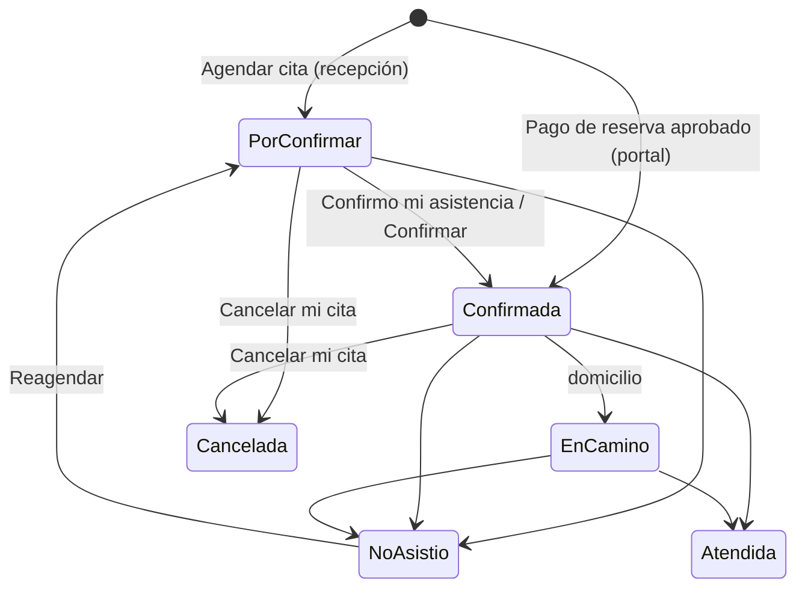

| De | A | Dispara | Quién (según lo visto) | Marca |
|---|---|---|---|---|
| (nueva) | Por confirmar | "Agendar cita" / "Agendar y cobrar anticipo" / "Agendar y enviar liga por WhatsApp" (11) | Recepción (Ana López) | [VISTO 11] |
| (nueva) | Confirmada | "Pago aprobado → cita confirmada + correo" (26, portal) | Paciente, sin cuenta | [VISTO 26] — ver C-20 |
| Por confirmar | Confirmada | botón "Confirmo mi asistencia" en la liga del recordatorio (27) | Paciente, sin sesión | [VISTO 27] |
| Por confirmar | Confirmada | botón "Confirmar" en la agenda móvil (30, fila R. Vega) | Podólogo/recepción en PWA (no se dice cuál) | [VISTO 30] (quién: no se ve) |
| Por confirmar / Confirmada | Cancelada | "Cancelar mi cita" (27) | Paciente | [VISTO 27] |
| Por confirmar / Confirmada | Cancelada | cancelación hecha por la clínica | recepción | [INFERIDO] (no hay botón de cancelar en 01/11/30) |
| Confirmada | Confirmada (nuevo horario) | "Confirmar nuevo horario" tras "Reprogramar mi cita" (27) o "Reagendar" (30) | Paciente / podólogo-recepción | [VISTO 27,30]; el estado resultante tras reprogramar no se muestra (D-63) |
| Confirmada | En camino | no se ve el botón | no se ve | [INFERIDO] (solo domicilio) |
| Por confirmar / Confirmada / En camino | No asistió | no se ve la acción (¿manual o automática?) | no se ve | [INFERIDO]; el resultado sí se ve en 01 y 30 |
| No asistió | (nueva cita) | "Reagendar" / "Llamar" (30) | podólogo/recepción | [VISTO 30] |
| Confirmada / En camino | Atendida | "Iniciar consulta" (30) abre la consulta; la cita queda "Atendida" y aparece "por cobrar" (17); en planes "se descuenta una sesión al marcar la cita como atendida" (20) | Podólogo (consulta), luego Recepción cobra | [VISTO 30,17,20]; el disparador exacto (¿al iniciar o al cerrar y firmar la consulta?) no se ve (D-64) |

**Reglas visibles que condicionan transiciones:** conflicto de cabina/podólogo se avisa al agendar con sugerencia (11); si no hay lugar → lista de espera (11, 25); sobrecupo solo lo autoriza administración (11).

---

## S02. Reserva en línea y pago de la reserva (portal)

| Estado | Marca |
|---|---|
| Paso 1 Sede → 2 Servicio → 3 Podólogo → 4 Horario → 5 Datos y pago (asistente) | [VISTO 25,26] |
| Horario retenido (10 minutos) | [VISTO 26] |
| Pago aprobado | [VISTO 26] |
| Pago rechazado (el horario se retiene 10 min) | [VISTO 26] |
| Horario ya no disponible | [VISTO 26] |
| Retención vencida | [INFERIDO] (consecuencia lógica de los 10 minutos) |

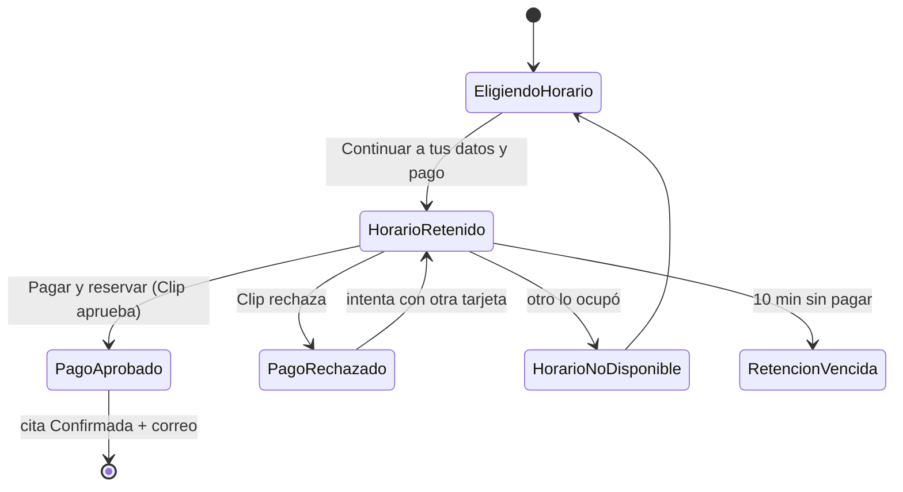

| De | A | Dispara | Quién | Marca |
|---|---|---|---|---|
| Eligiendo horario | Horario retenido | "Continuar a tus datos y pago →" (25) | Paciente | [VISTO 25,26] |
| Horario retenido | Pago aprobado | "Pagar $200.00 y reservar" (26) | Paciente | [VISTO 26] |
| Horario retenido | Pago rechazado | respuesta de Clip | sistema/Clip | [VISTO 26] |
| Horario retenido | Horario ya no disponible | otro paciente lo ocupa | sistema | [VISTO 26] |
| Horario retenido | Retención vencida | pasan 10 minutos | sistema | [INFERIDO] |
| (cualquiera) | Lista de espera | "Avisarme si se libera un horario" (25) | Paciente | [VISTO 25] |

---

## S03. Liga de cita (confirmar / reprogramar / cancelar)

| Estado | Marca |
|---|---|
| Activa | [VISTO 27] |
| Expirada ("Liga vencida") | [VISTO 27] |
| Resultado: Cita confirmada / Cita cancelada (con o sin reembolso) / Reprogramada | [VISTO 27] |

| De | A | Dispara | Quién | Marca |
|---|---|---|---|---|
| Activa | Confirmada (cita) | "Confirmo mi asistencia" | Paciente | [VISTO 27] |
| Activa | Reprogramada | "Reprogramar mi cita" → elegir horario → "Confirmar nuevo horario"; "tu anticipo de $200 se conserva" | Paciente | [VISTO 27] |
| Activa | Cancelada | "Cancelar mi cita": con más de 48 h se reembolsa el anticipo (5–10 días hábiles); con menos de 48 h no es reembolsable | Paciente | [VISTO 27] |
| Activa | Expirada | fin de vigencia ("Llama a la sede") | sistema | [VISTO 27] (cuándo vence: no se ve, D-22) |

---

## S04. Lista de espera

| Estado | Cómo se ve | Marca |
|---|---|---|
| Esperando | acciones "Agendar", "WhatsApp" | [VISTO 12] |
| Notificado | acciones "Agendar", "Reenviar"; indicador "Notificados sin respuesta > 2 h" | [VISTO 12] |
| Agendado | acción "Ver cita" | [VISTO 12] |
| Vencida | acciones "Reactivar", "Quitar" | [VISTO 12] |
| (prioridad Alta/Media/Baja) | **no es estado**: es atributo | [VISTO 12] |

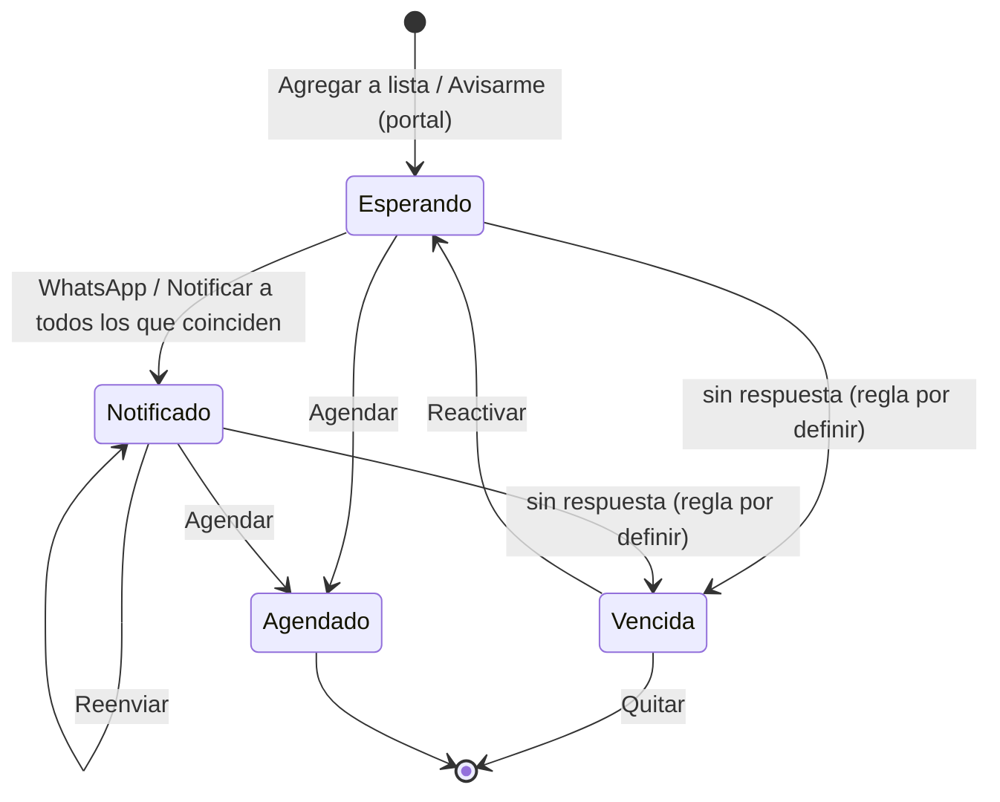

| De | A | Dispara | Quién | Marca |
|---|---|---|---|---|
| (nuevo) | Esperando | "+ Agregar a lista" (12); "si no hay lugar, agregar a lista de espera" (11); "Avisarme si se libera un horario" (25) | Recepción / Paciente | [VISTO 12,11,25] |
| Esperando | Notificado | "WhatsApp"; "Notificar a todos los que coinciden" (12); regla "notificar automáticamente al liberarse un hueco" | Recepción (automático = por definir) | [VISTO 12] |
| Esperando / Notificado | Agendado | "Agendar" (12) | Recepción | [VISTO 12] |
| Esperando / Notificado | Vencida | "Vencer solicitudes sin respuesta tras 14 días" | sistema | [VISTO 12] como regla "por definir"; la vigencia real es duda D-26 |
| Vencida | Esperando | "Reactivar" | Recepción | [VISTO 12] |
| Vencida | (sale) | "Quitar" | Recepción | [VISTO 12] |

---

## S05. Consulta / nota de evolución

**Estados** (02, columnas "Firma" y "Estado de nota"; 03 "Borrador autoguardado"):

| Estado | Marca |
|---|---|
| Borrador (autoguardado) | [VISTO 02,03] |
| Pendiente de firma (visto como valor de "Firma" junto a "Borrador") | [VISTO 02] |
| Firmada / Cerrada | [VISTO 02,03] |
| Versión 2 (re-firmada) | [VISTO 43] |
| "A distancia" | [VISTO 02] pero es **modalidad**, no estado (C-05) |

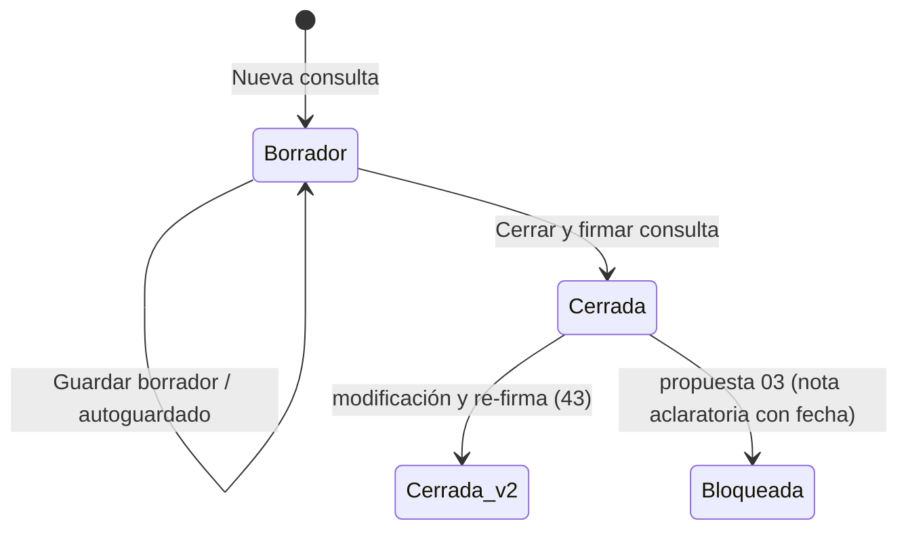

| De | A | Dispara | Quién | Marca |
|---|---|---|---|---|
| (nueva) | Borrador | "+ Nueva consulta" (02), "Iniciar consulta" (30) | Podólogo | [VISTO 02,30] |
| Borrador | Borrador | "Guardar borrador"; autoguardado 10:38 (03) | Podólogo | [VISTO 03] |
| Borrador | Cerrada (firmada) | "Cerrar y firmar consulta" con firma del podólogo en pantalla (03) | Podólogo | [VISTO 03] |
| Borrador | Cerrada | "Firmar nota" en videoconsulta (09) | Podólogo | [VISTO 09] |
| Cerrada | Cerrada versión 2 | edición de la nota y re-firma; se guarda antes/después y versión (43, usuario: Dra. Elena Ruiz) | Podólogo | [VISTO 43] |
| Cerrada | Bloqueada con nota aclaratoria | propuesta de NOM-004: "queda bloqueada y solo admite nota aclaratoria con fecha" | Podólogo | [VISTO 03] como PREGUNTA, **contradice** a 43 (C-01, D-13) |
| Borrador/Cerrada | (cobro) | "Enviar a caja" (03) genera venta pendiente; no cambia el estado de la nota | Podólogo | [VISTO 03] |
| Borrador | (dictado) | "Dictar nota por voz" (03, 09) → S06; "Nada se guarda en el expediente hasta que el podólogo firma" (08) | Podólogo | [VISTO 03,08,09] |

---

## S06. Dictado por voz

| Estado | Marca |
|---|---|
| En curso (grabando, con tiempo) / Pausado | [VISTO 08] |
| Transcrito (transcripción editable + propuesta de la IA) | [VISTO 08] |
| Aceptado | [VISTO 08] (lista "Dictados recientes") |
| Editado | [VISTO 08] |
| Descartado | [VISTO 08] |

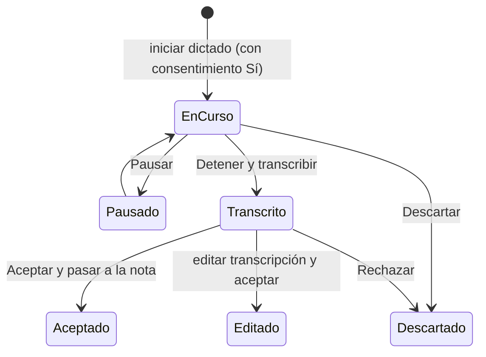

| De | A | Dispara | Quién | Marca |
|---|---|---|---|---|
| (nuevo) | En curso | botón de dictado (03, 09); requiere "Consentimiento del paciente para grabar / usar IA: Sí, informado" | Podólogo | [VISTO 08] |
| En curso | Transcrito | "Detener y transcribir" | Podólogo | [VISTO 08] |
| En curso / Transcrito | Descartado | "Descartar" / "Rechazar" | Podólogo | [VISTO 08] |
| Transcrito | Aceptado / Editado | "Aceptar y pasar a la nota", campo por campo; **el diagnóstico nunca lo propone la IA** | Podólogo | [VISTO 08] |

---

## S07. Videoconsulta (sala)

**Estados del paciente en la sala** (29, "Estados"): Aún no es la hora · En sala de espera · En consulta · Finalizada · Liga vencida. En 09 el podólogo ve indicadores: Paciente conectado, Consentimiento a distancia firmado, Pagado en línea.

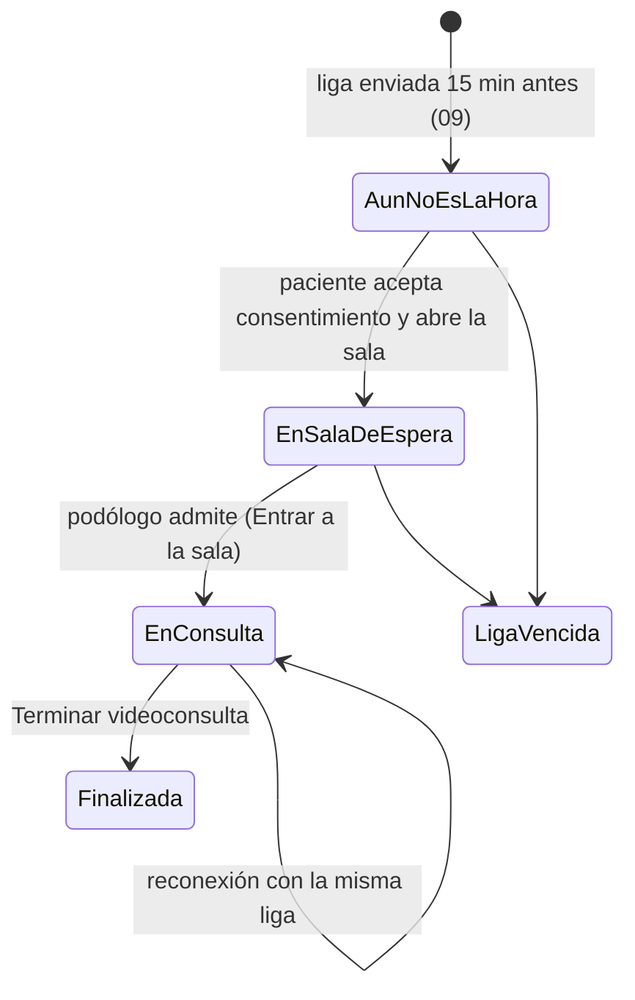

| De | A | Dispara | Quién | Marca |
|---|---|---|---|---|
| Aún no es la hora | En sala de espera | "Unirme a la videoconsulta" (se activa al aceptar el consentimiento de telemedicina); "puedes entrar 10 minutos antes" (29) | Paciente, sin cuenta | [VISTO 29] |
| En sala de espera | En consulta | "Entrar a la sala" (30) / sala (09) | Podólogo | [VISTO 09,30] |
| En consulta | Finalizada | "Terminar videoconsulta" (09) | Podólogo | [VISTO 09] |
| (cualquiera previa) | Liga vencida | fin de vigencia | sistema | [VISTO 29] (cuándo: no se ve, D-82) |
| En consulta | En consulta | "Si se corta la conexión, vuelve a entrar con esta misma liga" | Paciente | [VISTO 29] |

---

## S08. Valoración de pie diabético y revisión periódica

| Estado | Marca |
|---|---|
| Borrador ("Guardar valoración") | [VISTO 06] (el nombre "Borrador" es [INFERIDO]) |
| Firmada y cerrada ("Firmar y cerrar") | [VISTO 06] |
| Revisión al día / próxima revisión / **vencida hace N días** (alerta en expediente) | [VISTO 02,06] |

| De | A | Dispara | Quién | Marca |
|---|---|---|---|---|
| (nueva) | Borrador | "Evaluar pie diabético (SINBAD)" desde la consulta (03); "Guardar valoración" (06) | Podólogo | [VISTO 03,06] |
| Borrador | Firmada y cerrada | "Firmar y cerrar" | Podólogo | [VISTO 06] |
| Revisión programada | Revisión vencida | llegada de la fecha de "Próxima revisión" sin nueva valoración; "Alerta en expediente si la revisión se vence" (06); "vencida hace 38 días" (02) | sistema | [VISTO 06,02] |
| Revisión vencida | (se atiende) | nueva valoración | Podólogo | [INFERIDO] |
| (categoría de riesgo) | confirmada | "Propuesta automática; el podólogo confirma" | Podólogo | [VISTO 06] |

---

## S09. Plan de tratamiento y sesión del plan

**Plan** — estados "posibles" (05): En curso · Pausado · Abandonado · Concluido.
**Sesión del plan** — estados visibles (05): Agendada · Por generar. Marcados implícitos: realizada ("1 de 3 sesiones realizadas"), falta, reprogramación.

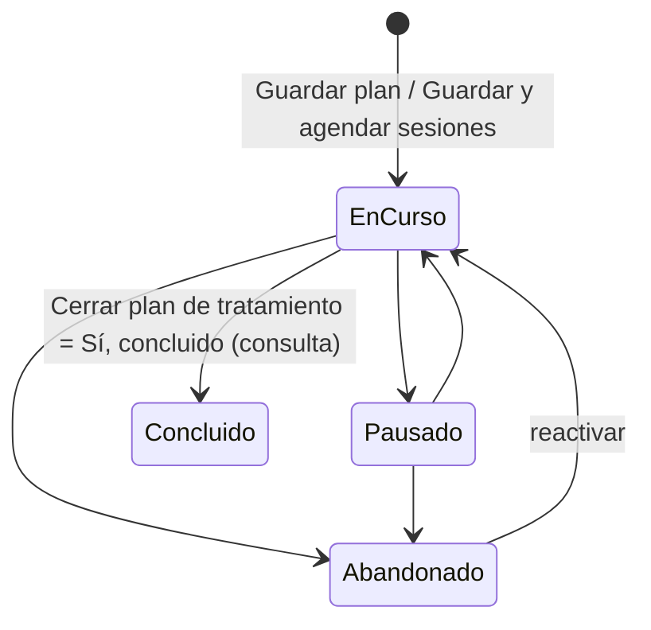

| De | A | Dispara | Quién | Marca |
|---|---|---|---|---|
| (nuevo) | En curso | "Guardar plan" / "Guardar y agendar sesiones" (05) | Podólogo | [VISTO 05] (¿hay estado previo "Borrador"/"Sin iniciar"? no se ve, D-66) |
| En curso | Concluido | "Cerrar plan de tratamiento: Sí, concluido" al firmar la última consulta (03) | Podólogo | [VISTO 03] |
| En curso | Pausado | no se ve el disparador | no se ve | [INFERIDO] |
| En curso / Pausado | Abandonado | no se ve el disparador; en 16 la etiqueta "Plan abandonado" aparece en pacientes con plan incompleto e inactivos y en 05 "Avisar a recepción si el paciente no agenda en 3 días" | recepción/sistema | [INFERIDO] (D-66) |
| Abandonado | En curso | "Reactivar" no existe | — | [INFERIDO] |

| Sesión | De | A | Dispara | Quién | Marca |
|---|---|---|---|---|---|
| Sesión n | Por generar | Agendada | "Generar automáticamente las citas siguientes al cerrar cada sesión"; "Guardar y agendar sesiones"; "bloquear la cabina para las 3 citas al crear el plan" | Podólogo / automático | [VISTO 05] |
| Sesión 1 | (nuevo) | Agendada | creación del plan (la cita de la sesión 1 aparece como "Agendada · Confirmar") | Podólogo | [VISTO 05] |
| Sesión n | Agendada | Realizada | consulta cerrada y firmada vinculada (03: "Plan: Extracción 3 citas (3/3)") | Podólogo | [VISTO 03] |
| Sesión n | Agendada | Falta | cita "No asistió" (contador "0 faltas") | sistema | [VISTO 05] |
| Sesión n | Agendada | Agendada (nuevo horario) | reprogramación (contador "0 reprogramaciones") | Paciente/Recepción | [VISTO 05] |

---

## S10. Orden de plantilla ortopédica

**Estados** (07, barra de estados): Borrador · Enviada a laboratorio · Recibida · Entregada.

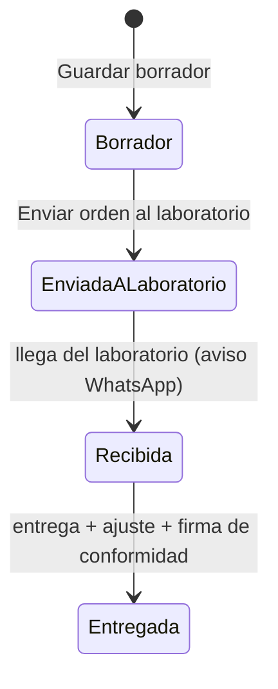

| De | A | Dispara | Quién | Marca |
|---|---|---|---|---|
| (nueva) | Borrador | "Guardar borrador" | Podólogo | [VISTO 07] |
| Borrador | Enviada a laboratorio | "Enviar orden al laboratorio" (fecha de envío) | Podólogo | [VISTO 07] |
| Enviada | Recibida | no se ve botón; "Avisar por WhatsApp cuando llegue del laboratorio" | no se ve (¿recepción?) | [VISTO 07] (disparador [INFERIDO]) |
| Recibida | Entregada | datos de entrega: fecha, entregó, ajuste realizado, firma de conformidad | no se ve | [VISTO 07] (botón [INFERIDO]) |
| Entregada | Garantía vigente → vencida; revisión de ajuste a 30 días; renovación a 12–18 meses | transcurso de tiempo | sistema | [VISTO 07] (derivado) |

---

## S11. Anticipo / pago previo

| Estado | Marca |
|---|---|
| Pendiente (11: "Estado del anticipo: Pendiente") | [VISTO 11] |
| Pagado (17: ANT-0412 "Pagado") | [VISTO 17] |
| Aplicado (en la venta: "Aplicar: Sí", "Anticipo aplicado ANT-0412") | [VISTO 17] como acción; el nombre del estado es [INFERIDO] |
| Reembolsado ("tu anticipo se reembolsará") | [VISTO 27] como texto |
| No reembolsable / perdido (cancelación con < 48 h) | [VISTO 27] como texto |
| Vencido (la liga de pago tiene "vencimiento de la liga 27/10 18:00") | [VISTO 11] (el estado es [INFERIDO]) |

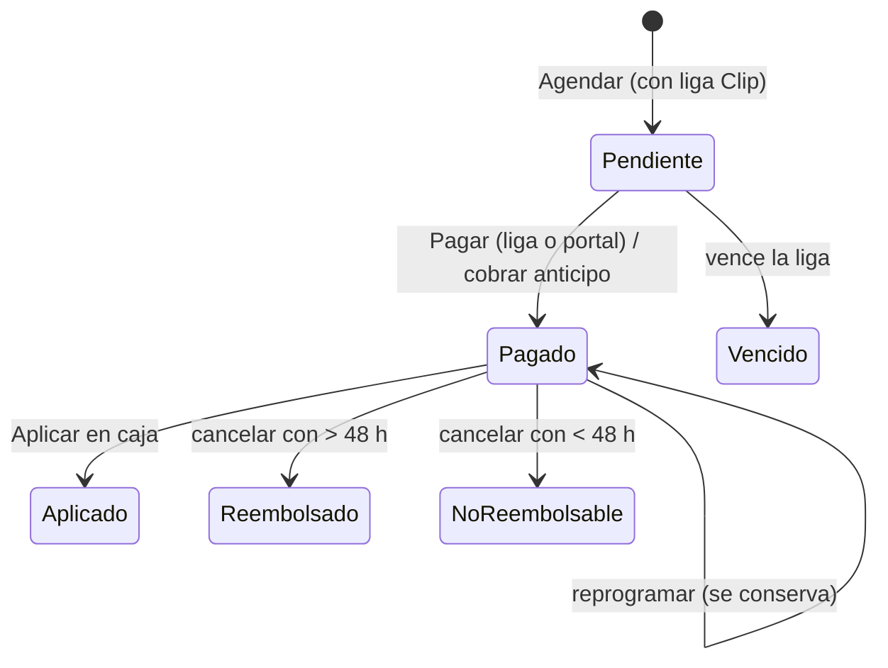

| De | A | Dispara | Quién | Marca |
|---|---|---|---|---|
| (nuevo) | Pendiente | "Agendar cita" con método "Liga de pago Clip" (11) | Recepción | [VISTO 11] |
| Pendiente | Pagado | "Agendar y cobrar anticipo" (11) / pago en portal (26) / liga | Recepción / Paciente | [VISTO 11,26] |
| Pagado | Aplicado | "Aplicar" en la tabla de anticipos de caja (17) | Recepción | [VISTO 17] |
| Pagado | Reembolsado | "Cancelar mi cita" con más de 48 h (27) | Paciente (el reembolso lo ejecuta ¿Clip o clínica? D-22) | [VISTO 27] |
| Pagado | No reembolsable | cancelación con menos de 48 h | Paciente | [VISTO 27] |
| Pendiente | Vencido | pasa el vencimiento de la liga | sistema | [INFERIDO] |

---

## S12. Venta / ticket

**Estados** (derivados de los botones de 17 y los contadores de 18):

| Estado | Marca |
|---|---|
| Por cobrar (cita "Atendida · por cobrar"; consulta "Pendiente de cobro") | [VISTO 17,03] |
| Cuenta abierta ("Guardar como cuenta abierta") | [VISTO 17] (nombre del estado [INFERIDO]) |
| Cobrada (ticket impreso o "sin ticket") | [VISTO 17] (nombre [INFERIDO]) |
| Por facturar ("Tickets por facturar 9 · $14,260") | [VISTO 18] |
| Facturada (ticket con CFDI) | [VISTO 18] (nombre [INFERIDO]) |
| Cancelada ("Cancelaciones (1 ticket)" en el corte; botón "Cancelar venta") | [VISTO 17] |

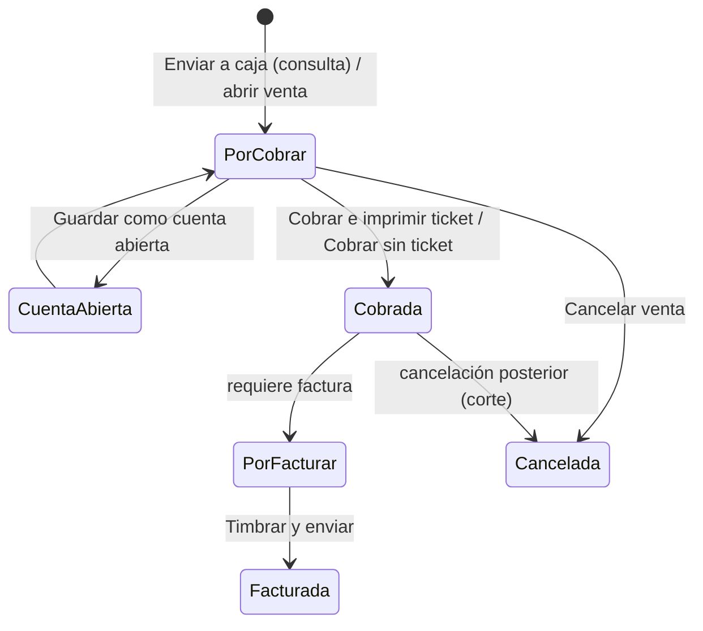

| De | A | Dispara | Quién | Marca |
|---|---|---|---|---|
| (nueva) | Por cobrar | "Enviar a caja" (03) | Podólogo | [VISTO 03] |
| (nueva) | Por cobrar | venta de mostrador (productos, paquete, gift card): "+ Agregar" (17) | Recepción | [VISTO 17] |
| Por cobrar | Cuenta abierta | "Guardar como cuenta abierta" | Recepción | [VISTO 17] |
| Por cobrar | Cobrada | "Cobrar e imprimir ticket" / "Cobrar sin ticket"; pago dividido en varios métodos | Recepción (cajera) | [VISTO 17] |
| Cobrada | Por facturar | "¿Requiere factura? Sí (datos fiscales ✓)" | Recepción | [VISTO 17,18] |
| Por facturar | Facturada | "Timbrar y enviar" (18) / "Facturar este ticket" (17) | Recepción | [VISTO 17,18] |
| Por cobrar | Cancelada | "Cancelar venta" | Recepción | [VISTO 17] |
| Cobrada | Cancelada | cancelación registrada en el corte (−$250) | no se ve (D-68) | [VISTO 17] |

---

## S13. Turno y corte de caja

| Estado | Marca |
|---|---|
| Turno abierto (08:02) | [VISTO 17] |
| Turno cerrado (sin diferencia / con diferencia justificada) | [VISTO 17] como botón y campos; nombres [INFERIDO] |
| Cerrado y revisado ("revisa Admin") | [VISTO 17] |

| De | A | Dispara | Quién | Marca |
|---|---|---|---|---|
| (nuevo) | Abierto | apertura con fondo inicial ($1,500) | Recepción (Ana López) | [VISTO 17] (botón de apertura: no se ve) |
| Abierto | Cerrado | "Cerrar turno" con efectivo contado, diferencia y justificación | Recepción | [VISTO 17] |
| Cerrado | Revisado | "revisa Admin" | Administrador | [VISTO 17] (acción: no se ve) |
| Cerrado con diferencia | (autorizado) | ¿quién autoriza? | no se ve | duda D-37 |

---

## S14. Factura CFDI 4.0

**Estatus visibles** (18): Borrador · Vigente · Cancelación en proceso ("Esperando aceptación del receptor") · Cancelada.

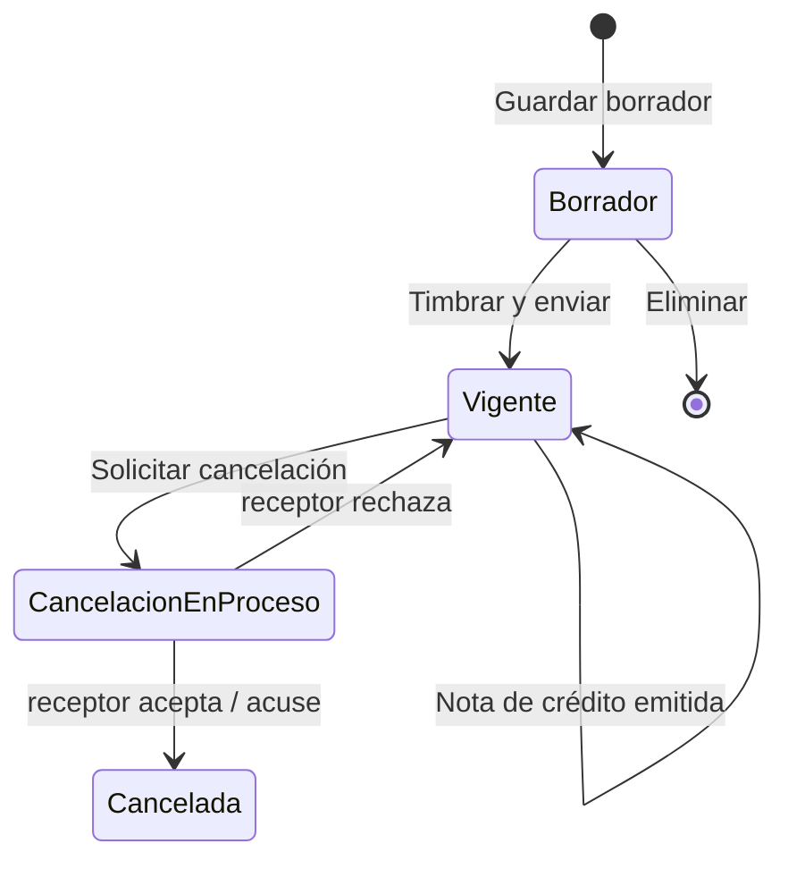

| De | A | Dispara | Quién | Marca |
|---|---|---|---|---|
| (nueva) | Borrador | "Guardar borrador" / "Nueva factura desde ticket" | Recepción | [VISTO 18] |
| Borrador | Vigente | "Timbrar y enviar" (UUID asignado) | Recepción | [VISTO 18] |
| Borrador | (elimina) | "Eliminar" (fila Borrador) | Recepción | [VISTO 18] |
| Vigente | Cancelación en proceso | "Solicitar cancelación" con motivo SAT 01–04 | pregunta: ¿solo Administrador? | [VISTO 18] (quién: no se ve) |
| Cancelación en proceso | Cancelada | aceptación del receptor + acuse ("Motivo 02 · Ver acuse") | sistema/receptor | [VISTO 18] |
| Cancelación en proceso | Vigente | rechazo del receptor | sistema/receptor | [INFERIDO] |
| Vigente | Vigente (con nota de crédito) | "Emitir CFDI de egreso" (RN-000337 sigue "Vigente" con NC-000012) | Recepción | [VISTO 18] |
| Vigente | (envío) | "Reenviar" | Recepción | [VISTO 18] |

## S15. Cancelación de CFDI

Se modela como evento con estado propio: **Solicitada → Esperando aceptación → Aceptada (acuse) / Rechazada**. Solicitada y "Esperando aceptación" [VISTO 18]; "Rechazada" [INFERIDO]. Motivo SAT 01 exige "UUID que sustituye" [VISTO 18].

## S16. Nota de crédito

Estado único visible: **Emitida** ("NC-000012") [VISTO 18]. Tipos: devolución / descuento / bonificación. Opción "Devolver dinero en caja" genera movimiento de caja [VISTO 18]. Estados previos (borrador) y cancelación de NC: no se ven (D-69).

---

## S17. Ingreso (validación del cobro)

**Estados** (33, "Validación contra banco y CFDI"): Por validar → Validado → con CFDI / sin CFDI; **Observado** = no coincide con el estado de cuenta. En 36 los cobros se agrupan además como Pagados (conciliados) · Pendientes · En mora / sin cobro. En 33 hay además "Por cobrar (mes)" = citas sin pago.

| Estado | Marca |
|---|---|
| Por cobrar (cita atendida sin pago) | [VISTO 33] |
| Por validar | [VISTO 33] |
| Validado | [VISTO 33] |
| Validado CFDI | [VISTO 33] |
| Observado | [VISTO 33] |
| En mora (cobro pendiente vencido) | [VISTO 36] |

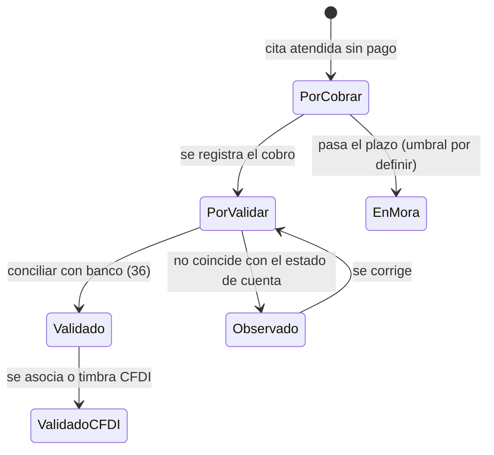

| De | A | Dispara | Quién | Marca |
|---|---|---|---|---|
| (nuevo) | Por validar | cobro de caja (17) o "+ Registrar ingreso" (33, modal) | Recepción / Administrador | [VISTO 17,33] |
| Por validar | Validado | "Confirmar" / "Palomear" en conciliación (36) o "Auto-conciliar" | Administrador | [VISTO 36] (la pantalla es de administración) |
| Por validar | Observado | el movimiento no coincide con el estado de cuenta | sistema | [VISTO 33] |
| Observado | Por validar | corrección manual | Administrador | [INFERIDO] |
| Validado | Validado CFDI | "Timbrar CFDI desde el ticket" o subir PDF/XML | Recepción/Administrador | [VISTO 33,18] |
| (cualquiera) | (edita/elimina) | iconos ✎ 🗑 por renglón | no se ve | [VISTO 33] (quién y tras validar: D-43) |

Efectos en otras pantallas: solo los ingresos **validados** cuentan para comisión (40), para el EDR "real_" (35) y para el asistente IA (47). [VISTO 40,35,47]

---

## S18. Movimiento bancario (conciliación)

| Estado | Marca |
|---|---|
| Conciliado | [VISTO 36] |
| Sugerido | [VISTO 36] |
| Ambiguo | [VISTO 36] |
| Es gasto | [VISTO 36] |
| Sin cobro | [VISTO 36] |

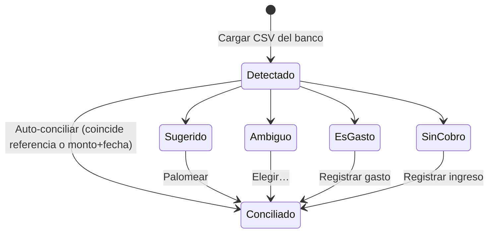

| De | A | Dispara | Quién | Marca |
|---|---|---|---|---|
| (nuevo) | Detectado | "Cargar CSV del banco" (112 movimientos detectados) | Administrador | [VISTO 36] |
| Detectado | Conciliado / Sugerido / Ambiguo / Es gasto / Sin cobro | "Auto-conciliar" (cruce por referencia y por monto+fecha) | Administrador | [VISTO 36] |
| Sugerido | Conciliado | "Palomear" → modal "Palomear cobro manualmente" → "Confirmar" | Administrador | [VISTO 36] |
| Ambiguo | Conciliado | "Elegir…" entre las candidatas | Administrador | [VISTO 36] |
| Es gasto | Conciliado | "Registrar gasto" | Administrador | [VISTO 36] |
| Sin cobro | Conciliado | "Registrar ingreso" | Administrador | [VISTO 36] |
| Conciliado | (deshacer) | no existe en la pantalla | — | duda D-75 |

---

## S19. Comprobante de gasto (carga en grupo) y gasto

**Comprobante en carga en grupo** (34): ⏳ IA procesando → ✓ Listo / ❌ Ilegible → Guardado (botón "Guardar 2 listos").

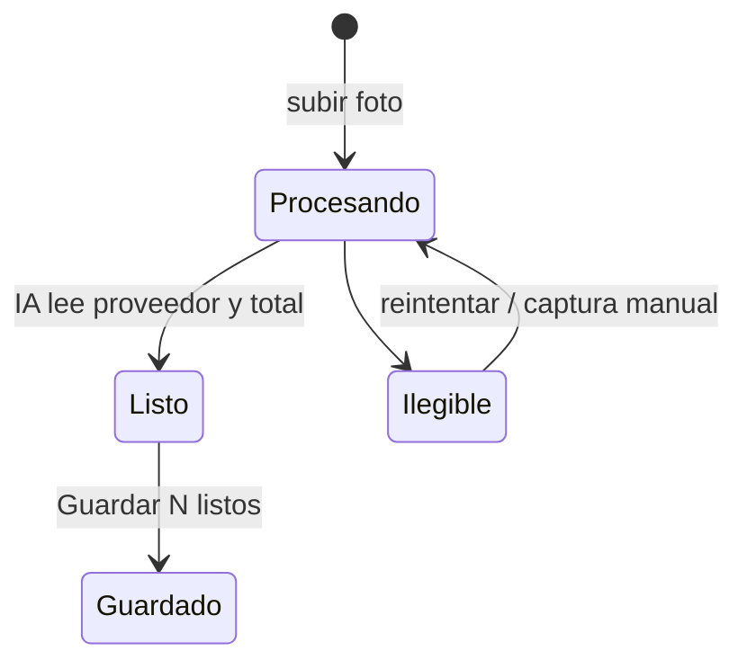

| De | A | Dispara | Quién | Marca |
|---|---|---|---|---|
| (nuevo) | Procesando | "📷 Carga en grupo" | Administrador (pantalla 34) | [VISTO 34] |
| Procesando | Listo / Ilegible | lectura por IA | sistema | [VISTO 34] |
| Listo | Guardado | "Guardar 2 listos" / "Guardar gasto" / "Guardar y agregar otro" | Administrador | [VISTO 34] |
| Ilegible | (manual) | captura individual del ticket | Administrador | [INFERIDO] |

**Gasto**: la pantalla no muestra estados del gasto (ni borrador, ni autorizado, ni observado). Solo "Guardar" y edición/eliminación (✎ 🗑 en 37). Se anota [INFERIDO] que existe Guardado; no se definen más (D-44). **Fondo revolvente**: estado numérico "64% usado" (no hay estados nominales); la acción "Reponer fondo" cierra el ciclo [VISTO 37].

---

## S20. Cuenta por pagar

**Estados** (38): Vencida · Por vencer · Programada · Parcial · Pagada.

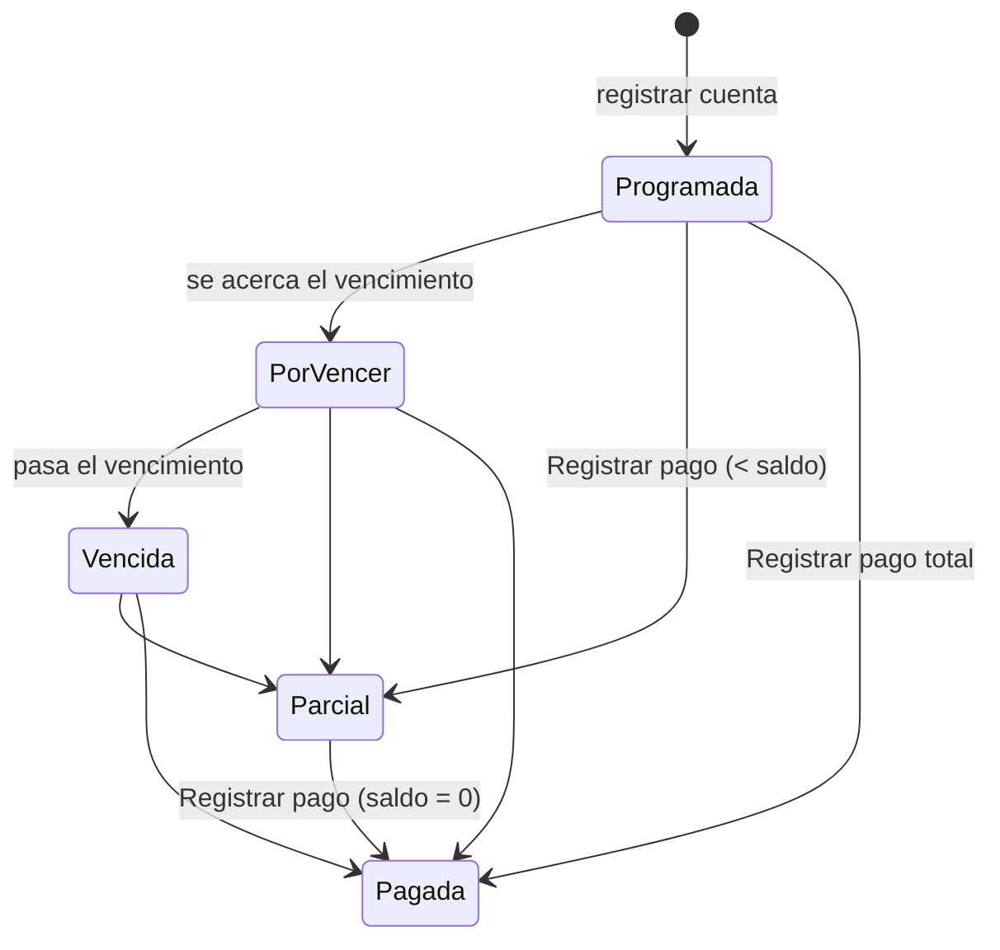

| De | A | Dispara | Quién | Marca |
|---|---|---|---|---|
| (nueva) | Programada | "+ Registrar cuenta" (38); recepción de mercancía con factura del proveedor (23) | Administrador / Administrador | [VISTO 38,23] (si es automática desde la recepción: D-42) |
| Programada / Por vencer / Vencida / Parcial | Parcial / Pagada | "Registrar pago"; "Ligar a gasto" | Administrador | [VISTO 38] |
| Programada → Por vencer → Vencida | | transcurso de tiempo (umbrales por definir) | sistema | [VISTO 38] (días del umbral: no se ven) |

## S21. Cuenta por cobrar (saldo de paciente)

**Estados** (38): Reciente · Pendiente · En mora; implícito Cobrada. Disparador de la transición: paso del tiempo (2 / 5–12 / 31 días en el ejemplo; **umbrales no definidos**, D-49) y cobro en caja. Origen: plan, apartado de plantillas, cita sin cobro [VISTO 38]. Marca de transiciones: tiempo [VISTO 38] (umbral [INFERIDO]); cobro [INFERIDO].

---

## S22. Corte semanal operativo

**Estados** (32): En curso · Por cerrar · Cerrada.

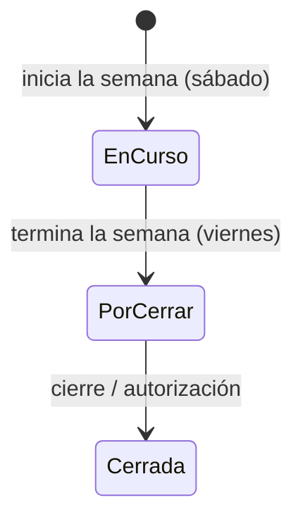

| De | A | Dispara | Quién | Marca |
|---|---|---|---|---|
| En curso | Por cerrar | fin de semana | sistema | [VISTO 32] |
| Por cerrar | Cerrada | no hay botón de cierre en la pantalla; solo "Generar corte HTML" e "Imprimir corte" | pregunta: ¿quién autoriza? | [INFERIDO] (D-48) |
| Por cerrar | (edición) | "Detalle de ingresos de la semana (editable)" con ✎ 🗑 🧾 | Administrador | [VISTO 32] |

## S23. Estado de resultados (EDR)

Pestañas: **Tablero** (consulta) y **En elaboración (proyecciones)** [VISTO 35]. `proy_*`: captura manual del administrador, el sistema nunca la modifica. `real_*`: calculado. Estados del periodo (borrador de proyección, publicado, cerrado): no se ven (D-79). Transición visible: el administrador edita proyecciones en "En elaboración" y la bitácora registra "Proyección de octubre: Quiropodia 125,000 → 130,000" [VISTO 35,43].

---

## S24. Periodo de nómina y recibo

**Estados del periodo** (39): CALCULADA (insignia en el encabezado); acciones "Crear período", "Calcular", "Autorizar nómina". **Recibo/CFDI de nómina**: Borrador (columna CFDI).

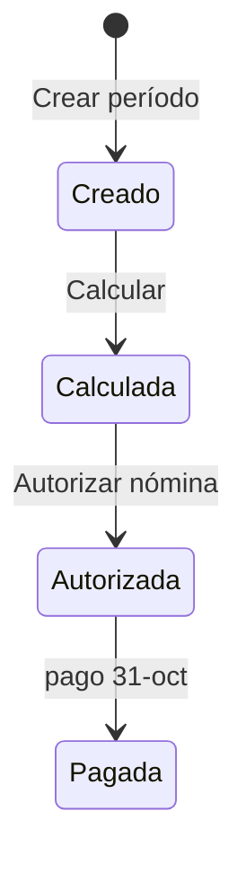

| De | A | Dispara | Quién | Marca |
|---|---|---|---|---|
| (nuevo) | Creado | "Crear período" | Administrador | [VISTO 39] (estado nombrado [INFERIDO]) |
| Creado | Calculada | "Calcular" | Administrador | [VISTO 39] |
| Calculada | Autorizada | "Autorizar nómina" | Administrador | [VISTO 39] |
| Autorizada | Pagada | "Pago 31-oct" | no se ve | [INFERIDO] |
| CFDI Borrador | Timbrado | no se ve el botón; ¿se timbra desde Pie Firme? | no se ve | [INFERIDO] (D-50) |
| Recibo | Firmado | pestaña "Recibos firmados" | empleado | [VISTO 39] (flujo: no se ve) |

## S25. Periodo de comisiones

**Estados** (40): Por cerrar (columna "Estado" de cada podólogo) → Cerrado ("Cerrar periodo"). "Solo ingresos validados". Quién: Administrador [VISTO 40]. Estados posteriores (pagado vía nómina) [INFERIDO]; reapertura: D-79.

---

## S26. Queja / incidencia

**Estados** (14): Nueva · En revisión · Escalada · Resuelta · Cerrada.

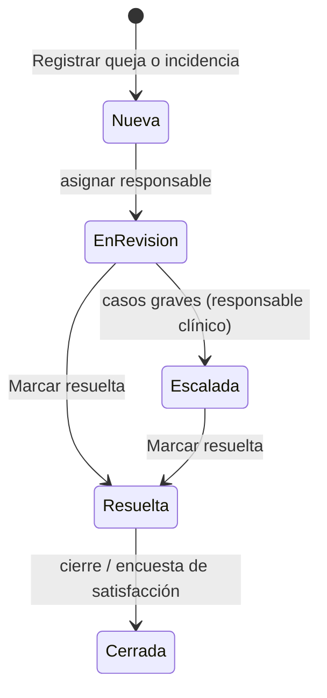

| De | A | Dispara | Quién | Marca |
|---|---|---|---|---|
| (nueva) | Nueva | "+ Registrar queja o incidencia" (canal: llamada, etc.) | Recepción o Administración ("Registró / canal: Recepción A. López · Llamada") | [VISTO 14] |
| Nueva | En revisión | asignación de "Responsable de seguimiento" + "Guardar" | Administración | [VISTO 14] (la transición exacta es [INFERIDO]) |
| En revisión | Escalada | "Estado: Escalada ▾" (selector) a responsable clínico (Podóloga Ruiz) | Administración | [VISTO 14] (regla de escalamiento no visible, D-70) |
| En revisión / Escalada | Resuelta | "Marcar resuelta" | Administración / responsable | [VISTO 14] |
| Resuelta | Cerrada | "Fecha de cierre"; "Enviar encuesta" / "Notificar al paciente" | Administración | [VISTO 14] (no hay botón "Cerrar"; es [INFERIDO] que la cierre la encuesta o el administrador) |
| (cualquiera) | (edición) | "Guardar" | Administración | [VISTO 14] |

Indicadores ligados: días abiertos, meta de resolución 3 días, "3 con más de 7 días". [VISTO 14]

---

## S27. Importación (lote y filas)

**Pasos del lote** (13): 1 Subir archivo ✓ · 2 Mapeo propuesto por IA ✓ · 3 Vista previa y validación · 4 Confirmar carga. **Filas**: Válido · Advertencia · Error · Duplicado (se combinará / omitirá / crea nuevo).

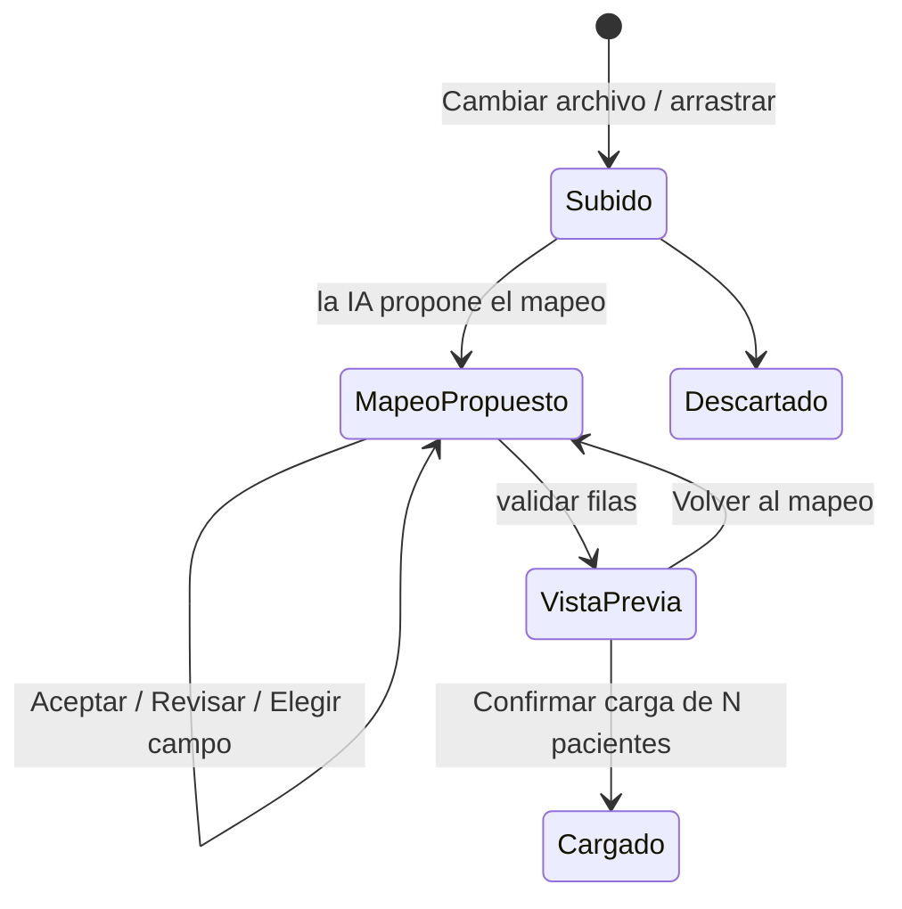

| De | A | Dispara | Quién | Marca |
|---|---|---|---|---|
| (nuevo) | Subido | "Cambiar archivo / arrastra aquí o elige (xlsx, csv)" | Administrador | [VISTO 13] |
| Subido | Mapeo propuesto | IA analiza (96–99% de confianza en columnas claras) | sistema | [VISTO 13] |
| Mapeo propuesto | Vista previa y validación | columnas aceptadas/revisadas; "Guardar mapeo como plantilla" opcional | Administrador | [VISTO 13] |
| Vista previa | Mapeo propuesto | "← Volver al mapeo" | Administrador | [VISTO 13] |
| Vista previa | Cargado | "Confirmar carga de 1,250 pacientes" (las filas con error **no** se cargan; se descargan en CSV) | Administrador | [VISTO 13] |
| Cargado | Revertido | reversa por lote | — | no existe en la pantalla (D-54) |
| (cualquier paso previo) | Descartado | no existe botón de cancelar | — | [INFERIDO] |

Estados de la **fila**: se asignan en la validación automática [VISTO 13]; las acciones por fila posibles son "Omitir / Combinar datos / Crear nuevo" (elegidas al nivel del lote, no por fila) [VISTO 13].

---

## S28. Traspaso entre sucursales

**Estados** (22, texto "Estados del traspaso"): Borrador → Enviado (en tránsito) → Recibido con diferencias / Recibido completo · Cancelado. Alias en la lista: "En tránsito", "Con diferencias".

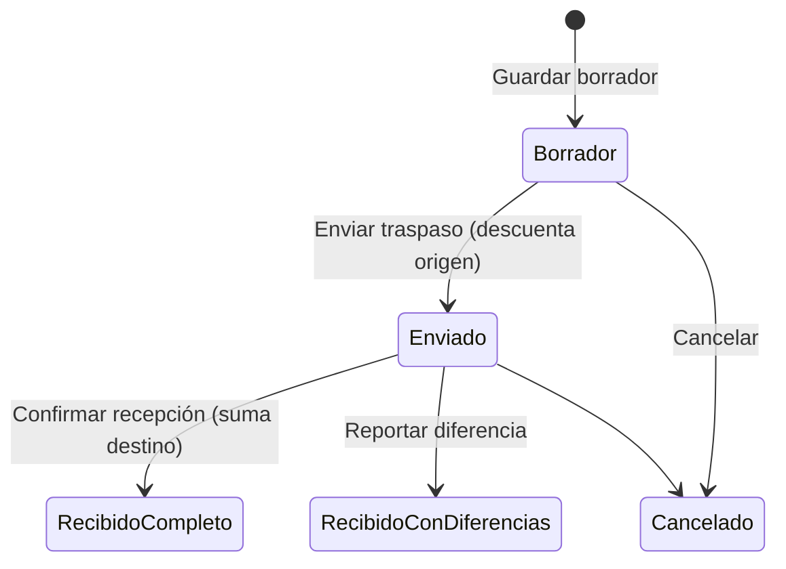

| De | A | Dispara | Quién | Marca |
|---|---|---|---|---|
| (nuevo) | Borrador | "Nuevo traspaso" (folio TR-0062) | Administrador (sede destino solicita: "Solicitó Luis Ortega") | [VISTO 22] |
| Borrador | Enviado | "Enviar traspaso": **descuenta de origen** y queda en tránsito | Responsable del envío (Ana López) / Administrador | [VISTO 22] |
| Enviado | Recibido completo | "Confirmar recepción": **suma al destino** | Sede destino (Luis Ortega / Marta Gil) | [VISTO 22] |
| Enviado | Recibido con diferencias | "Reportar diferencia" (faltante/dañado) | Sede destino | [VISTO 22] |
| Borrador | Cancelado | "Cancelar" | quién envía | [VISTO 22] |
| Enviado | Cancelado | ¿posible tras el envío? | — | [INFERIDO] (D-72) |

Cada paso queda en bitácora [VISTO 22].

---

## S29. Orden de compra y recepción

**Estados de la orden** (23): Borrador · Enviada · Recibida parcial · Recibida · Cancelada. **Pago de la orden**: — (sin pago) · Por pagar (fecha) · Pagada.

```mermaid
stateDiagram-v2
  [*] --> Borrador: Guardar borrador
  Borrador --> Enviada: Enviar orden al proveedor
  Enviada --> RecibidaParcial: Confirmar recepción (hay pendiente)
  Enviada --> Recibida: Confirmar recepción (completa)
  RecibidaParcial --> Recibida: nueva recepción
  Borrador --> Cancelada: Cancelar
  Enviada --> Cancelada
```

| De | A | Dispara | Quién | Marca |
|---|---|---|---|---|
| (nueva) | Borrador | "Nueva orden" (OC-0046) | Administrador | [VISTO 23] |
| Borrador | Enviada | "Enviar orden al proveedor" | Administrador (solicita Dr. Salinas) | [VISTO 23] |
| Enviada | Recibida parcial / Recibida | "Confirmar recepción" con lote, caducidad, costo real; **suma existencias, recalcula costo promedio y deja el costo en histórico**; si hay pendiente queda "Parcial" | quien recibe (Ana López) | [VISTO 23] |
| Borrador / Enviada | Cancelada | "Cancelar" | Administrador | [VISTO 23] |
| Recibida | (devolución) | "Registrar devolución a proveedor" | Administrador | [VISTO 23] (efecto en el estado: no se ve) |
| Pago: (sin) | Por pagar | factura del proveedor con vencimiento | Administrador | [VISTO 23] |
| Por pagar | Pagada | pago (S20) | Administrador | [VISTO 23,38] |

---

## S30. Existencia por producto-sede (estado derivado)

Estados calculados (21): **OK · En el mínimo · Bajo mínimo · Sin existencia · Caduca pronto**; semáforo naranja/rojo [VISTO 21]. Son derivados de existencia, mínimo y caducidad (no transiciones por botón). Disparadores de cambio: venta, traspaso, merma, conteo físico, compra, consumo en consulta (kardex) [VISTO 21]. "Acción" sugerida en caducidades: Rematar/mermar · Mover a sede con más rotación · Vigilar [VISTO 21].

## S31. Lote de esterilización y kit

**Lote** (15): Liberado · Rechazado; con "En proceso/Pendiente" implícito antes de liberar [INFERIDO]. **Indicador biológico**: Pendiente 24 h → Negativo ("—" en rechazado) [VISTO 15]. **Kit**: En circulación / Por esterilizar / Esterilizado [VISTO 15, "24 en circulación · 3 por esterilizar"].

```mermaid
stateDiagram-v2
  [*] --> Registrado: Registrar lote de esterilización
  Registrado --> Liberado: Liberar lote (indicador químico viró)
  Registrado --> Rechazado: Rechazar lote (no viró)
  Liberado --> Rechazado: biológico positivo (incidente)
```

| De | A | Dispara | Quién | Marca |
|---|---|---|---|---|
| (nuevo) | Registrado | "+ Registrar lote de esterilización" | Operó: recepción (Ana López) o personal de apoyo (Lupita Torres) | [VISTO 15] (estado "Registrado" [INFERIDO]) |
| Registrado | Liberado | "Liberar lote" (con "Estéril hasta") | Administración (pantalla 15 es de administración) | [VISTO 15] |
| Registrado | Rechazado | "Rechazar lote" (ej. "indicador no virado") | Administración | [VISTO 15] |
| Liberado | Rechazado | resultado positivo del biológico → "búsqueda inversa: pacientes atendidos con ese instrumental" | Administración | [VISTO 15] (la transición es [INFERIDO]; el caso lo menciona la pantalla) |
| Kit: Por esterilizar | Esterilizado | liberación del lote que lo incluye | sistema | [VISTO 15] |
| Kit: Esterilizado | En uso | se liga a una consulta (K-12 → #CON-10259) | Podólogo | [VISTO 15,03] |
| Kit: En uso | Por esterilizar | cierre de la consulta | sistema | [INFERIDO] |

Tema abierto: el lote A-2610-03 aparece "Liberado" con biológico "Pendiente 24 h"; la pantalla no dice si se libera antes del resultado (D-76).

---

## S32. Orden de trabajo (mantenimiento) y equipo

**Estatus de la OT** (41): Solicitado · Autorizado · En proceso · Cerrado · Rechazado. **Equipo**: Vigente · Vencido · Falla · En proceso.

```mermaid
stateDiagram-v2
  [*] --> Solicitado: Nueva solicitud
  Solicitado --> Autorizado: Autorizar
  Solicitado --> Rechazado
  Autorizado --> EnProceso
  EnProceso --> Cerrado
```

| De | A | Dispara | Quién | Marca |
|---|---|---|---|---|
| (nueva) | Solicitado | "+ Nueva solicitud" (sede, categoría, tipo, equipo, falla, foto, asignar) | cualquier usuario de la sede (no se ve) | [VISTO 41] (quién: no se ve) |
| Solicitado | Autorizado | botón "Autorizar" en la fila; filtro "Solo las que yo autoricé" | Administrador | [VISTO 41] |
| Solicitado | Rechazado | no se ve el botón (OT-0143 existe como Rechazado) | Administrador | [VISTO 41] (acción [INFERIDO]) |
| Autorizado | En proceso | no se ve | no se ve | [INFERIDO] |
| En proceso | Cerrado | no se ve | no se ve | [INFERIDO] |
| Equipo: Vigente | Vencido | llega la fecha "Próximo servicio" | sistema | [VISTO 41] |
| Equipo | Falla | solicitud urgente ligada al equipo | usuario | [VISTO 41] |
| Equipo: Falla/Vencido | Vigente | OT cerrada | sistema | [INFERIDO] |

---

## S33. Oferta comercial (paquete, plan multi-sesión, membresía, gift card, promoción)

**Estatus** (20): Activo/Activa · Programada · Vencida · Pausado · Cancelada.

```mermaid
stateDiagram-v2
  [*] --> Programada: crear con vigencia futura
  [*] --> Activa: crear con vigencia vigente
  Programada --> Activa: llega la fecha
  Activa --> Pausada: Pausar
  Pausada --> Activa
  Activa --> Vencida: termina la vigencia
  Programada --> Cancelada: Cancelar
  Vencida --> Activa: Duplicar (crea otra)
```

| De | A | Dispara | Quién | Marca |
|---|---|---|---|---|
| (nueva) | Activa / Programada | "+ Nuevo paquete / plan / membresía / gift card / promoción" | Administrador (Dr. Héctor Salinas) | [VISTO 20] |
| Activa | Pausada | "Pausar" | Administrador | [VISTO 20] |
| Programada | Cancelada | "Cancelar" | Administrador | [VISTO 20] |
| Activa | Vencida | fin de vigencia | sistema | [VISTO 20] |
| Vencida | (nueva copia) | "Duplicar" | Administrador | [VISTO 20] |

## S34. Plan adquirido, membresía y gift card del paciente

- **Plan adquirido**: con saldo de sesiones; "se descuenta una sesión al marcar la cita como atendida" [VISTO 20]; caducidad 12 meses [VISTO 20]. Estados vigente/consumido/caducado [INFERIDO]; sesiones no usadas al caducar: D-85.
- **Membresía**: vigente → "renuevan en 30 días" (recordatorio 30 días antes) [VISTO 20]; renovada/vencida [INFERIDO].
- **Gift card**: "con saldo" ($3,100 por canjear), caducidad 12 meses [VISTO 20]; saldo visible en caja; canje como método de pago [VISTO 17]; estados canjeada/caducada [INFERIDO].
- Transición de canje: "Gift card — código y saldo" en pago de venta (17) [VISTO 17].

## S35. Campaña de recontacto

**Estados**: Borrador ("Guardar borrador") → Programada ("Programar envío") [VISTO 16] → Enviada (los resultados "Enviados 64 · Respondieron 31 · Citas 22 · Ingreso $7,150") [VISTO 16: nombre del estado [INFERIDO]].

| De | A | Dispara | Quién | Marca |
|---|---|---|---|---|
| (nueva) | Borrador | "Crear campaña con selección" / "Guardar borrador" | Recepción (16) | [VISTO 16] |
| Borrador | Programada | "Programar envío" (28/10 10:00) | Recepción (autorización del texto/descuento: D-32) | [VISTO 16] |
| Programada | Enviada | llega la hora | sistema | [INFERIDO] |
| Enviada | (con resultados) | respuestas, citas, ingreso | sistema | [VISTO 16] |

Regla visible: solo se envía a pacientes con consentimiento de comunicaciones; los demás se excluyen automáticamente [VISTO 16].

## S36. Consentimiento / documento firmado

| Estado | Marca |
|---|---|
| Plantilla: Activa / Borrador (con versión) | [VISTO 45] |
| Consentimiento del paciente: Pendiente de firma → Firmado/vigente ("Documentos vigentes") → Reemplazado por versión nueva | [VISTO 02,10] (los nombres de estado: [INFERIDO]) |
| Aceptación en portal (casillas) / firma en pantalla / "Enviar liga para firmar desde su celular" | [VISTO 10,26,29] |

| De | A | Dispara | Quién | Marca |
|---|---|---|---|---|
| (nuevo) | Pendiente de firma | alta de paciente sin firma / "Enviar liga para firmar desde su celular" | Recepción | [VISTO 10] |
| Pendiente | Firmado | firma en pantalla (tablet recepción) o liga | Paciente | [VISTO 10] |
| Firmado | Vigente | "Documentos vigentes: Aviso de privacidad v3 firmado 12/01/2026" | sistema | [VISTO 02] |
| Plantilla Borrador | Activa | editar y activar la plantilla ("Autorización de fotografías clínicas: Borrador") | Administrador | [VISTO 45] (acción de activar: [INFERIDO]) |
| Firmado | Revocado | derecho ARCO / revocar | Paciente/Recepción | [INFERIDO] (botón "Solicitud ARCO" en 02) |

---

## S37. Suscripción de la clínica y cobro mensual

**Estados de la clínica/suscripción** (48, 46): Activa · Prueba (n días) · Suspendida (pago). **Cobro mensual** (46, 48): Próxima → Pagada · Rechazado.

```mermaid
stateDiagram-v2
  [*] --> Invitada: Crear y enviar invitación (alta)
  Invitada --> Prueba: administrador acepta (14 días)
  Prueba --> Activa: fin de prueba con cobro exitoso
  Activa --> Suspendida: cobro rechazado / falta de pago
  Suspendida --> Activa: Reactivar cuenta (soporte)
  Activa --> Cancelada: cancelación
```

| De | A | Dispara | Quién | Marca |
|---|---|---|---|---|
| (nueva) | Invitada | "Alta de clínica": razón social, correo del administrador, plan, prueba gratuita (14 d) → "Crear y enviar invitación" | Superadmin RANNIX (Roberto Aguilar) | [VISTO 48] |
| Invitada | Prueba | el administrador de la clínica acepta | Administrador de la clínica | [INFERIDO] |
| Prueba | Activa | termina la prueba y se cobra | sistema | [INFERIDO] |
| Activa | Suspendida | cobro rechazado ("Quiropodia Norte: Suspendida (pago)", "1 rechazado") | sistema | [VISTO 48] (plazo y reintentos no se ven, D-80) |
| Suspendida | Activa | ticket de soporte "Reactivar cuenta" (S-208) | Superadmin | [VISTO 48] |
| Activa | Activa (otro plan) | "Cambiar de plan" / "Cambiar a plan por clínica" | Administrador | [VISTO 46] |
| Activa | Activa (otra tarjeta) | "Actualizar tarjeta" | Administrador | [VISTO 46] |
| Activa | Cancelada | no se muestra | — | [INFERIDO] (D-52, D-80) |
| Cobro mensual | Próxima → Pagada | cobro automático "1-nov" | sistema | [VISTO 46,48] |
| Cobro mensual | Rechazado | "Cobro automático del mes: 4 de 5 cobrados · 1 rechazado" | sistema | [VISTO 48] |

## S38. Usuario

**Estados** (44): Activo · Inactivo · Bloqueado.

```mermaid
stateDiagram-v2
  [*] --> Activo: Crear usuario
  Activo --> Inactivo: Desactivar
  Inactivo --> Activo: Activar
  Activo --> Bloqueado: intentos fallidos
  Bloqueado --> Activo: Activar
```

| De | A | Dispara | Quién | Marca |
|---|---|---|---|---|
| (nuevo) | Activo | modal "Nuevo usuario" → "Crear usuario" | Administrador | [VISTO 44] |
| Activo | Inactivo | "Desactivar" | Administrador | [VISTO 44] |
| Inactivo | Activo | "Activar" | Administrador | [VISTO 44] |
| Activo | Bloqueado | "Inicio de sesión intento fallido ×3" → "1 usuario bloqueado" (43) | sistema | [VISTO 43,44] |
| Bloqueado | Activo | "Activar" (44, fila iparedes) | Administrador | [VISTO 44] |
| (cambio de rol) | — | "Cambio de rol: Recepción → Administrador" queda en bitácora | Administrador | [VISTO 43] |

## S39. Ticket de soporte

Estados visibles (48): **Urgente · Abierto**; es una mezcla de prioridad y estado. Cerrado: [INFERIDO]. Quién: Superadmin RANNIX [VISTO 48]; los tickets los abren las clínicas ("Importar pacientes", "No timbra CFDI") [VISTO 48]. Flujo completo: no se ve (D-06, D-80).

## S40. Servicio / producto / proveedor / sede / cabina (activo–inactivo)

- Servicio: Activo · Pausado [VISTO 19]. Producto: Activo · Sin existencia [VISTO 19]. Proveedor: Activo · Inactivo ("Dar de baja") [VISTO 24]. Cabina/recurso: Activa [VISTO 45]. Sede: no se muestra baja [INFERIDO].
- Transiciones: editar / pausar / "Dar de baja" [VISTO 19,24]. Quién: Administrador [VISTO 19,24].

## S41. Paciente

Estados: **Activa(o)** (cabecera de 02) · **Inactivo** (> 6 meses sin visita, 16) [VISTO 02,16]; **Posible duplicado** → "Abrir ficha existente" / "No es la misma persona" [VISTO 10]. La inactivación es derivada del tiempo; la reactivación (23 reactivados este mes) ocurre al volver a atenderse [VISTO 16] (transición [INFERIDO]). "Baja" del paciente: no se ve.

| De | A | Dispara | Quién | Marca |
|---|---|---|---|---|
| (nuevo) | Activo | "Guardar paciente" / "Guardar y crear cita" / "Guardar y abrir expediente" | Recepción | [VISTO 10] |
| (nuevo) | Posible duplicado | coincidencia por teléfono al capturar | sistema | [VISTO 10] |
| Posible duplicado | Activo (misma ficha) | "Abrir ficha existente" | Recepción | [VISTO 10] |
| Posible duplicado | Activo (nuevo registro) | "No es la misma persona" | Recepción | [VISTO 10] |
| Activo | Inactivo | > 6 meses sin visita | sistema | [VISTO 16] |
| Inactivo | Activo | nueva atención / campaña de reactivación | sistema | [VISTO 16] (transición [INFERIDO]) |

---

## Contradicciones de estados que se suman a las del diccionario

| Id | Qué se contradice | Dónde |
|---|---|---|
| C-20 | **Estado de una cita reservada y pagada en línea.** 26: "Pago aprobado → cita confirmada + correo". 27: esa misma cita, con anticipo $200 pagado, aparece con "Estado actual: **Por confirmar**" hasta que el paciente pulsa "Confirmo mi asistencia". No es claro si la reserva pagada nace Confirmada o Por confirmar. | 26 vs 27 |
| C-21 | **Estados del traspaso.** El texto de la pantalla dice "Borrador → Enviado (en tránsito) → Recibido con diferencias / Recibido completo · Cancelado"; las filas de la lista usan "En tránsito" y "Con diferencias" (mismos estados con otro nombre). Alias, no contradicción de regla: se anota para unificar nombres. | 22 (interno) |
| C-22 | **"Liberado" antes del resultado biológico.** El lote A-2610-03 está "Liberado" con indicador biológico "Pendiente 24 h" y el lote A-2610-02 "Liberado" con biológico "Negativo": la pantalla no dice si se puede liberar sin el biológico. | 15 (interno) |

(En el diccionario siguen valiendo C-01 a C-19; el total de contradicciones reales hallado es 22 si se cuentan las de este archivo.)

---

## Dudas que van a PREGUNTAS_ABIERTAS

> Continúan la numeración de `DICCIONARIO_DATOS.md` (D-01 a D-60). Aquí solo lo que afecta a **estados y transiciones**; no se supone ninguna respuesta. Las de la forma "ver D-nn" ya están redactadas en el diccionario.

- **D-61** Cita: ¿quién y cuándo pasa a "En camino" (solo domicilio)? ¿"No asistió" es manual o automático y a qué hora? ¿Qué pasa con el anticipo? (ver D-29) [S01]
- **D-62** Cita reservada y pagada en línea: ¿nace "Confirmada" (26) o "Por confirmar" hasta que el paciente confirme (27)? (C-20) [S01, S02]
- **D-63** Reprogramación: ¿la cita conserva folio y vuelve a "Por confirmar"? ¿Se guarda el horario anterior? ¿Reprogramar con < 48 h cobra algo? (ver D-22) [S01, S03]
- **D-64** ¿Existe un estado "En atención" para citas presenciales (la PWA tiene "Iniciar consulta" y 29 tiene "En consulta" solo para video)? ¿La cita pasa a "Atendida" al iniciar la consulta, al cerrarla/firmarla o al cobrarla? Afecta el saldo de planes (20) y el "por cobrar" (17). [S01, S05]
- **D-65** Consulta: ¿"Pendiente de firma" es estado propio distinto de "Borrador" (02 los muestra juntos en una fila)? ¿Se puede cerrar sin firma del paciente? ¿Puede firmar un podólogo distinto del que atendió? ¿Quién puede reabrir un borrador de otro podólogo? [S05]
- **D-66** Plan de tratamiento: estado inicial (¿"Sin iniciar"/"Borrador"?), criterio y responsable de Pausado y Abandonado (¿manual o por días sin cita?), ¿se puede reactivar un plan abandonado?, ¿qué pasa con las sesiones "Por generar" restantes y el anticipo? (ver D-30) [S09]
- **D-67** Anticipo con liga vencida: ¿la cita se cancela, se queda "Por confirmar", se libera el horario? ¿Se envía nueva liga? [S11]
- **D-68** Venta: ¿se puede editar o cancelar una venta ya cobrada, quién, hasta cuándo y cómo se refleja si ya hay factura o corte cerrado? ¿Hay tope de "cuenta abierta"? (ver D-37) [S12, S13]
- **D-69** Factura: ¿cuándo y por quién se cancela?, ¿qué pasa si el receptor rechaza?, ¿una factura "Cancelación en proceso" caduca?; nota de crédito: ¿tiene borrador o se cancela? (ver D-36) [S14–S16]
- **D-70** Queja: ¿qué dispara "Escalada" (gravedad Alta, días sin resolver, decisión manual) y a quién?; ¿quién cierra y puede reabrirse?; ¿"Resuelta" requiere aceptación del paciente? (ver D-33) [S26]
- **D-71** Importación: ¿"Confirmar carga" se permite con errores abiertos (la pantalla dice que se omiten) o con duplicados sin decidir?; ¿qué estado tiene un lote abandonado a medio proceso y por cuánto tiempo se conserva el archivo? [S27]
- **D-72** Traspaso: ¿se puede cancelar uno ya "Enviado" y qué pasa con el inventario en tránsito?; ¿quién resuelve un "Recibido con diferencias" y cómo se ajusta (merma, reclamo, reenvío)? (ver D-41) [S28]
- **D-73** Compra: ¿se puede cerrar una orden "Recibida parcial" sin recibir el resto?; ¿qué hace una diferencia entre costo ordenado y costo real?; ¿una devolución a proveedor cambia el estado? (ver D-42) [S29]
- **D-74** Ingreso "Observado": ¿cómo se sale del estado? ¿Se puede editar/eliminar un ingreso "Validado"? (ver D-43) [S17]
- **D-75** Conciliación: ¿se puede deshacer?; ¿qué pasa si un movimiento conciliado cambia de monto?; ¿un depósito Clip con N cobros puede quedar parcialmente conciliado? (ver D-46) [S18]
- **D-76** Esterilización: ¿se libera antes del resultado biológico (C-22)? ¿Qué se hace con un biológico positivo (retiro de kits, aviso a pacientes)? ¿Quién libera/rechaza? [S31]
- **D-77** Orden de trabajo: ¿tope por monto de autorización?, ¿motivo obligatorio al rechazar?, ¿puede reabrirse una OT cerrada? (ver D-51) [S32]
- **D-78** Nómina: estados posteriores a "Autorizada" (pagada, timbrada), reapertura de una nómina autorizada, ajuste por incidencia tardía. (ver D-50) [S24]
- **D-79** Periodos cerrados (turno de caja, corte semanal, comisiones, nómina, EDR): ¿se puede registrar o corregir un ingreso/gasto con fecha en un periodo ya cerrado? ¿Quién lo reabre y queda bitácora? [S13, S22, S23, S24, S25]
- **D-80** Suscripción: ¿cuántos reintentos y qué plazo antes de "Suspendida"?; ¿qué ve y puede hacer una clínica suspendida o cancelada (¿solo lectura, exportar sus datos?)?; ¿prueba → activa automático? (ver D-52) [S37, S39]
- **D-81** Usuario: ¿el bloqueo por intentos fallidos caduca solo o solo lo levanta un administrador?; ¿se puede eliminar un usuario o solo desactivar (por la bitácora)? (ver D-05) [S38]
- **D-82** Videoconsulta: ¿cuánto espera el paciente antes de "Liga vencida"?; ¿qué pasa si el podólogo no admite al paciente o falla la conexión: reprogramar sin costo, reembolsar? [S07]
- **D-83** Dictado: ¿"Descartar" borra audio y transcripción de inmediato o quedan en bitácora? (ver D-16) [S06]
- **D-84** Ofertas: ¿se puede vender una oferta "Pausada" o "Programada"?; ¿cómo se trata lo ya vendido cuando una oferta vence o se cancela? [S33]
- **D-85** Plan adquirido, membresía y gift card: estados "consumido", "caducado", "canjeada" y qué pasa con sesiones o saldo sin usar al caducar (ver D-12, D-39). [S34]
- **D-86** **Concurrencia** (aplica a todas las máquinas): dos personas pulsando a la vez "Cerrar y firmar", "Cobrar" sobre la misma cita, "Confirmar recepción" o "Palomear" del mismo cobro: ¿gana la primera, se bloquea el registro, se avisa? ¿Hay bloqueo optimista por versión?
- **D-87** Cita "Atendida" sin cobro (el dashboard cuenta 23 citas sin pago por $18,450): ¿qué estado tiene, quién las persigue y cuándo pasan a "En mora"? (ver D-49) [S12, S17, S21]

---

## Resumen

- **Máquinas de estado:** 41 (S01–S41). En cada tabla, los estados y transiciones llevan su marca [VISTO]/[INFERIDO].
- **Contradicciones de estado halladas aquí:** 3 (C-20, C-21, C-22); contando las del diccionario son 22.
- **Dudas nuevas:** 27 (D-61 a D-87); con las del diccionario, 87.
